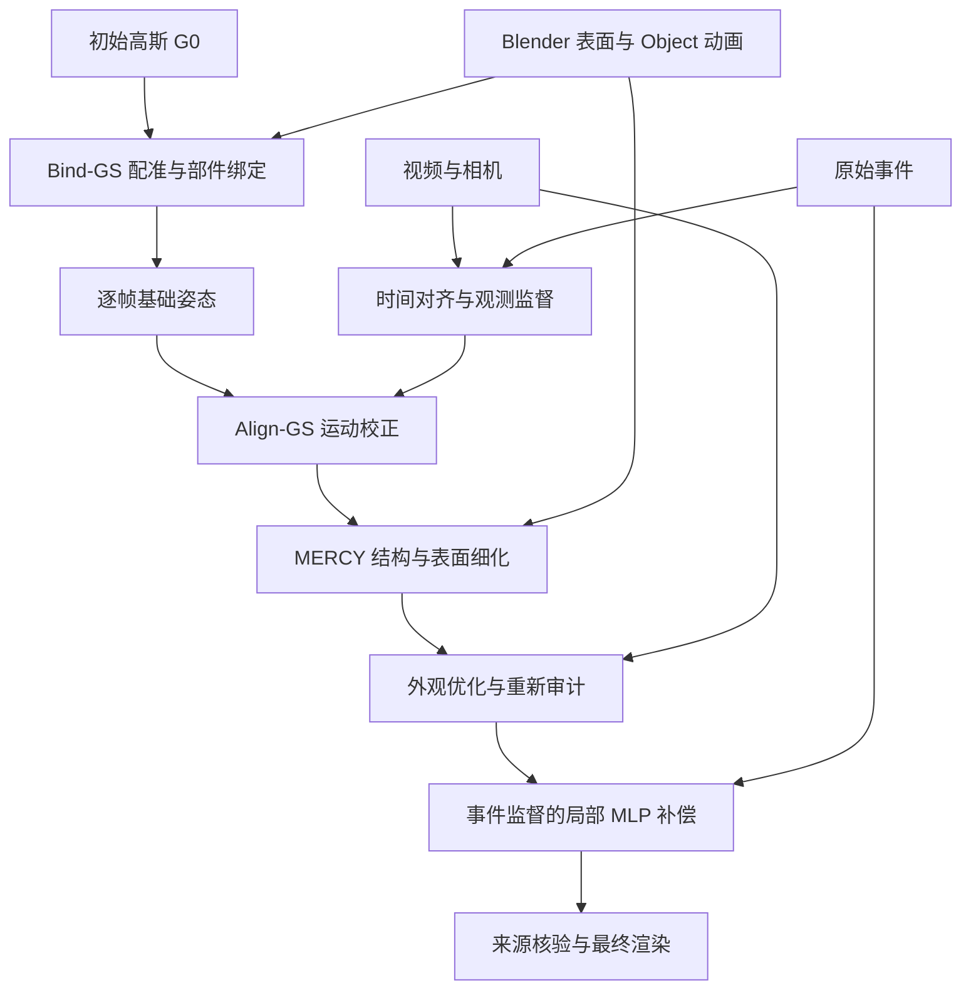

# Bind-GS Align-GS 与 MERCY 技术流程

本目录详细说明 Lego 动态高斯从动画绑定到观测校正，再到完整融合方案的过程。名称用于本项目的方法组织，不代表三个已经完成、统一评测的独立部署模型。

| 名称 | 版本 | 作用 | 产物状态 |
| --- | --- | --- | --- |
| Bind-GS | V1 | 部件绑定与基础动画转移 | 对应已有动画基线 |
| Align-GS | V2 | 视频与事件约束下的运动校正 | 新定义的中间方法阶段；没有统一独立部署产物 |
| MERCY | V3 | 结构、表面、外观与局部辅助变形的完整融合 | 对应当前融合方案，具体成绩依候选审计 |

Bind-GS、Align-GS 是本项目的描述性名称，不指外部论文。历史目录中的 v1/v2/v3 继续表示各子实验版本，不能仅凭数字确定所属阶段。

## 阅读顺序

1. [Bind-GS 完整流程](01-bind-gs.md)：输入身份、Blender 导出、配准、绑定、刚体与弹性运动、缓存及断臂诊断。
2. [Align-GS 完整流程](02-align-gs.md)：父模型冻结、视频事件对齐、标定、损失、校正模型、优化、审计及独立产物条件。
3. [MERCY 完整流程](03-mercy.md)：关节约束、运动校正、表面修复、先验补全、外观、局部 MLP、导出、展示与消融。

## 数据如何流动

这是模块依赖示意，不表示所有历史实验由一个脚本顺序执行。独立事件-only 支线不在此图中，也不读取这里的 Blender 动画或旧绑定。

## 产物之间必须保存的关系

每次运行记录源文件哈希、父模型、相机、时间采样、动态行号、绑定版本、监督划分、标定、训练配置与输出格式。新增几何后同步保存行号和归属；运动、外观与辅助网络的父来源必须一致。

验证按输入检查、零校正一致性、训练区间优化、留出评估、结构检查、序列化重载、同帧同相机展示的顺序进行。某一步未通过时，保留候选和失败记录，不以后一阶段的外观修补代替前一步的运动验证。

## 运行入口与复现范围

脚本参数以仓库当前 `--help` 和具体实验配置为准。数据和检查点不全部包含在仓库中，因此本目录说明完整处理步骤，不提供缺少输入仍声称可一键复现的命令。Blender 导出入口需在 Blender 环境执行，CUDA 训练与渲染需配套依赖。

三阶段的“进步”是增加处理能力和约束的设计方向。要证明数值或视觉效果逐级改善，仍需固定可比条件并为各组提供明确产物。现有图片保留在原目录中，不重新归属到尚未形成独立产物的 Align-GS。

返回 [项目概览](../../readme.md)。

## 数学 复现 评估与独立示例

| 文档 | 用途 |
| --- | --- |
| [04 表示与优化](04-formulation.md) | 高斯参数、坐标关系、观测目标、关节与局部 MLP |
| [05 复现与接口](05-reproduction.md) | 环境、入口依赖、产物字段与故障定位 |
| [06 指标与消融](06-evaluation.md) | 数据划分、指标聚合、结构、平滑性与验收 |
| [07 Fan 技术流程](07-fan-and-viewer.md) | 独立视频拟合、绑定修复、表面细化及显示 |
| [08 历史实验记录](08-experiment-records.md) | 原始表格、旧分支、失败结果与历史图像 |
| [09 查看器操作](09-viewer-reference.md) | 场景、参考帧、显示模式、局部放大及视频导出 |
| [10 补充处理命令](10-processing-recipes.md) | Mesh、混合模式与受保护表面细化 |

## 场景与版本不可混用

Bind-GS / Align-GS / MERCY 的技术路线针对 Lego。Fan 的 V1/V3 是独立场景内的产物标签，其主运动来自视频拟合，表面细化不训练事件运动。原始 SC-GS 网络、严格事件-only 支线和历史辅助场实验分别保留，不能凭文件名相近归入当前部署链。

所有技术说明以仓库实现和历史记录为依据；本次文档维护没有重训、更新检查点或访问服务器确认部署。原始演示图片保留像素与标注，布局及哈希见 [图库清单](../demo/gallery-manifest.json)。
