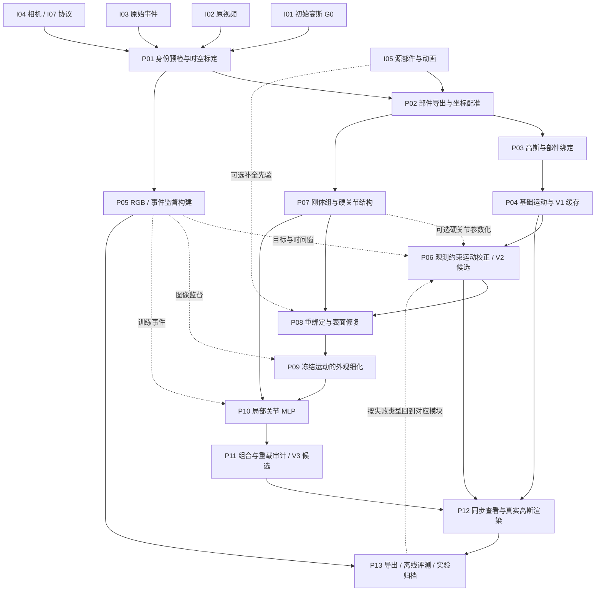
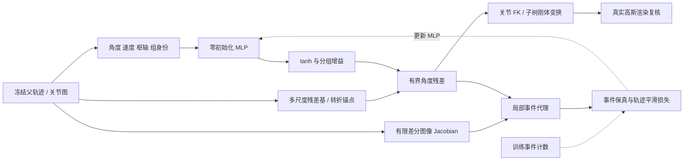

# Pipeline：动态高斯重建的输入、技术步骤与数据流

> 本文依据 2026-11-03 本地源码、技术说明及实验归档整理，用作项目技术 README 和后续流程图底稿。主线以 Lego 的 Bind-GS → Align-GS → MERCY 模块依赖为骨架，同时说明其他物件与独立分支。本文是实现拆解，不表示本次重新训练、远端部署或复测了模型。

## 1. 阅读范围与版本解释

项目处理的核心问题是：给定规范空间初始高斯、图像观测和明确声明的结构先验，如何得到随时间运动、能够渲染并可审计的动态三维高斯。

主线可概括为：

**输入与标定 → 部件配准绑定 → 基础姿态 → 观测校正 → 结构约束 → 几何修复 → 外观优化 → 局部关节补偿 → 动态高斯渲染 → 导出与评测。**

这是一张依赖图，不是一个脚本里的统一端到端优化。部分模块可选，关节结构也可以提前进入观测校正；不能把全部历史候选串接成一个真实运行过的模型。

| 路线 | 输入与核心方法 | 版本与结论范围 |
| --- | --- | --- |
| Lego 融合主线 | G0、视频、原始事件、相机、部件动画；绑定、观测校正、结构及局部补偿 | 方法层面使用 V1 Bind-GS、V2 Align-GS、V3 MERCY |
| Fan | G0、相机、视频转角拟合；绑定修复、表面与周期外观 | Fan 自有版本；其历史事件评测不等于基础运动由事件训练 |
| Lamp / Metronome / Microphone | 源表面与运动辅助的物件分支及各自细化 | 必须查看物件报告，不能自动归入 Lego 的同构消融 |
| Arm / Robot / Gears / Rotation | 源表面动画、高斯绑定、RGB 或多视角外观细化 | 现有展示中 V1 可为已有修正版，V2 为原始高斯，V3 为派生优化版 |
| 严格 event-only | G0、原始事件、相机 | 独立运动学习与审计，不继承融合路线动画、视频监督或旧运动 |
| Hybrid FVV | 上游兼容训练数据或已有 Hybrid 检查点 | 独立静态 3D＋动态 4D 模型及浏览服务 |
| 原始 SC-GS | 原仓库数据、稀疏控制与形变网络 | 保留的训练路径，不等于当前 Lego 绑定动画或局部 MLP |

**文档冲突处理。** 早期 [Align-GS 文档](02-align-gs.md) 和 [技术索引](README.md) 记录“没有统一独立 V2 部署产物”，根 [readme](../../readme.md) 则已经描述 `middle_path` 中间版本入口。本文只确定模块能力与接口；某次实验是否确有独立 V2、它加载什么模型，以该实验的版本映射、父模型和 SHA-256 为准。最新物件归档入口为 [experiments/README.md](../../experiments/README.md)，不能用旧说明覆盖已归档证据。

## 2. 统一符号与数据契约

### 2.1 基础符号

| 符号 | 含义与典型维度 | 必须明确的约定 |
| --- | --- | --- |
| N / Nd / J / F | 全部高斯数 / 动态高斯数 / 部件数 / 帧数 | 新增点或筛点后重新登记 N、Nd 和行号 |
| H、W | 图像高、宽 | 视频、事件、渲染比较尺度可能不同，转换必须显式 |
| G0 | 规范高斯集合 | 对应哪个源帧、哪个坐标系、哪份 PLY |
| μ、q、s、α、c | 中心、四元数、尺度、不透明度、SH 外观 | 当前动画转移采用 wxyz；原始优化参数不等于激活后的物理量 |
| A | 源世界坐标到高斯世界坐标的配准 | 4×4 相似变换；尺度、轴向、平移共同确定 |
| Mj(t) | 部件 j 在源动画中的世界矩阵 | 绝对矩阵，应用时转为相对规范帧变换 |
| C | 相机 | 内外参、尺寸、坐标约定、背景和投影共同定义 |
| tk | 第 k 帧的物理时间 | 单位秒；规则采样时通常为 k/fps，再应用声明的时间偏移 |
| e | 单个事件 (x,y,t,p) | p 为 +1 或 −1，t 单调非递减 |
| B、θ、Δθ | 局部时间残差基、基础关节角、角度补偿 | 不把角度残差当成逐点空间位移 |

单个高斯的物理表示与协方差为：

```text
Gi = { μi ∈ R³, qi ∈ R⁴, si ∈ R⁺³, αi ∈ [0,1], ci }
Σi = R(qi) diag(si²) R(qi)ᵀ
```

加载 PLY 时使用模型定义的尺度、不透明度激活与四元数归一化。读取端以 [GaussianModel](../../scene/gaussian_model.py) 和具体序列加载器为准，不能直接把 log-scale 或 opacity logits 送入物理公式。

### 2.2 原始输入清单

| 编号 | 输入 | 详细内容 | 消费模块 | 不可缺失的检查 |
| --- | --- | --- | --- | --- |
| I01 | 初始高斯 PLY / 兼容模型 | XYZ、旋转、尺度、opacity、DC/高阶 SH、点顺序 | P02–P04、P07–P11 | 有限值、有效旋转、规范姿态、文件哈希 |
| I02 | 原始 RGB 视频 | 帧、FPS、分辨率、颜色编码、时间起点 | P01、P05、P06、P09、P13 | 解码长度与时刻对应；保留原始参考 |
| I03 | 原始事件数组 | 数值 [Ne,4]，列为 x,y,t,p | P01、P05、P06、P10、P13 | 时间单位、极性、像素边界、排序、完整时间覆盖 |
| I04 | 采集相机 | R/T 或等价外参、焦距/视场、主点及尺寸等实际字段 | 配准、训练、渲染、评测 | 区分世界到相机与相机到世界、行列与轴向 |
| I05 | 辅助源场景 / 部件归档 | Blender 网格、对象身份、材质、逐帧矩阵、变形表面 | P02–P04、P07–P08 | 拓扑、部件顺序、源帧和规范帧一致 |
| I06 | 关节定义 | 父子层级、转轴、枢轴、闭环和锁定组 | P07、P10 | 层级可遍历；轴及连接点坐标明确 |
| I07 | 运行协议 | 划分、采样、损失权重、开放参数、输出路径、代码版本 | 全流程 | 来源清单、实际参数与选择规则可重建 |
| I08 | 固定评测参考 | RGB、前景/部件掩码、事件标定、评测相机和时间表 | P13 | 参考来源独立于候选预测；缺项如实登记 |

G0 的上游生成方式不由这条后处理链自动证明。若 G0、补全几何或训练参考来自源资产，应在 I07 中披露。不同场景没有相同的文件命名，Lego 专用脚本不能仅替换目录名就视为适用于全部物件。

### 2.3 关键中间产物

| 产物 | 已有字段或典型布局 | 下游如何使用 |
| --- | --- | --- |
| 部件 NPZ | `rest_points`、`point_parts`、`object_matrices`、`source_frames`、`part_offsets`、可选 `deformed_*` | 给配准、绑定、刚体和弹性分支提供源信息 |
| 绑定 NPZ | `labels`、`nearest_vertex`、`dynamic_indices`、配准和距离 | 将 G0 行号映射到部件及表面 |
| 基础缓存 | `poses.npy`: [F,Nd,7]；`dynamic_indices.npy`: [Nd] | 7 个值是 XYZ＋wxyz，替换完整模型中的动态行 |
| 导出序列 | 当前相关路径的 `poses`: [Nd,F,7] | 与基础缓存轴顺序不同，需由专用加载器解释 |
| `supervision.npz` | `images`: [F,H,W]；`counts`: [F−1,2,H,W]；`metadata_json` | 图像为准备脚本解码的灰度；计数正通道在前、负通道在后 |
| `calibration.json` | 偏移、log floor、正负阈值、标定区间、划分、候选记录 | 训练和审计使用相同事件口径 |
| `correction.json` | 校正格式、参数、父来源及分支信息 | 由格式标识加载所选校正模型 |
| 几何/外观增量 | 新点或属性、部件归属、父文件和映射 | 重建完整模型，不丢弃父动画或冻结属性 |
| MLP 检查点 | 数据、局部基、特征、网络设置、权重及 provenance | 与相同父轨迹组合一次 |
| comparison manifest | 各版本独立资产、参考、可选层和来源 | 查看器及实验导出解析真实版本 |

其中形状是已核对路径的接口，不是全仓库通用标准。即使形状相同，也必须匹配点身份与父模型。

## 3. 总体依赖图

实线表示数据/产物流；虚线表示监督、约束或迭代反馈。P 编号与后文逐项说明一致。P07 的结构可以提前用于 P06，图中明确保留这条边。



此图展示完整能力组合；实际运行需标记绕过的可选节点、实际检查点和失败状态。评测反馈不能使用最终测试集反复选模。

## 4. P01：输入身份、时间与坐标预检

**输入：** I01–I05、I07；至少具备可对应的 G0、相机、时间和本路线所需观测。

**步骤与技术连接：**

1. 登记输入路径、大小、SHA-256、代码版本、场景名、父模型和预定划分。文件身份使后续校正不能误套到同名但不同内容的模型。
2. 检查 G0 参数、点数、旋转和首帧姿态。规范姿态错误会传递到所有相对运动。
3. 解码视频并获得帧数、FPS、尺寸；从原始事件检查时间范围和像素范围。
4. 明确 `t_video(k)`、`t_event`、`source_frame(k)` 三个映射。规则动画采样可为 `source_start+k×step`，事件还可能有偏移 δ；三个编号不是同一时间单位。
5. 核对相机投影与背景。源世界坐标、高斯世界坐标、相机坐标和像素坐标之间的映射应分别保存。
6. 固定训练/验证/测试协议。历史脚本每五个事件区间留出一个只是其实际验证划分；新增独立测试必须另外定义，且避免跨集合窗口。

**输出：** 可追溯输入清单、规范帧关系、相机和时间映射；传给 P02 与 P05。

**检查：** 首帧同相机叠加是否对应、事件/视频时长是否合理、事件极性是否有效。推荐先定位时间和相机，再优化运动；否则优化器可能用错误空间位移补偿时间误差。

实现入口：[事件读取与校验](../../utils/event_supervision.py)、[Lego 输入诊断](../../scripts/diagnostics/inspect_lego_data.py)。当前 `prepare_lego_events.py` 还会拒绝事件终点与视频末帧相差超过 `2/fps` 的输入。

## 5. P02：源部件导出与坐标配准

**输入：** I05 源场景、I01 G0、I04 相机和源帧采样配置。

**步骤与技术连接：**

1. Blender 在各源帧求值，导出部件规范表面、标签、对象世界矩阵和必要的逐帧变形表面。
2. 固定部件顺序和顶点身份，保存 `source_frames`。弹性/非刚性表面若拓扑变化，不能继续把相同行号当成同一个材料点。
3. 使用相机关系初始化配准，再以稳健相似变换 ICP 对齐源表面与 G0；也可以加载已核验的配准文件。
4. 得到 `x_gaussian = A x_source`。A 负责坐标对应；它不产生新高斯，也不证明源几何来自观测恢复。
5. 检查整体误差分位数以及杆件、关节、邻接表面的局部重叠。

**输出：** 部件 NPZ、配准 A 及诊断；P03 用它建立行号绑定，P07 用它解释轴与枢轴。

**失败定位：** 整体翻转检查坐标轴；尺寸不对检查尺度；局部偏差检查规范姿态与采样，而不是无限放宽绑定距离。

代码：[export_blender_parts.py](../../scripts/motion/export_blender_parts.py)、[bind_lego_parts.py](../../scripts/motion/bind_lego_parts.py)。

## 6. P03：高斯与部件绑定

**输入：** G0 中心 [N,3]、配准后的表面点、部件标签、运动矩阵、绑定距离设置。

**步骤与技术连接：**

1. 在配准表面上建立近邻查询，为每个高斯记录最近表面点与距离。
2. 从最近表面继承候选部件标签；结合部件是否运动及附着距离形成动态行集合。
3. 区分刚性部件、局部弹性区、静态行与未绑定行。
4. 输出按 G0 行顺序保存的映射；后续所有运动只通过该映射写回完整高斯数组。
5. 用部件着色和多时刻观察检查误绑定：相邻零件距离小不代表属于同一部件。

**输出：** `labels`、`nearest_vertex`、`dynamic_indices`、距离和配准。连接至 P04；P08 重绑定时也从此处派生产物。

**检查：** 行号唯一且不越界；未绑定区域有明确统计；同部件点不跨到另一个运动组。单纯检查数组长度无法发现“点序已变但长度不变”的错误。

## 7. P04：生成 V1 基础动态高斯

**输入：** G0、A、每帧部件矩阵、绑定映射，以及可选变形表面。

### 7.1 刚体运动

对绑定到部件 j 的高斯，先消去源规范帧的世界姿态：

```text
Dj(t) = A Mj(t) inverse(Mj(0)) inverse(A)
μi(t) = Rj(t) μi(0) + Tj(t)
qi(t) = quaternion(Rj(t)) ⊗ qi(0)
```

NumPy 行向量写法对应 `points @ R.T + T`。这里修改中心和旋转，刚体步骤不训练颜色、不透明度或尺度。规范帧应为恒等运动。

### 7.2 弹性连接区

从源动画取对应表面邻域，以 SVD 拟合局部旋转，把高斯相对规范表面的偏移映射到当前表面并更新朝向。这是源变形驱动的局部刚性近似；不能画成受力求解器。

### 7.3 缓存与交付

1. 按帧计算动态行 XYZ＋wxyz，写入 `[F,Nd,7]`。
2. 保存动态行号、基础高斯和时间元数据；静态行保持 G0。
3. 重载缓存后渲染同帧同相机，确认与直接计算一致。
4. 检查刚体内点对距离、四元数范数、首帧、全周期关节及未绑定区域。

**输出：** V1 基础序列。P06 在它上面校正，不重新把绝对源矩阵乘到已经运动的高斯上。

代码：[ArticulatedBaker](../../utils/articulated_motion.py)、[cache_lego_initial_motion.py](../../scripts/motion/cache_lego_initial_motion.py)。

## 8. P05：RGB、原始事件与监督窗口

**输入：** 原视频、原始事件、FPS、像素映射和预定划分；不需要通过彩色事件预览还原计数。

### 8.1 事件累积

当前 `EventStream` 接受非空数值 `[Ne,4]` 数组，验证 x/y 为整数像素，p∈{−1,+1}，t 单调非递减。区间采用：

```text
Wk = (tk + δ, t(k+1) + δ]
N⁺k(u) = Wk 内像素 u 的正事件数
N⁻k(u) = Wk 内像素 u 的负事件数
```

实现对两个端点使用 `searchsorted(..., side='right')`，避免相邻窗口重复计入边界事件。正负计数分开保存，不能先相消后把零值解释为无活动。

### 8.2 时间与响应标定

当前 Lego 准备脚本：

1. 将视频解码为灰度 `images`。
2. 每五个区间留出一个；标定区间排除这些留出区间。
3. 枚举时间偏移 `{-1,-0.5,0,0.5,1}` 帧与 log floor `{1/255,0.01,0.03}`。
4. 在标定样本上以非负最小二乘拟合正负阈值 C⁺、C⁻，目标是视频 log 灰度差。
5. 按标定余弦选择组合，低于脚本门槛时拒绝继续；具体候选范围是 Lego 实现设置，不是通用传感器常数。
6. 保存全区间正负计数、图像和元数据。当前计数写为 uint16，超出容量会报错。

### 8.3 可比较的预测量

```text
Ek = C⁺ N⁺k − C⁻ N⁻k
Lk = log(max(gray(Render(G(tk), C)), ε))
Dk = L(k+1) − Lk
```

E 是观测目标，D 来自高斯真实渲染。比较时固定灰度规则、ε、时间偏移、事件空间映射和池化。`pool(log I)` 与 `log(pool I)` 不等价。

**输出：** `supervision.npz`、`calibration.json`；接入 P06/P10 监督与 P13 事件审计。评测所需无损 RGB 和前景掩码另由参考准备链保存；灰度监督 NPZ 不自动等于完整 RGB 评测包。

代码：[prepare_lego_events.py](../../scripts/events/prepare_lego_events.py)、[event_supervision.py](../../utils/event_supervision.py)。

## 9. P06：Align-GS 观测约束校正

**输入：** V1 基础姿态、G0、相机、事件监督；按配置额外提供关节结构。先保存父来源并验证零校正能复现父结果。

### 9.1 选择参数化

| 模型 | 更新对象 | 适用误差 | 需要额外关注 |
| --- | --- | --- | --- |
| 共享校正 | 有界旋转、平移、尺度等对齐参数 | 整体配准偏差 | 运动校正中的尺度不意味着 splat 尺度也在学习 |
| 连续时间校正 | 时间控制量及插值 | 随时间改变的偏差 | 当前相关实现采用 Catmull–Rom；连续不等于无抖动 |
| 分组校正 | 不同运动组的受限参数 | 部件级残差 | 防止独立部件漂移造成断裂 |
| 硬关节校正 | 允许的关节自由度 | 需要连接约束的运动 | 先读取 P07 的轴、枢轴、父子结构 |

这些是配置分支，不是默认串联四层变换。相关实现见 [event_refinement.py](../../utils/event_refinement.py) 和 [joint_refinement.py](../../utils/joint_refinement.py)。

### 9.2 单次训练迭代

1. 取训练区间 k 和端点 tk、t(k+1)。
2. 读取两端基础姿态，计算所选模型的校正。
3. 对允许的高斯行应用校正；硬关节分支先执行前向运动学。
4. 在同一观测相机下真实渲染两个端点，生成 RGB/灰度及覆盖信息。
5. 取 log 差，再按目标尺度池化，得到 D。
6. 计算事件、图像、覆盖与正则目标。
7. 反向传播到本轮开放参数；检查有限值、幅度和结构，再进入下一迭代。

概念目标为：

```text
L = λevt Lrelative-L1 + λcos (1 − cosine(D,E))
  + λpol Lpolarity + λimg Limage + λcov Lcoverage + Lregularization
```

具体归一化、掩码和系数以 [refine_lego_temporal.py](../../scripts/events/refine_lego_temporal.py) 的实际配置为准。L1 约束变化幅度，余弦约束空间变化方向，极性约束正负，图像提供亮度/位置锚，覆盖抑制“缩小前景来降低事件损失”，正则限制无必要修正。

**输出：** 校正文件、训练日志、父来源和审计。它们与父序列组合才构成可加载的 V2 候选；单独一个版本名没有指定全部资产。

**检查：** 训练与留出分开；事件误差下降时同时检查动作幅度、前景覆盖、静态行和刚体结构。事件图像约束不能唯一确定三维深度或运动。

## 10. P07：刚体组、硬关节与运动学一致性

**输入：** 部件归属、规范几何、父子关系、转轴、枢轴、锁定自由度及闭环设置。

**步骤与技术连接：**

1. 建立部件图，确认每个关节连接哪两个组、轴在哪个坐标系。
2. 把连接点转换到统一坐标系或各自局部坐标并保存变换。
3. 按父子拓扑顺序执行前向运动学；父部件变化会传到子部件。
4. 同一刚体组全部高斯共享一个变换，保持组内距离。
5. 对闭环、传动及受保护关节按实现锁定/约束自由度，不能用普通树递推自动保证闭环。
6. 在每帧检查连接点间距、旋转正交性、行列式以及刚体点对距离。

**输出：** 结构化轨迹与允许更新的自由度。P06 可以使用它优化关节参数，P10 使用相同结构传播局部补偿。

连接点一致不代表表面已被高斯覆盖，因此 P08 仍必需按实际缺陷选择。该模块提供运动学约束，不包含质量、力、惯性或碰撞求解。

代码：[lego_joint_structure.py](../../scripts/motion/lego_joint_structure.py)、[joint_refinement.py](../../utils/joint_refinement.py)。

## 11. P08：绑定诊断、可见表面修复与可选补全

**输入：** 校正轨迹、当前高斯、绑定、源表面/材质、观测相机与诊断视角。

### 11.1 先区分缺陷

| 观测现象 | 更可能的原因 | 操作 |
| --- | --- | --- |
| 零件动了但部分高斯留在原位 | 未绑定或误标静态 | 更新归属与动态行号 |
| 高斯跟随旁边零件 | 近邻错绑 | 同部件约束下重绑定 |
| 姿态正确但表面有孔 | 规范高斯覆盖不足 | 表面采样、尺度/法向与覆盖修复 |
| 正面完整、背面缺失 | 单目不可见区域缺少约束 | 显式先验补全，并披露来源 |

### 11.2 修复顺序

1. 先固定正确运动关系，避免新增点继承错误部件。
2. 在可见薄弱表面生成/调整高斯，保存位置、法向、尺度、外观来源及部件归属。
3. 若启用多视角补全，从声明的三角网格采样候选，筛选轨道视角可见而采样观测视角不可见的区域。
4. 新点继承部件运动，建立旧行→新行及父子来源映射。
5. 重新渲染原观测视角和诊断轨道视角，检查缺失、外溢、跨部件连接及遮挡。

**输出：** 派生几何层和完整绑定；传给 P09。点数改变后，旧姿态不能无映射地直接覆盖新数组。

代码：[rebind_lego_coherent.py](../../scripts/motion/rebind_lego_coherent.py)、[rebuild_lego_rigid_surfaces.py](../../scripts/geometry/rebuild_lego_rigid_surfaces.py)、[build_lego_multiview_completion.py](../../scripts/geometry/build_lego_multiview_completion.py)。补全是几何先验使用，不应在图中命名为“事件恢复未知背面”。

## 12. P09：冻结运动后的外观与受限属性优化

**输入：** 已绑定几何、冻结轨迹、RGB 参考、相机、训练/验证划分、可更新行与属性范围。

### 12.1 Lego 外观阶段

按实验只开放指定表面的颜色、尺度或 opacity，固定声明不变的位置、旋转和运动。逐帧真实渲染，比较视频亮度/外观，更新允许属性，并检查尺度变化是否只是以大 splat 遮孔。代码：[refine_lego_appearance.py](../../scripts/appearance/refine_lego_appearance.py)。

### 12.2 多物件连续时序外观

[refine_temporal_appearance.py](../../scripts/evaluation/refine_temporal_appearance.py) 与 [appearance_stage.py](../../utils/appearance_stage.py) 支持跨时间共享系数：

```text
DCi(t) = DCi,base + Σm aim φm(t)
```

常规时间基为归一化时间上的 Legendre 多项式，排除常数项；旋转周期分支使用随转角的 Fourier 正余弦基。`degree`、时间长度和基类型必须随模型保存。时间外观基与视角相关 SH 是两个不同维度。

具体处理链：

1. 加载父模型与参考，固定训练/验证时刻。
2. 初始化时序系数，按配置开放 DC、高阶 SH、尺度、opacity 或有界局部位移。
3. 真实渲染，计算 RGB、可选 SSIM/LPIPS、空间邻域一致性、覆盖及参数锚定。
4. 若启用 `preserve_unobserved`，利用训练时刻对 DC 的实际渲染梯度贡献确定可更新点；不可见点屏蔽梯度并恢复父属性。
5. 若开放局部几何位移，使其在本地坐标内受界限约束，并随父运动旋转。
6. 按声明的验证协议选择检查点，保存增量属性，不为每帧复制整个模型。

只在视锥内或投影半径大于零不等于有真实图像贡献。保护不可见参数也不能保证其他视角完全不受遮挡变化影响。

**输出：** 外观/属性层和训练记录。再次执行事件审计：即使轨迹没变，颜色、透明度和尺度仍会改变 log 亮度差。

## 13. P10：姿态条件局部 MLP 补偿

这一节点最容易被画错。它以冻结主轨迹为条件，学习局部小角度残差；不是以时间为唯一输入、重新生成全部高斯运动的网络。

**输入：** 兼容 `base-field`、规范行与分组、基础组四元数/平移、关节轴与枢轴、父子结构、scene scale、允许活动关节、已标定训练事件及父来源。普通 PLY 或任意 `deform.pth` 不满足此契约。

### 13.1 提取特征和残差基

[make_local_basis](../../utils/v4_local_mlp.py) 的实际路径：

1. 从基础变换计算各关节角 θ(t)。
2. 检查活动组唯一、非根节点且不在锁定组。
3. 用多尺度平滑建议生成小幅残差基 B；默认 strengths 为 1、16、256、4096，保持同一组转折锚点。
4. 构建特征：归一化角度、sinθ、cosθ、归一化角速度、按场景尺度归一化的三维枢轴、活动组 one-hot。
5. 若活动关节数为 Ja，则特征维数为 `7+Ja`，特征形状 `[F,Ja,7+Ja]`；残差基为 `[F,Ja,K]`。

这些特征来自冻结运动，不读取 RGB 目标或留出事件作为网络输入。

### 13.2 网络与约束

```text
特征 → Linear → SiLU → Linear → SiLU → Linear(K)
     → tanh → 有界混合权重 → 残差基组合 → 局部角度补偿
```

默认隐藏宽度为 32，末层权重和偏置均零初始化：

```text
ajk(t) = tanh(MLP(fj(t))k) × gain / K
Δθj(t) = group_gainj × Σk Bjk(t) ajk(t)
```

当前实现局部角度检查上限为 0.05°；总增益与分组增益分别有边界。锚点处基为零，因此保持锚点。补偿经既有 FK 传播到相关子树，受影响子部件应包含在检查范围中；未受影响行避免恒等四元数往返以保持逐位不变。

### 13.3 事件代理训练与真实渲染复核

[训练器](../../scripts/deformation/train_v4_local_mlp.py) 并非每一步都依赖完整 rasterizer 的稳定亚像素梯度：

1. 对父模型渲染 log 灰度并池化，得到基础图 L0(t)。
2. 对活动关节施加 ±ε 小扰动，中心有限差分计算图像关于关节角的 Jacobian J；当前 ε 为 `1e-4` 弧度。
3. 构造局部线性预测 `L̂(t) ≈ L0(t)+J(t)Δθ(t)`，对相邻帧求差得到事件代理。
4. 由源渲染敏感区域构造固定局部支持掩码，计算全图与局部训练事件误差。
5. 联合优化叠加后的角轨迹 jerk、事件保真和小幅补偿正则；只更新 MLP 参数。
6. 对候选调用真实高斯渲染，检查事件与几何门槛；分支增益选择使用训练事件。
7. 最终留出审计独立记录，同时披露父模型/标定可能已有的数据暴露。

当前 Lego 训练器包含 640→80 的 8 倍池化等特定尺寸假设，迁移其他物件前需要适配，不能直接当作任意分辨率通用训练器。

**输出：** `v4_local_joint_mlp_v1` 格式检查点、来源、选点与审计。文件名中的 v4 是历史兼容名称，当前入口 [train_v3_deformation.py](../../scripts/deformation/train_v3_deformation.py) 复用此训练器。



## 14. P11：组合、序列化与重载验收

**输入：** 父高斯、基础运动、所选校正、几何/外观层、可选 MLP、相机/时间元数据及全部来源。

逻辑组合过程：

```text
父规范高斯 + 已声明的几何派生与行号映射
→ 基础姿态及所选结构化校正
→ 可选局部关节增量
→ 本帧外观属性
→ 最终 G(t)
```

实际加载顺序由产物格式决定；不能机械地把所有文件依次乘一遍。若某层已经烘焙到父序列中，则只能记录其来源，不能再次应用。

1. 校验格式、哈希、父模型、点数、行号、帧数及时间。
2. 组合时记录每层是否已烘焙、是否启用、影响哪些参数。
3. 保存序列或 manifest 与增量层。
4. 重新加载，比较规范帧、转折帧、遮挡帧和完整序列审计。
5. 核对受保护组、关节间隙、刚体距离、RGB、事件和局部轨迹。
6. 保留未通过区间及候选状态。能导出预览不等于通过质量门槛。

代码：[export_lego_event_preview.py](../../scripts/events/export_lego_event_preview.py)、[v3_deformation.py](../../utils/v3_deformation.py)、[gaussian_sequence.py](../../utils/gaussian_sequence.py)。

## 15. P12：高斯渲染与查看器

**输入：** 完整 G(t)、观察相机、分辨率、背景、显示模式，以及各版本独立 manifest。

### 15.1 渲染内部连接

1. 时间选择/求值：取对应基础姿态、校正与属性层，得到 μ(t)、q(t)、s(t)、α(t)、c(t)。
2. 投影：用相机外参把中心及协方差变换至相机空间，再投影成屏幕空间高斯。
3. 颜色求值：按视线方向计算 SH 或使用明确的预计算颜色。
4. 光栅化：由 rasterizer 做可见性处理、屏幕贡献计算和深度顺序下的透明度合成。
5. 输出 RGB、深度/alpha 等当前接口提供的量。光栅器不是源视频播放器。

概念上的像素合成为：

```text
I(u) = Σi Ti(u) αi(u) ci + Tbackground(u) cbackground
Ti(u) = Πj<i (1 − αj(u))
```

这里 αi(u) 是像素处的高斯贡献，不等同于高斯存储的标量 opacity。训练路径利用可微渲染将图像误差传回开放参数。实现入口：[gaussian_renderer](../../gaussian_renderer/__init__.py)。

### 15.2 查看与评测相机分离

各版本自由视角可联动，但 RGB/Event 参考仍属于源采集相机。六面切换不是获得六份真实拍摄参考。Gaussian、Mesh、Mesh＋GS、白模、伪彩色是显示/表示配置，不是 V1/V2/V3 算法编号。

界面同步需统一帧号、真实时间、FPS、相机与背景。若评测使用超采样，必须保存倍率、截断及下采样顺序；显示去噪、白底合成或伪彩色不能悄悄进入原始 RGB 指标。

**输出：** 交互画面与供 P13 导出的固定设置渲染。参考 [查看器说明](09-viewer-reference.md)。

## 16. P13：实验导出、量化与归档

**输入：** 真实版本清单、共同时间/相机、渲染设置、RGB/掩码/事件参考、部件和轨迹信息。

**执行步骤：**

1. 冻结版本映射、采样时刻和参考，记录哪些帧参与训练/选点。
2. 在共同条件下导出各版本无损图像、覆盖、轨迹和计时；公共参考单独保存。
3. 保存协议、输入清单、可用性原因及文件哈希；没有原始事件/可靠标定时，事件指标记不可用。
4. 用离线评测读取导出产物，计算全图与前景指标，保留逐帧值及均值。
5. 将训练、验证、独立测试、合成视角和原视频分别汇总。
6. 对推荐版本保留单一真实检查点的指标与取舍，不把不同候选的最好数值拼在一起。

| 指标族 | 消费的数据 | 回答的问题 | 需要保留的边界 |
| --- | --- | --- | --- |
| PSNR / SSIM / L1 / LPIPS | 同时刻同相机 RGB | 图像重建是否接近参考 | 背景占比、颜色范围、LPIPS 配置 |
| IoU / 缺失率 / 部件缺失 | 渲染覆盖与固定掩码 | 轮廓及部件覆盖是否完整 | 光度阈值掩码不是独立几何真值 |
| 事件相对 L1 / 余弦 / 极性 | 渲染 log 差、原始计数、标定 | 时间亮度变化是否一致 | 正负抵消、静默区、窗口与有效域 |
| 关节间隙 / 刚体误差 | 部件图、连接点、固定点对 | 运动学结构是否保持 | 不等于力学正确 |
| 轨迹 jerk | 固定点/关节的等间隔轨迹 | 轨迹是否抖动 | 时间单位、幅度归一化和局部范围 |
| latency / FPS / 显存 | 固定硬件与计时边界 | 计算/服务成本 | 离线渲染、传输解码、浏览器显示分别计时 |

空间改进图应定义为 `error(V3,GT)−error(V2,GT)`，负值表示误差减少。两张渲染图直接相减只表达变化；均值改善也需要保留局部退化。

代码与归档：[experiment](../../experiment/README.md)、[UI 导出接口](13-experiment-export.md)、[build_summary.py](../../experiments/build_summary.py)、[全部实验](../../experiments/README.md)、[现存可视化目录](../../experiments/all_visualization/README.md)。本地当前不存在旧路径 `experiments/visualization/README.md`，此处链接实际目录。

## 17. 物件分支如何接到主图

### 17.1 Fan：视频转角与周期外观

**输入：** G0、相机、Fan 视频及旋转轴/平面等假设；若做事件评测，额外需要原始事件和标定。

**连接：** 视频 → 转角拟合 → 旋转组 → 多时刻误绑定修复 → 规范表面细化/周期外观候选 → 同一运动驱动渲染 → 共同参考审计。

基础拟合利用世界 Z 轴、近似平面叶片及前层分组假设；误绑定修复通过静止位置与旋转位置的视频支持度判断支架点。表面分支在同组邻域中拟合局部平面，做有界法向调整、朝向和颜色正则，必要时切向分裂大 splat。周期外观分支用转角 Fourier 基，使相同旋转相位获得一致的时序外观表达。

这些是不同派生阶段，推荐模型究竟包含哪些层仍以 manifest 为准。[Fan 推荐登记](../../experiments/best/fan.json) 已有事件 L1、余弦和极性指标；不能因为早期说明或后来服务器缺文件就否定归档结果，也不能由“有事件评测”推出“事件参与运动训练”。

入口：[prepare_fan_viewer.py](../../scripts/fan/prepare_fan_viewer.py)、[repair_fan_motion_binding.py](../../scripts/fan/repair_fan_motion_binding.py)、[表面说明](../../scripts/fan/SURFACE_REFINEMENT.md)。

### 17.2 Lamp、Metronome、Microphone

这三者在实验归档中有各自版本身份与选择依据。源表面准备、覆盖修复、外观优化属于可复用模块，但不能据此假设三者都执行了 Lego 事件校正和局部关节 MLP。

绘图时将其放入“物件专用几何/外观候选”分支，输入连接源资产、G0、相机及实际使用的观测，输出连接 P11–P13。Lamp 的连续表面候选与历史高 PSNR 外观候选存在取舍，不能合并成一份结果。

具体身份：[Lamp](../../experiments/objects/lamp.md)、[Metronome](../../experiments/objects/metronome.md)、[Microphone](../../experiments/objects/microphone.md)、[Lamp 工具链](../../scripts/lamp/README.md)。

### 17.3 Arm、Gears、Rotation：源动画与 RGB 细化

**输入：** 原始/已有修正 G0、源表面动画、配准、原视频和相机。

**连接：** 源刚体表面导出 → 配准与分组 → 表面高斯候选 → 原运动驱动 → RGB/时序外观及按配置开放的受限几何 → 检查点选择 → 六面诊断与固定相机评测。

Arm 关注关节外壳等结构外观；Gears 的紧致候选限制位移，保留侧背面齿缘与图像分数间的取舍；Rotation 的归档候选以时序外观及有界属性优化为主，位置/旋转/源运动固定。这些差异应作为分支内配置标注，不画成所有物件都经过同一 MLP。

### 17.4 Robot：固定拓扑非刚体表面与多视角外观

**输入：** 源动画逐帧三角面、固定拓扑、G0、配准、原视频，以及明确标注为源资产合成的多视角参考。

1. 源动画包含局部非刚体形变，不能强行只用一个部件 SE(3) 表示。
2. 导出每帧实际三角面，以面内坐标、局部偏移和旋转搬运高斯；相关基础路径保留原尺度，不等于完整非刚体协方差求解。
3. 外观阶段使用实际可见性保护、平滑时间系数和约束属性更新。
4. 多视角阶段从源场景渲染明确的训练、验证及独立测试角度；相机经已有配准映射。
5. 按归档候选训练视角相关 SH 与时间外观，固定该阶段的几何、尺度、opacity 和动画。
6. 原视频与合成视角分别审计。同一源资产的独立角度测试不等于真实多相机采集或跨物件泛化。

入口：[prepare_deforming_object.py](../../scripts/lamp/prepare_deforming_object.py)、[render_robot_multiview.py](../../scripts/lamp/render_robot_multiview.py)、[audit_robot_multiview.py](../../scripts/evaluation/audit_robot_multiview.py)。物件细节见 [四物件记录](16-four-object-animated-observations.md) 及 [Robot 归档](../../experiments/objects/robot.md)。

## 18. 必须单独绘制的独立路线

### 18.1 严格 event-only

**输入边界：** 仅 G0、原始事件、相机及本路线配置；不连接融合路线的 RGB、源动画、表面补全或旧轨迹。

**模块级流程：** 输入隔离检查 → 原始事件监督/辐射模型 → 按配置启用事件流初始化、特征轨迹或刚体组发现 → 连续运动参数化与事件渲染优化 → 独立检查点 → 独立审计。

可选初始化不是全部强制执行。代码入口为 [reconstruct_lego_event_only.py](../../scripts/events/reconstruct_lego_event_only.py)，相关模块包括 [event_only_inputs.py](../../utils/event_only_inputs.py)、[event_only_motion.py](../../utils/event_only_motion.py) 和 [独立审计](../../scripts/events/audit_event_only_checkpoint.py)。本文不把该支线的模块存在性写成已解决所有遮挡和三维可观测性问题。

### 18.2 Hybrid FVV

**输入：** 上游兼容训练数据和相机，或有效 Hybrid 检查点。MERCY 的 PLY/NPZ 不自动是该模型的 checkpoint。

**流程：** 数据准备 → 独立静态 3D＋动态 4D 训练/加载 → 时间与自由相机求值 → 联合光栅化 → 图像编码/传输 → 浏览器解码与显示。

这里“Hybrid”是模型路线，不是 Mesh＋GS 显示模式。性能图应区分 GPU 渲染、网络＋解码、浏览器显示三个阶段。接口说明见 [Hybrid FVV](14-hybrid-fvv.md) 和 [fvv_gateway.py](../../utils/fvv_gateway.py)。

### 18.3 原始 SC-GS 路线

根 [train.py](../../train.py)、[train_gui.py](../../train_gui.py)、[deform_model.py](../../scene/deform_model.py) 保留原始训练与形变接口。画项目架构时将其列作保留的训练后端；画当前 MERCY 主方法时，不把“稀疏控制节点网络训练”写进 P04 的源动画缓存，也不把 P10 的局部 MLP 改名为完整 SC-GS 重训。

## 19. 后续画流程图的直接素材

### 19.1 推荐拆成四张图

| 图 | 内容 | 建议节点粒度 |
| --- | --- | --- |
| A：方法总览 | 输入 → 基础绑定 → 观测校正 → 结构/表面/外观/局部补偿 → 动态 GS → 评测 | 采用第 3 节；可把 P01–P03 合并作初始化大框 |
| B：监督优化闭环 | 两端姿态 → 两端渲染 → log 差 → 事件损失＋RGB/覆盖 → 参数更新 | 展开 P05/P06，标出可训练参数与冻结父模型 |
| C：局部 MLP | 姿态特征与残差基 → MLP → 有界残差 → FK → 真实渲染 | 采用第 13 节，并单画代理训练与真实复核 |
| D：工程与实验 | manifest → 版本加载 → 同步渲染 → 导出 → 离线指标 → 归档 | 展开 P11–P13；物件分支作为独立输入泳道 |

### 19.2 主要连线标签

| 起点 → 终点 | 箭头上应写的内容 | 技术含义 |
| --- | --- | --- |
| G0 → 绑定 | XYZ / row identity | 以规范高斯行号建立附着关系 |
| 源场景 → 配准 | rest surface / part labels / world transforms | 提供声明的辅助几何与动画 |
| 配准 → 绑定 | A / aligned surface | 在统一空间查询近邻 |
| 绑定 → 基础运动 | labels / dynamic indices | 将部件变换传播到对应高斯 |
| 基础运动 → 校正 | frozen poses / parent hash | 优化已有运动上的有限增量 |
| 原始事件 → 监督 | x,y,t,p → positive/negative counts | 按严格时间窗积累 |
| 视频 → 标定 | grayscale log differences | 拟合偏移、阈值及亮度下限 |
| 监督 → 校正 | event targets / image targets / masks | 监督虚线，不是直接复制图像到输出 |
| 关节结构 → 校正或 MLP | parents / pivots / axes / locks | 限制合法变换空间 |
| 修复 → 外观 | new rows / ownership / geometry | 在正确几何与归属上优化属性 |
| 父轨迹 → MLP | pose features / temporal bases | 冻结轨迹是网络条件与小幅残差来源 |
| MLP → FK | bounded Δθ | 输出角度残差，不是每高斯自由 XYZ |
| 最终模型 → 渲染 | G(t) / camera / render settings | 通过光栅器形成预测图像 |
| 渲染 → 评测 | lossless images / alpha / trajectories | 与固定参考比较 |

### 19.3 图形与颜色约定

- 数据用平行四边形或文档形状，计算模块用矩形，验收条件用菱形。
- 蓝色表示观测与标定，灰色表示冻结资产，橙色表示可训练校正，绿色表示最终产物，紫色表示审计。
- 实线表示前向数据，虚线表示损失监督/反馈；可选模块加“可选”标签及旁路。
- 框内写“输入 → 关键操作 → 输出”，长公式放附图或图注。
- 用外层泳道明确“训练”“推理/展示”“评测”，不要让读者误以为每次播放都会重新训练。
- 若画论文主图，源动画、网格先验和合成多视角必须显式出现；若画实现架构图，另外标注实际脚本与产物。

### 19.4 可直接使用的图注

> 系统以规范高斯为基础，通过部件配准与绑定生成初始动态姿态；视频及原始事件在统一时间和相机下提供观测约束，对既有运动进行受限校正。结构、表面与外观模块分别维护关节关系、几何覆盖和成像一致性，可选姿态条件 MLP 对冻结轨迹施加局部有界关节补偿。最终动态高斯通过真实光栅化渲染，并在共同相机、时间与参考下导出审计。具体实验仅包含其 manifest 明确启用的模块；各物件及独立路线分别记录输入来源与版本身份。

## 20. 复现与交付核对

执行级命令见 [05 复现与接口](05-reproduction.md)，几何/显示附加入口见 [10 处理配方](10-processing-recipes.md)。Blender 导出、CUDA 训练、FFmpeg 解码和 CPU 文档/归档检查需要不同环境；本文未启动训练或部署。

每次形成用于绘图或报告的具体实验实例，应填写：

```text
场景 / 路线：
G0 身份与规范帧：
视频 / 原始事件 / 相机来源：
源动画 / 网格 / 合成参考是否使用：
V1 / V2 / V3 各自实际模型与版本映射：
启用的 P 节点及跳过原因：
每阶段开放参数 / 冻结参数：
父模型 → 校正 → 几何 → 外观 → MLP 的哈希关系：
训练 / 标定 / 验证选点 / 独立测试划分：
渲染分辨率 / 背景 / 超采样 / 相机 / 时间表：
输出文件、通过项、失败项与不可用指标：
```

这张实例清单把“方法框架图”连接到“某次真实实验”，可避免从模块名称推断未经验证的训练过程或效果。
