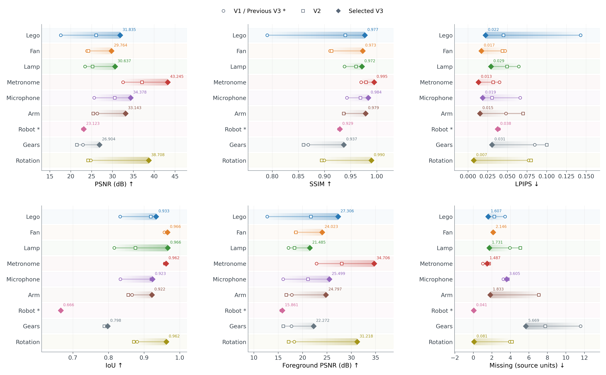
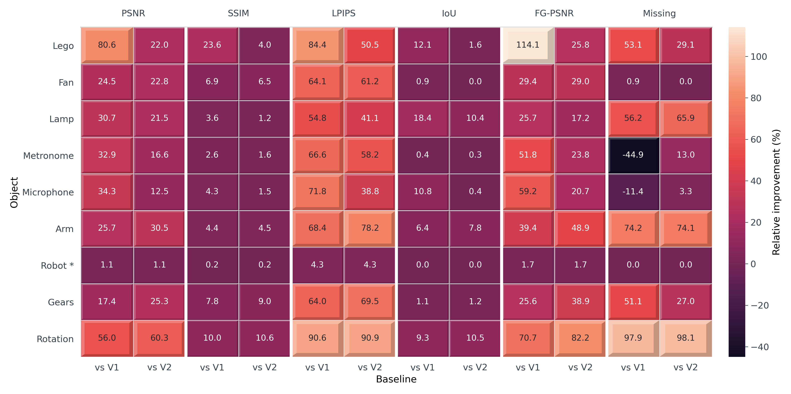
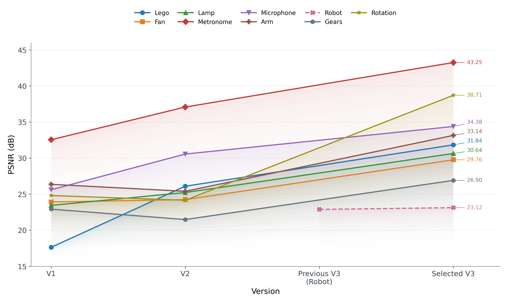
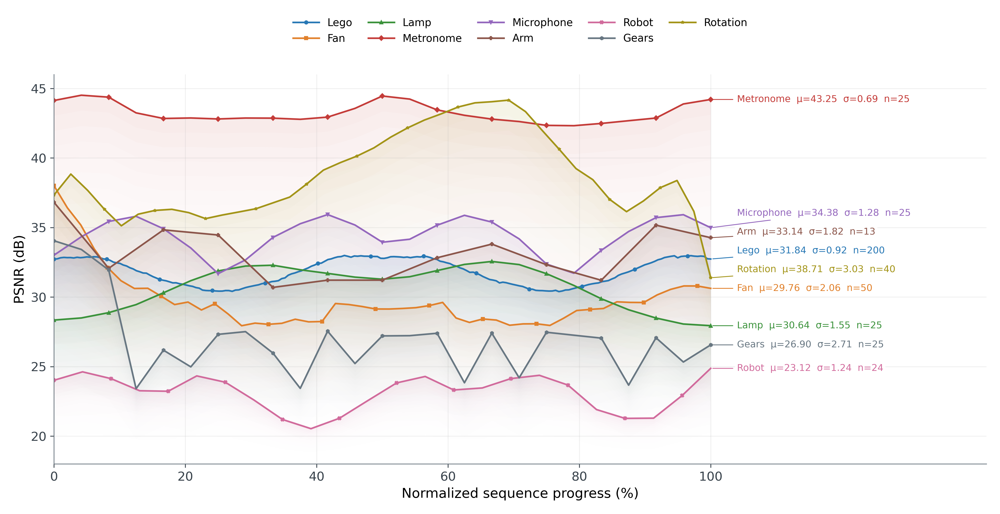
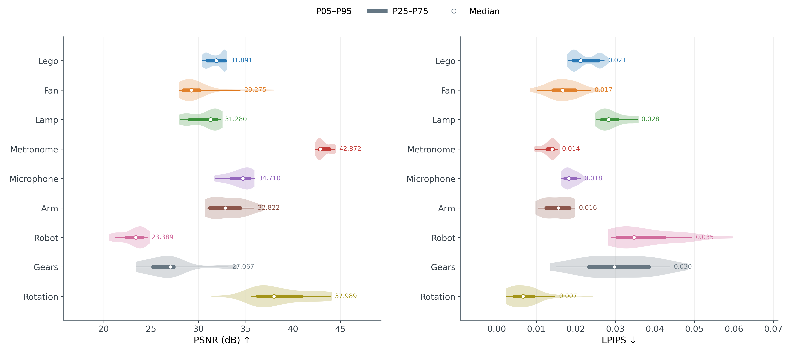
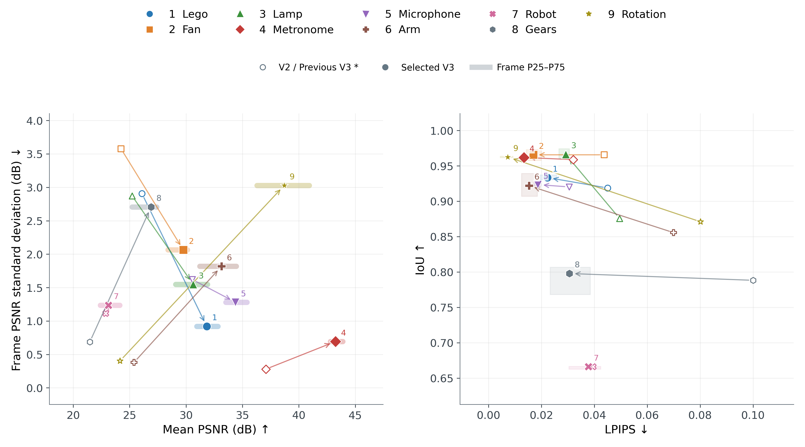

# 全物件实验 · 学术风格 PNG

当前输出 8 张 300 DPI 图片。全英文、无标题或说明段落，保留必要坐标、图例、数值与曲线旁标注。跨图统一物件颜色；原始数值保持不变。

| 图片 | 呈现内容 |
|---|---|
| [六指标子图](png/01_recommended_metrics.png) | 六个原单位面板；V1/V2 空心标记、推荐 V3 实心菱形、版本连线、选中值标注、渐变增幅带 |
| [融合热力图](png/02_improvement_combined.png) | 每个指标并排呈现相对 V1/V2 的改善，共用色标与分组列轴；浮雕边缘突出变化幅度 |
| [版本演进](png/03_version_psnr.png) | 多物件曲线、渐变填充、错位端点数值，无右侧表格 |
| [逐帧曲线](png/04_temporal_psnr.png) | 九物件叠加曲线、渐变填充；曲线旁标注 n、μ、σ，引线连接且自动检查标签不重叠 |









## 复现和数据来源

```bash
python experiments/all_visualization/plot_results.py
```

依赖 NumPy、Matplotlib。脚本校验原归档与 Arm 补充文件 SHA256，清理已知旧版输出后重新绘制。`figure_manifest.json` 保存图片哈希和数据来源；`data.json` 保留指标十进制字符串；`plot_statistics.json` 保存派生热力图数值。

Arm 的 `supplemental/arm-series.npz`、`arm-protocol.json`、`arm-analysis.json` 来自 AutoDL 的 `Arm_V3_RGB结构优化_20261101_222918_077652/data`。来源和文件哈希见 `supplemental/provenance.json`。原始 13 帧编号为 0、2、…、24。每次生成检查版本顺序，并核对三个版本七项指标逐帧均值与原归档汇总一致（rtol=1e-10、atol=1e-12），不修改原归档。

## 图表口径

- 六指标子图保留原单位，不再使用 min–max 归一化。空心圆表示 V1，空心方形表示 V2，实心菱形表示推荐 V3；Robot 的空心圆是旧 V3。连线仅用于对照版本，不表示中间测量。
- 融合热力图公式为 `direction × (selected-baseline)/abs(baseline) × 100`。高值优指标 direction=1，低值优指标=-1。正数改善、负数退化，零基线显示 N/A。两个基线共用同一色标，不使用遮挡数值的三维透视。
- Robot 标记 `*` 使用同一批 24 帧的旧 V3/推荐 V3 配对，所以两列数值相同。不得与旧 12 帧 V1/V2 混算。
- 版本图仅标注推荐版本的 PSNR 端点数值；Previous V3 (Robot) 是独立类别坐标，其他曲线经过该横坐标不代表测量。
- 逐帧曲线横轴为 `100 × (source_frame-first_frame)/(last_frame-first_frame)`，只把各序列覆盖范围映射到 0–100%，不插值、不重采样、不平滑；不是相同物理时间或运动阶段。曲线旁 μ 为均值、n 为样本数、σ 为总体标准差（ddof=0）。
- 填充是视觉辅助，不表示置信区间或误差带；版本图填充下界 15 dB，逐帧图下界 18 dB。填充渐变在靠近曲线时更明显，避免多层叠加遮挡。
- 不同物件评估协议、样本数、掩码口径不一致，不能据此给出跨物件排名或合成总分。Missing 沿用源单位。训练/选点重叠和推荐版本取舍见[实验主报告](../README.md)。

- 渐变增幅带从基线延伸至推荐值；同一指标内绝对变化越大填充越明显。退化用红色标示。热力图浮雕宽度与全图绝对相对变化成比例，阴影仅作视觉提示，单元格中心颜色仍使用统一色标。


## 新增：物件差异与实测优势

| 图片 | 对比维度 |
|---|---|
| [逐帧分布](png/05_frame_distributions.png) | PSNR / LPIPS 小提琴分布，P05–P95、四分位区间与中位数 |
| [累计分布](png/06_quality_ecdf.png) | 真实阶梯 ECDF，增加沿阶梯的淡色渐变填充 |
| [质量与稳定性](png/07_quality_stability.png) | 基线到推荐版本箭头、逐帧四分位范围；质量与稳定性 / LPIPS 与 IoU |
| [前景与整图差距](png/09_foreground_fullframe.png) | 前景和整图 PSNR，显式展示两者差距 |






这些图呈现的是九个已有物件序列的差异，不代表新增场景实验，也不是跨协议排名。以下特点仅限各自的归档评估：

- **Lego**：200 帧中 PSNR、SSIM、LPIPS 均优于 V2；长序列的逐帧 PSNR 波动可由分布图直接观察。
- **Fan**：50 帧中 49 帧的 PSNR、SSIM、LPIPS 改善；IoU、Missing 的零改善比例不能直接解释为退化，应查看保存的 unchanged/degraded 计数。
- **Lamp**：LPIPS、IoU 与 Missing 在全部 25 帧改善；PSNR、SSIM 并非所有帧改善，体现指标取舍。
- **Metronome**：记录中的 PSNR 均值约 43.25 dB、标准差约 0.69 dB；六项指标全部 25 帧优于 V2。
- **Microphone**：LPIPS、IoU、Missing 全部 25 帧改善；分布图同时显示 PSNR 的低值尾部。
- **Arm**：补回的 13 个真实配对样本，六项指标逐帧均优于 V2；这不等于未见视角验证。
- **Robot**：只能与同一批 24 帧旧 V3 配对，PSNR 20/24 帧改善、LPIPS 18/24 帧改善，提升范围如实保留。
- **Gears**：PSNR、SSIM、LPIPS 全部 25 帧改善；IoU 为 23/25，不能宣称全部指标逐帧最优。
- **Rotation**：该报告 LPIPS 约 0.00728，六项指标全部 40 帧优于 V2；PSNR 的约 3.03 dB 标准差也显示较明显帧间波动。

### 新图统计定义

- 小提琴外形是对真实帧值的核密度估计，仅描述分布，不生成实验样本；中位数和分位数来自原始数组。ECDF 不做平滑，每个序列自身归一化为 100%。
- 稳定性采用逐帧 PSNR 总体标准差（ddof=0），也受姿态与场景难度影响，不等同于直接测量视觉闪烁。
- 前景 / 整图差距是两个源指标的算术差，不是可直接跨物件比较的背景质量分数。
- 新绘图实现位于 `plot_differences.py`，由 `plot_results.py` 一并调用。原档案、版本选择和训练模型均保持原样。


### 本次样式与内容调整

- 已删除逐帧改善率热力图及其计算、绘图代码和派生计数输出；保留原始实验数据。
- 质量／稳定性图加入同物件 V2 → Selected V3 的箭头；Robot 使用 Previous V3 基线。空心标记是基线，实心标记是推荐版。所有坐标由现有逐帧数组重新计算。
- 左图粗横线为推荐版 PSNR 的 P25–P75，放在该物件标准差高度；右图淡色矩形为 LPIPS 和 IoU 各自 P25–P75 的笛卡尔积。这些是帧值分布范围，不是置信区间，也不表示联合概率覆盖率。
- 累计分布填充随曲线渐变，严格采用 step=post，不改变阶梯数值。填充只是视觉辅助，不表示误差范围。
