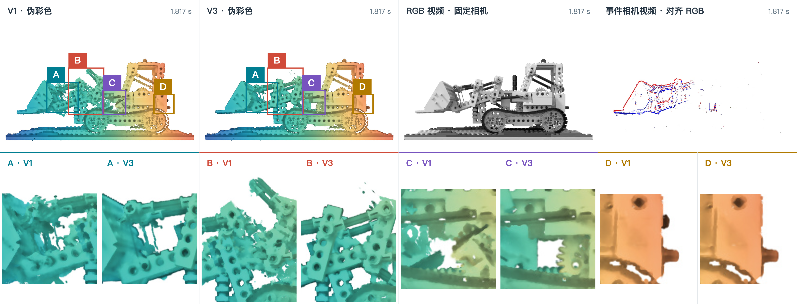
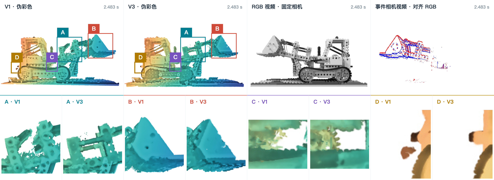
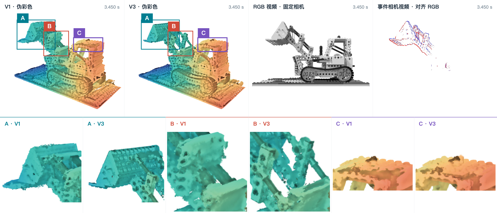
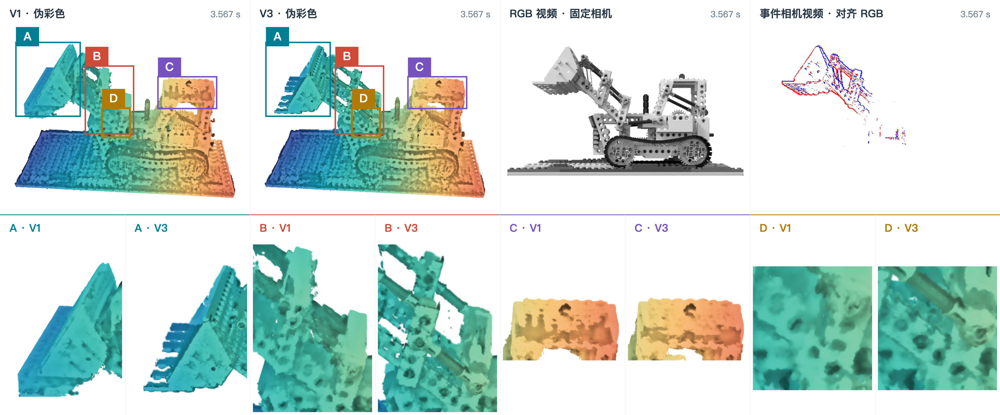
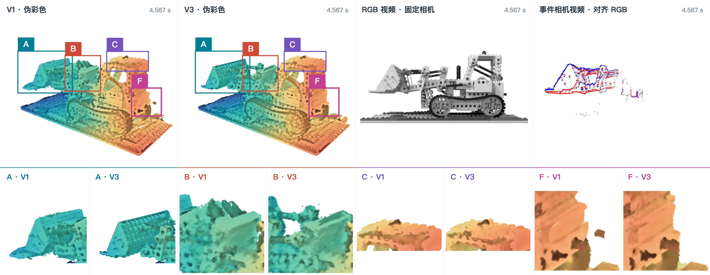
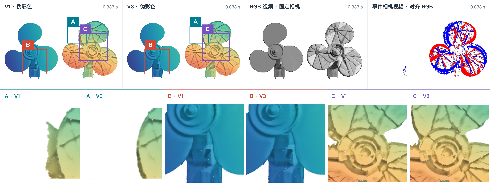
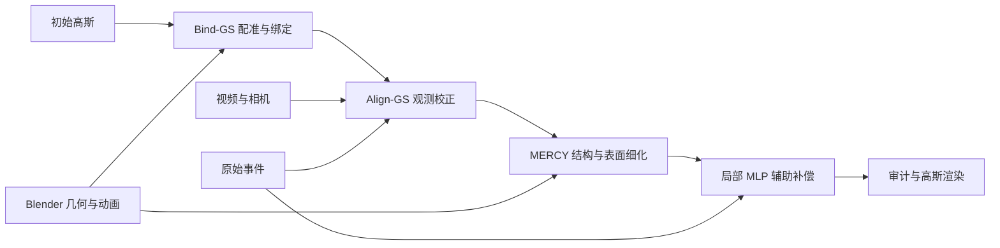

# MERCY

**Monocular Event-boosted Locally RigidMotion Coherent 4DGS Reconstruction Dynamics**

🌟 Collaborators

Li Minghao: suleynanaiur@gmail.com
Liang Yirui: Laybaeknim@gmail.com

MERCY 面向 Lego 机械结构，研究如何利用事件流的时序变化信息和视频帧的外观参照，提高动态高斯与观测的一致性、部件连续性及多视角覆盖。实际显示资产是三维高斯；基础运动和部分几何来自 Blender 先验。Bind-GS / Align-GS 是本项目的方法组织名称，历史目录中的 `v1`、`v2`、`v3` 不能直接当作这三个阶段的检查点。

当前 Lego 查看器比较 Bind-GS 基线与 MERCY 候选。Fan 是独立的视频拟合刚体示例，其界面 V1/V3 表示风扇修复前后的产物，不与 Lego 的训练阶段等同。方法结构、历史实验及部署记录在文档中分别说明。

[演示](#演示与图片说明) · [方法](#方法与技术路线) · [实验](#实验结果与证据范围) · [运行](#安装与运行) · [技术文档](assets/technical/README.md)

## 演示与图片说明

### Lego 多时刻与多视角对比

以下六张原始截图按 **3 列 × 2 行** 排列。每张图上部依次包含 V1、V3、固定相机 RGB 和事件参考，下部为对应选区的细节。点击任一图片可查看原始 4096 px 宽截图。

<table>
  <tr>
    <td width="320" height="120" align="center" valign="middle"><a href="assets/demo/pseudocolor-frame-0109.png"></a></td>
    <td width="320" height="120" align="center" valign="middle"><a href="assets/demo/pseudocolor-frame-0149.png"></a></td>
    <td width="320" height="120" align="center" valign="middle"><a href="assets/demo/pseudocolor-frame-0207.png"></a></td>
  </tr>
  <tr>
    <td align="center"><sub>Lego · 1.817 s</sub></td>
    <td align="center"><sub>Lego · 2.483 s</sub></td>
    <td align="center"><sub>Lego · 3.450 s</sub></td>
  </tr>
  <tr>
    <td width="320" height="120" align="center" valign="middle"><a href="assets/demo/pseudocolor-frame-0214.png"></a></td>
    <td width="320" height="120" align="center" valign="middle"><a href="assets/demo/pseudocolor-frame-0214%20%281%29.png"></a></td>
    <td width="320" height="120" align="center" valign="middle"><a href="assets/demo/pseudocolor-frame-0274.png"></a></td>
  </tr>
  <tr>
    <td align="center"><sub>Lego · 3.567 s · 视角 A</sub></td>
    <td align="center"><sub>Lego · 3.567 s · 视角 B</sub></td>
    <td align="center"><sub>Lego · 4.567 s</sub></td>
  </tr>
</table>

伪彩色是显示着色，不代表真实材质或误差大小。两侧高斯共享观察视角；RGB／事件保留采集视角，不能直接用自由视角截图与 RGB 计算逐像素误差。截图中的历史 V1/V3 标签保留原义，不能据图推断某个单独模块的增益。

### Fan 双视角对比

以下两张原始截图按 **1 行 × 2 列** 排列，均为 0.833 s 的不同观察视角。Fan 的基础运动由视频拟合；事件画面用于展示参照，不能据此声称已完成事件监督训练。

<table>
  <tr>
    <td width="240" height="120" align="center" valign="middle"><a href="assets/demo/pseudocolor-frame-0025.png"></a></td>
    <td width="240" height="120" align="center" valign="middle"><a href="assets/demo/pseudocolor-frame-0025%20%281%29.png"></a></td>
  </tr>
  <tr>
    <td align="center"><sub>Fan · 0.833 s · 视角 A</sub></td>
    <td align="center"><sub>Fan · 0.833 s · 视角 B</sub></td>
  </tr>
</table>

两组图统一使用 **240 × 120 px 图片框**，Lego 与 Fan 的单格尺寸相同；图片等比居中，空余区域留白。图框尺寸不含标题和表格内边距。所有图片直接引用 `assets/demo` 原文件，保留原始比例、标注和局部细节，点击可查看原图。截图清单及校验值见 [演示素材清单](assets/demo/gallery-manifest.json)。

| 版本 | 名称与主要区别 | 运动来源 |
| --- | --- | --- |
| **V1 · Bind-GS** | 部件绑定动画基线；初始高斯可能存在误绑定、缺口和断臂 | Blender 部件 Object 矩阵，通过绑定带动高斯 |
| **V2 · Align-GS** | 观测约束校正阶段：组织视频、事件标定和运动校正模块；**尚无统一独立网页产物** | Blender 基础运动＋观测约束校正，具体形式由实验配置确定 |
| **V3 · MERCY** | 完整融合方案：事件等监督的校正、刚体与关节约束、表面和外观改进，以及局部 MLP 辅助变形 | **Blender 主运动＋校正＋局部 MLP 小幅补偿**；不是完全由 MLP 学习运动 |


## 方法与技术路线

### 表示和输入

规范状态中的每个高斯包含中心、旋转、尺度、不透明度及颜色。动态模块更新位置与朝向，部分独立外观阶段可调整尺度、颜色或不透明度；渲染器根据相机将当前高斯投影成像。**运动生成、几何优化、外观优化和显示滤波是不同环节。**

| 信息 | Lego 融合流程中的作用 | 不应作出的推断 |
| --- | --- | --- |
| 初始高斯 G0 | 实际渲染表示与初始几何 | G0 的上游来源自动等于纯观测重建 |
| Blender 部件几何与动画 | 配准、绑定、基础运动及部分隐藏表面补全 | 主运动由事件从零恢复 |
| 视频与相机 | 外观、可见位置参照及事件时间／亮度标定 | 单视角拟合能唯一确定三维结构 |
| 原始事件 | 帧间对数亮度变化约束与运动校正 | 显示用事件视频等同于训练事件流 |
| 局部 MLP | 已有轨迹上的受限关节补偿 | 全场景自由形变或替代 Blender 动画 |

### Bind-GS 部件绑定基线

从 Blender 导出初始表面及逐帧 `matrix_world`，将表面与 G0 配准后按几何邻近关系建立部件绑定。对部件 j 的高斯，使用相对首帧变换：

```text
D_j(t) = A · M_j(t) · inverse(M_j(0)) · inverse(A)
x_i(t) = R_j(t) · x_i(0) + T_j(t)
q_i(t) = quaternion(R_j(t)) ⊗ q_i(0)
```

A 是 Blender 到高斯坐标的配准矩阵，R、T 来自 D。刚体内统一变换保持点对距离；弹性带使用源表面局部拟合近似。误绑定、未绑定行、配准误差和 G0 表面缺失均可能造成断臂，即使源动画本身完整。

详见 [Bind-GS 的输入、绑定、缓存及验证](assets/technical/01-bind-gs.md)。

### Align-GS 观测约束校正

冻结基础序列，先核对视频／事件时间单位、分辨率和首帧，再建立训练／留出区间并标定事件阈值。对校正后的高斯实际渲染，比较相邻时刻对数亮度变化与事件累计量；结合视频灰度、前景覆盖和正则项优化受限的全局、时间或分组校正。

Align-GS 可同时使用视频与事件，因此不是“无事件基线”的别名。它目前是模块层面的中间阶段；独立版本仍需明确父模型、配置、检查点及审计结果。详见 [Align-GS 流程](assets/technical/02-align-gs.md)。

### MERCY 结构与局部辅助变形

完整方案在已有校正上组织以下模块，各阶段通过产物来源连接，不是一次端到端联合训练的默认承诺：

1. **刚体与关节约束**：同组高斯共享部件变换，关节层级传递运动，限制连接点分离及闭环不一致。
2. **绑定与表面修复**：区分错组、未绑定和几何覆盖缺失，分别处理并保留行号对应。
3. **隐藏区域先验补全**：从 Blender 网格采样部分侧面、背面，检查观测相机中是否产生错误露出。
4. **外观细化**：在对应实验声明的冻结条件下优化颜色、尺度或不透明度，之后重新审计事件一致性。
5. **局部 MLP 补偿**：以冻结的关节姿态、速度及组信息为条件，对多尺度时间残差基预测有界权重，经关节层级施加小幅补偿。
6. **整段审计与导出**：核对事件、结构、幅度、相位、来源哈希与重载一致性，再交付候选及报告。

最新局部 MLP 不读取 RGB 训练目标，也不从时间 t 独立预测全部高斯运动。它与整个融合流程的视频监督应分开描述。完整步骤见 [MERCY 技术流程](assets/technical/03-mercy.md)，数学定义见 [表示与优化目标](assets/technical/04-formulation.md)。



## 实验结果与证据范围

以下数字来自仓库已有实验记录，不是本次重新训练的结果，也不是 Bind-GS／Align-GS／MERCY 三组统一消融。每一行保留自身模型与评估范围。

| 实验与范围 | 已有记录 | 解释 |
| --- | --- | --- |
| 表面修复，40 个采样帧 | 1,489 个满足条件的部件帧中，缺失超过 10% 的数量由 130 降至 0，仍有 56 个缺失像素 | 支持所检可见区域覆盖改善，不覆盖所有遮挡面 |
| `lego-multiview-v2` 留出背面视角 | 像素加权缺失率 12.9274% → 0.3481% | 依赖 Blender 几何先验，不等于未知背面恢复 |
| 400 帧、每帧 14 个关节 | 最大关节间隙 1.42e-6 场景单位 | 支持所检连接的运动学一致性，不是动力学验证 |
| `lego-global-detail-v1` 记录 | 382 / 399 个事件区间通过，17 个未通过 | 尚未通过全序列严格事件验收 |
| 局部 MLP，实际启用 6/8 关节 | 4,665 个高斯受影响；局部角 jerk 下降 2.5428% | 同一权重的局部诊断，不能推为全模型视觉收益 |
| 同一局部 MLP 的事件与三维轨迹 | 局部区间平均事件 L1 上升 0.0656%；局部三维 jerk 上升 0.0203% | 平滑与观测保真存在取舍，并非所有指标改善 |

局部事件 L1 的“区间均值”和“总量聚合”可能呈现不同趋势；报告必须说明分母、掩码、时间范围及零事件处理。留出区间不参与本次模块训练，也不意味着父模型和历史标定完全没有数据暴露。

[评估指标与消融协议](assets/technical/06-evaluation.md) 定义比较口径；[历史实验记录](assets/technical/08-experiment-records.md) 保留原始表格、失败项、图像和旧分支命令。

## Fan 示例与可视化

Fan 使用 G0、相机和 `Fan.mkv` 拟合右侧叶片逐帧转角，左侧风扇及后方支架保持静止。后续处理包括支架归属修复，以及规范高斯的受限局部表面细化；这些步骤没有把 Fan 转成事件重建通过版。

已有表面细化实现包括组内稳健局部平面拟合、有界中心／朝向调整、受支持大 splat 分裂、低透明度清理和独立 Mesh 去噪。显示滤波与几何变化分别记录。相关 2026-10-24 记录表明图像内部高频代理值下降，同时部分强边缘梯度也下降，存在锐度取舍。

Fan 原始事件文件在历史运行中被记录为不完整；事件参考视频仍可展示，但不能替代原始数据用于训练验收。完整流程与结果范围见 [Fan 技术说明](assets/technical/07-fan-and-viewer.md)。

查看器提供 Gaussian、Mesh、Mesh＋GS、白模和伪彩色等模式；实际可用项由各场景 manifest 决定。V1／V3 联动相机，RGB／事件保持原始视角。截图中的局部选区用于观察，不构成独立评估集。参考视频白底合成与显示去噪不参与训练指标计算。

## 安装与运行

### 环境与数据

训练与高斯渲染需要支持 CUDA 的 NVIDIA GPU、匹配的 PyTorch/CUDA 及编译工具链。仓库提供 AutoDL 环境脚本，也保留手动依赖安装入口；应使用实际服务器兼容的组合。

```bash
bash scripts/setup/setup_autodl.sh
source scripts/setup/autodl_env.sh
```

已有匹配 PyTorch/CUDA 的环境可安装功能依赖与本地扩展：

```bash
pip install -r requirements.txt
pip install -r requirements-event.txt
pip install -r requirements-viewer.txt
pip install --no-build-isolation ./submodules/diff-gaussian-rasterization
pip install --no-build-isolation ./submodules/simple-knn
```

部分模块另需 PyTorch3D；Mesh、Blender 导出、参考视频处理分别需要对应依赖、Blender 和 FFmpeg。安装细节与数据模式见 [复现与产物接口](assets/technical/05-reproduction.md)。

```text
data/Lego_data/                 # 也可使用仓库外的绝对路径
├── Lego.mkv
├── Lego_event                  # 原始事件数组，不是事件预览视频
├── Lego.blend
├── camera_intrinsics.json
├── fixed_camera.json
└── fan_contrastive_g0/
    └── contrastive_g0.ply
data/Fan_data/
├── Fan.mkv
├── fan_contrastive_g0.ply
└── fixed_camera.json
```

示例目录名不是自动的数据验证；时间单位、坐标、首帧和文件完整性仍需核对。数据、检查点和大型结果主要保存在忽略的本地目录中，克隆仓库不会自动获得全部产物。

### 生成事件监督与局部辅助模型

```bash
python scripts/events/prepare_lego_events.py   --data /path/to/Lego_data   --output outputs/lego-event-supervision

python scripts/deformation/train_v3_deformation.py   --base-field /path/to/verified-base-field.pth   --steps 300 --output outputs/lego-local-mlp
```

第二条命令依赖已验证的基础场及其完整来源，不是从原始数据一键训练 MERCY。Blender 导出、绑定、基础缓存、硬关节校正和导出的依赖顺序及命令见 [复现指南](assets/technical/05-reproduction.md)。

### 加载已有展示产物

先复制并编辑 `viewer/scenes.example.json`，将每个场景指向实际序列或 comparison manifest。示例 Fan 默认是单序列；启用 Mesh 或表面细化需要相应资产与配置。

```bash
python viewer.py --scenes_path /path/to/scenes.json   --host 127.0.0.1 --port 8892
```

打开 `http://127.0.0.1:8892/?scene=lego` 或 `?scene=fan`。服务器 GPU 负责渲染，浏览器负责交互与播放；远程服务可通过 SSH 转发到本地。完整的显示、参考帧、选区与视频导出说明见 [查看器操作](assets/technical/09-viewer-reference.md)。

## 技术文档与代码导航

| 文档 | 内容 |
| --- | --- |
| [技术总览](assets/technical/README.md) | 方法命名、模块依赖、阅读路径 |
| [01 Bind-GS](assets/technical/01-bind-gs.md) | 动画导出、配准、绑定、刚体／弹性运动、缓存 |
| [02 Align-GS](assets/technical/02-align-gs.md) | 时间标定、事件目标、运动校正与候选审计 |
| [03 MERCY](assets/technical/03-mercy.md) | 关节、几何、外观、局部 MLP 和导出全流程 |
| [04 数学与优化](assets/technical/04-formulation.md) | 高斯参数、坐标变换、观测损失、局部补偿 |
| [05 复现与接口](assets/technical/05-reproduction.md) | 环境、命令依赖、数据契约与故障定位 |
| [06 评估与消融](assets/technical/06-evaluation.md) | 指标、数据暴露、候选来源和可支持结论 |
| [07 Fan 技术说明](assets/technical/07-fan-and-viewer.md) | 视频拟合、绑定修复、表面细化与显示边界 |
| [08 历史实验记录](assets/technical/08-experiment-records.md) | 历史数字、失败实验、图像及旧分支 |
| [09 查看器操作](assets/technical/09-viewer-reference.md) | 场景、五种显示、参考画面、细节与视频导出 |

```text
gaussian_renderer/       高斯渲染接口
scene/                   数据、相机、高斯及原始形变模型
utils/                   运动、事件、关节、辅助网络与加载器
scripts/motion/          Blender 导出、配准、绑定、基础缓存
scripts/events/          事件监督、校正、审计与导出
scripts/deformation/     局部 MLP、历史形变分支与评估
scripts/geometry/        表面修复、补全及覆盖审计
scripts/appearance/      外观与局部细化
scripts/fan/             Fan 拟合、修复与表面处理
scripts/viewer/          参考图像、显示资产与浏览工具
scripts/mesh/            Mesh 重建、去噪与高斯绑定
viewer/                  浏览器前端与场景配置示例
tests/                   按功能分类的回归测试
assets/demo/             原始展示截图与图库清单
assets/technical/        技术文档、复现协议与历史记录
```

在安装相应依赖的环境中执行：

```bash
python -m unittest discover -s tests -t .
node --test tests/viewer/*.cjs
```

代码测试检查实现行为；视觉质量、事件通过率和物理一致性仍需对实际产物单独评估。

## 研究边界

- 当前融合路线使用 Blender 几何和动画先验，不能作为“仅 G0＋事件恢复完整运动”的证明。
- 原始 SC-GS 控制节点网络保留在仓库中，但 Bind-GS 的动画来源与其不同；MERCY 局部 MLP 也不是原版 SC-GS 的完整重训。
- 刚体与关节检查支持运动学一致性，未覆盖力、质量、惯性、碰撞或能量守恒。
- 表面更完整、角轨迹更平滑、事件误差更低是不同目标，必须分别报告。
- 独立事件-only 支线仅使用 G0、原始事件及相机，不读视频、Blender 或旧运动；已有失败记录保留在历史文档中，不能与融合成果混用。

## 致谢与许可

本项目基于 [SC-GS](https://github.com/yihua7/SC-GS)、[Deformable 3D Gaussians](https://github.com/ingra14m/Deformable-3D-Gaussians) 与 [3D Gaussian Splatting](https://repo-sam.inria.fr/fungraph/3d-gaussian-splatting/) 的相关工作和代码继续开发。使用时请遵守本仓库与上游各自许可；本仓库许可见 [LICENSE](LICENSE)。

```bibtex
@article{huang2023sc,
  title={SC-GS: Sparse-Controlled Gaussian Splatting for Editable Dynamic Scenes},
  author={Huang, Yi-Hua and Sun, Yang-Tian and Yang, Ziyi and Lyu, Xiaoyang and Cao, Yan-Pei and Qi, Xiaojuan},
  journal={arXiv preprint arXiv:2312.14937},
  year={2023}
}
```
