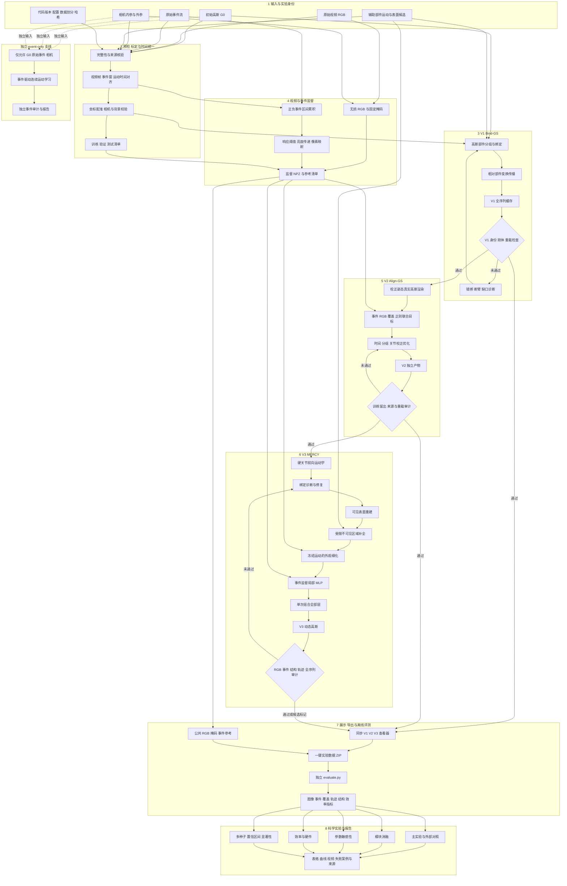

# MERCY

**Monocular Event-boosted Locally Rigid Motion and Coherent 4D Gaussian Reconstruction**

🌟 Collaborators

Li Minghao: suleynanaiur@gmail.com
Liang Yirui: Laybaeknim@gmail.com
Chen Qianqi：chenqianqi0719@gmail.com

MERCY 面向机械部件动态场景，以事件流和视频观测为主要约束，以动态三维高斯为最终表示。系统联合处理时间对齐、运动校正、刚体与关节一致性、表面覆盖、外观细化和局部辅助变形，使运动后的高斯同时满足观测一致性、结构连续性与可渲染性。部件级运动与几何资产只作为初始化和结构辅助，不替代事件／视频监督，也不作为最终显示资产。

Lego 主线固定为三个版本：**V1 是 Bind-GS 基线，V2 是 Align-GS 观测校正版，V3 是 MERCY 完整版**。UI、实验导出和本文均使用这套定义；具体产物由清单中的版本 ID、父产物及 SHA-256 唯一确认。Fan 是独立的视频拟合示例，其版本只在 Fan 场景内部比较。

[演示](#演示与图片说明) · [版本](#版本定义) · [完整流程](#项目从头到尾的完整流程) · [方法](#方法与技术路线) · [实验](#量化评测与实验导出) · [运行](#安装与运行) · [技术文档](assets/technical/README.md)

## 演示与图片说明

### Lego 多时刻与多视角对比

以下六张原始截图按 **3 列 × 2 行** 排列。每张图上部依次包含 V1、V3、固定相机 RGB 和事件参考，下部为对应选区的细节。点击任一图片可查看原始 4096 px 宽截图。

<table>
  <tr>
    <td width="240" height="120" align="center" valign="middle"><a href="assets/demo/pseudocolor-frame-0109.png"></a></td>
    <td width="240" height="120" align="center" valign="middle"><a href="assets/demo/pseudocolor-frame-0149.png"></a></td>
    <td width="240" height="120" align="center" valign="middle"><a href="assets/demo/pseudocolor-frame-0207.png"></a></td>
  </tr>
  <tr>
    <td align="center"><sub>Lego · 1.817 s</sub></td>
    <td align="center"><sub>Lego · 2.483 s</sub></td>
    <td align="center"><sub>Lego · 3.450 s</sub></td>
  </tr>
  <tr>
    <td width="240" height="120" align="center" valign="middle"><a href="assets/demo/pseudocolor-frame-0214.png"></a></td>
    <td width="240" height="120" align="center" valign="middle"><a href="assets/demo/pseudocolor-frame-0214%20%281%29.png"></a></td>
    <td width="240" height="120" align="center" valign="middle"><a href="assets/demo/pseudocolor-frame-0274.png"></a></td>
  </tr>
  <tr>
    <td align="center"><sub>Lego · 3.567 s · 视角 A</sub></td>
    <td align="center"><sub>Lego · 3.567 s · 视角 B</sub></td>
    <td align="center"><sub>Lego · 4.567 s</sub></td>
  </tr>
</table>

伪彩色是显示着色，不代表真实材质或误差大小。各版本高斯共享观察视角；RGB／事件保留采集视角，不能直接用自由视角截图与 RGB 计算逐像素误差。截图用于定性观察，正式数值来自固定相机、固定时间表的实验导出。

### Fan 双视角对比

以下两张原始截图按 **1 行 × 2 列** 排列，均为 0.833 s 的不同观察视角。Fan 的基础运动由视频拟合；事件画面用于展示参照，不能据此声称已完成事件监督训练。

<table>
  <tr>
    <td width="240" height="120" align="center" valign="middle"><a href="assets/demo/pseudocolor-frame-0025.png"></a></td>
    <td width="240" height="120" align="center" valign="middle"><a href="assets/demo/pseudocolor-frame-0025%20%281%29.png"></a></td>
  </tr>
  <tr>
    <td align="center"><sub>Fan · 0.833 s · 视角 A</sub></td>
    <td align="center"><sub>Fan · 0.833 s · 视角 B</sub></td>
  </tr>
</table>

两组图统一使用 **240 × 120 px 图片框**，Lego 与 Fan 的单格尺寸相同；图片等比居中，空余区域留白。图框尺寸不含标题和表格内边距。所有图片直接引用 `assets/demo` 原文件，保留原始比例、标注和局部细节，点击可查看原图。截图清单及校验值见 [演示素材清单](assets/demo/gallery-manifest.json)。

## 版本定义

| 版本 | 固定名称 | 核心能力 | 运动与优化路径 |
| --- | --- | --- | --- |
| **V1** | **Bind-GS** | 初始动态高斯基线；建立部件分组、坐标配准和逐帧刚体／弹性绑定 | 部件级运动先验驱动绑定高斯，保留误绑定、稀疏覆盖和断臂等基线问题 |
| **V2** | **Align-GS** | 在 V1 上加入视频／事件时间对齐、观测残差校正和前景约束 | 基础轨迹＋视频与事件联合校正；UI 通过独立 `middle_path` 加载，实验导出版本 ID 为 `1` |
| **V3** | **MERCY** | 完整融合：关节运动学、绑定与表面修复、外观细化、局部 MLP 和全序列审计 | V2 校正轨迹＋结构约束＋局部有界补偿；最终资产仍为动态三维高斯 |

版本名描述处理能力，实验结论由实际产物清单决定。正式对照必须核对父产物、时间表、相机、监督划分、模块开关和文件哈希；不能只根据目录名判断实验关系。

## 项目从头到尾的完整流程

1. **确定研究问题与冻结实验身份**
   - 明确本轮是生成 V1／V2／V3、训练新候选，还是只对已有产物做量化评测。
   - 为场景、G0、视频、事件、相机、部件结构、辅助资产和代码版本建立清单，保存绝对路径、文件大小与 SHA-256。
   - 预先固定训练、验证、测试时间段以及主指标，避免看到测试结果后再改变划分或选优规则。

2. **采集并整理主要观测数据**
   - 视频提供逐帧外观、可见轮廓、纹理与时间参照；保留原始分辨率、帧率、颜色空间和背景。
   - 原始事件按时间戳保存正负极性，不把彩色事件预览视频当成训练数据。
   - 相机保存内参、外参、坐标约定和采集时间；自由视角相机与固定参考相机分别管理。
   - 初始高斯 G0 提供规范空间中的位置、旋转、尺度、不透明度和颜色，后续所有版本都记录其来源。

3. **执行输入预检和统一标定**
   - 检查视频帧数、事件文件完整性、时间单位、首帧身份、相机方向、坐标尺度及背景颜色。
   - 将视频、事件和运动时间映射到同一秒单位，建立帧 `t_k` 到事件区间 `(t_k,t_{k+1}]` 的严格对应。
   - 对辅助部件／表面资产进行坐标配准；它只负责初始化、部件身份和可选几何候选。
   - 任何身份、哈希或时间关系不一致时停止流水线，不继续混合生成下游结果。

4. **建立规范动态高斯和部件关系**
   - 读取 G0 并验证所有高斯参数有限、四元数合法、尺度和不透明度可用。
   - 根据部件标签、几何邻域和运动边界建立高斯到部件的绑定，区分刚体组、弹性连接区、静态背景和未绑定点。
   - 保存行号、部件组、规范位置、首帧姿态、相机、时间表和来源哈希，确保派生阶段不会错用不同点序。

5. **生成 V1 Bind-GS 基线**
   - 将逐帧部件相对变换传播到绑定高斯，更新中心和旋转；刚体组共享变换，局部连接区使用受限映射。
   - 烘焙或缓存完整 V1 序列，并检查第 0 帧回到 G0、刚体内距离保持、旋转归一化和序列重载一致性。
   - 对断臂、缺口、背景误动、错组和未绑定区域建立失败记录；这些缺陷构成后续版本的基线。

6. **构建视频与事件监督**
   - 从原视频解码无损 RGB，生成固定前景／部件掩码；评测掩码不从任一方法的预测结果反推。
   - 在固定时间窗内累积正负事件计数，记录像素映射、亮度传递、log floor 和正负响应阈值。
   - 建立训练、验证和测试清单，边界处剔除跨集合的事件窗口；保存监督文件及其哈希。

7. **训练 V2 Align-GS 观测校正**
   - 以 V1 为父产物，对校正后的高斯执行真实光栅化，不使用输入视频替代预测渲染。
   - 联合优化事件幅度、方向、极性、视频灰度、前景覆盖和正则项，校正全局、时间节点、部件或关节参数。
   - 约束受保护高斯、变换幅度和时间平滑性，防止通过缩小前景、冻结运动或破坏刚体来降低单一损失。
   - 保存 V2 校正、训练日志、父 V1 哈希、模块配置和留出审计，使其成为独立可加载的中间版本。

8. **建立 V3 的刚体与硬关节结构**
   - 定义部件父子关系、关节轴、枢轴、锁定组和闭环条件，通过前向运动学统一传播运动。
   - 检查连接点距离、闭环残差、刚体内点对距离和受保护组变化；不允许逐点自由位移绕过结构约束。
   - 将结构化轨迹与 V2 校正绑定，避免重复应用基础运动或校正量。

9. **诊断绑定并修复几何表面**
   - 利用多时刻可见性、部件一致性和运动残差区分错绑、漏绑和真实几何覆盖不足。
   - 对错组点重新绑定，对可见薄弱表面重建高斯；新增点保存父来源、部件归属和行号映射。
   - 对不可见区域只使用已声明的几何候选，并同时检查新视角覆盖和原观测视角中的错误露出。

10. **冻结运动并细化外观**
    - 在明确的高斯集合上优化颜色、尺度或不透明度，保持声明冻结的位置、旋转、绑定和轨迹不变。
    - 比较 RGB、局部边缘、前景覆盖和部件完整性；防止单纯放大 splat 掩盖孔洞。
    - 外观改变会影响预测事件，因此完成后必须重新执行整段事件审计。

11. **训练事件监督的局部 MLP**
    - 从冻结轨迹提取关节角、角速度、关节位置和组身份，并构造多尺度时间残差基。
    - 使用零初始化 MLP 输出有界组合权重，只对预先指定的局部关节施加小幅补偿。
    - 联合检查事件误差、角／三维 jerk、运动幅度、相位、转折点、关节闭合和受保护组；更平滑不自动代表更准确。

12. **形成并验收 V3 MERCY**
    - 按固定顺序组合 V2 校正、关节结构、几何层、外观层和局部补偿，每一项只应用一次。
    - 重新加载最终产物，检查文件哈希、版本来源、全序列可渲染性和序列化一致性。
    - 分别报告 RGB、事件、覆盖、关节、刚体和轨迹指标；未通过条件的结果保留为候选，不能因为能播放就标记为通过。

13. **生成查看器和同步对照界面**
    - 将 V1、V2、V3 接入同一场景清单，统一帧数、FPS、相机、时间、背景和渲染模式。
    - 提供 Gaussian、Mesh、Mesh＋GS、白模和伪彩色等观察模式；这些模式只改变展示，不改变版本身份。
    - RGB／事件参考保持固定采集相机，三版本自由视图联动，用于定性观察但不直接替代固定相机量化。

14. **一键导出关键实验数据**
    - 按固定采样间隔同步保存三版本无损 PNG、alpha 覆盖、固定点轨迹、部件／关节信息和逐版本计时。
    - 同包保存公共 RGB、前景／部件掩码、原始事件计数、相机、真实时间、配置、来源清单和评测代码。
    - 导出完成后核对包内哈希和 `data_availability.json`；缺失数据写明原因，不用预测结果伪造参考。

15. **离线量化、消融和统计分析**
    - 从同一个导出包计算 PSNR、SSIM、L1、可选 LPIPS、事件相对 L1、事件余弦、极性一致率、轮廓 IoU、缺失率、jerk、关节间隙和刚体误差。
    - 主实验比较完整方法与外部对照；消融实验只改变一个模块；参数实验固定测试集；效率实验单独预热并重复测量。
    - 多随机种子或多独立场景用于置信区间和显著性检验；相邻帧、多个视角和同一模型重复导出不能当成独立训练样本。

16. **保持严格 event-only 支线独立**
    - 该支线只读取 G0、原始事件和相机，从事件学习连续运动，不读取视频、部件动画、几何先验或融合主线旧运动。
    - 它拥有独立的输入预检、训练、审计和报告，不能与 V1→V2→V3 融合路线的结果混用。

### 完整框架流程图



主线的技术贡献集中在视频／事件观测校正、结构一致性、表面与外观修复以及局部受限变形。辅助部件和表面信息只进入 V1 初始化及 V3 的可选补全节点；event-only 支线通过输入隔离，不继承主线运动。


## 方法与技术路线

### 动态高斯表示

规范空间中的第 i 个高斯记为

```text
G_i^0 = { μ_i^0, q_i^0, s_i, α_i, c_i }
```

其中 `μ`、`q`、`s`、`α`、`c` 分别表示中心、旋转、尺度、不透明度和球谐颜色。运动模块在时刻 t 生成位置与朝向 `μ_i(t), q_i(t)`；外观阶段只在实验声明允许的范围内更新颜色、尺度或不透明度。给定相机 `C_t`，高斯光栅器输出 RGB、灰度和 alpha：

```text
I_t, A_t = Render({G_i(t)}, C_t)
```

最终展示、截图和量化评测都来自该动态高斯表示。Mesh、白模、伪彩色和显示滤波是观察方式，不能替代原始 Gaussian 渲染指标。

### 输入与各自作用

| 信息 | 在主流程中的作用 | 约束范围 |
| --- | --- | --- |
| 原始事件 | 提供相邻时刻的亮度变化、极性和高速运动信息 | 需要固定时间窗、像素映射、正负响应阈值和亮度传递函数 |
| 视频与相机 | 提供外观、可见位置、轮廓、时间基准及事件响应参照 | 单目观测不能唯一决定遮挡背面和完整三维结构 |
| 初始高斯 G0 | 提供可微渲染的规范几何、外观和点身份 | 上游来源必须记录，不能把 G0 自动视为纯事件重建 |
| 部件与关节结构 | 约束刚性分组、父子关系、旋转轴及连接点 | 属于结构先验；运动学一致不等于动力学仿真 |
| 辅助运动／表面资产 | 为 V1 提供初始化，为不可见区域提供可选几何候选 | 当前资产由 Blender `.blend` 文件导出，只作为辅助先验，使用范围必须进入实验清单 |
| 局部 MLP | 在冻结轨迹上预测受限的局部关节补偿 | 不自由预测所有高斯的主运动，不替代视频与事件监督 |

事件和视频是 V2／V3 观测校正与验收的主要数据。辅助资产解决初始化、部件身份和不可见表面候选问题；其影响通过“关闭事件、关闭补全、限制先验”等消融单独报告。

### V1 Bind-GS 基础运动

V1 将 G0 对齐到部件坐标系，根据几何邻近、部件标签和边界规则建立高斯到部件的绑定。对绑定到部件 j 的高斯，先计算相对首帧变换：

```text
D_j(t) = A · M_j(t) · inverse(M_j(0)) · inverse(A)
x_i(t) = R_j(t) · x_i(0) + T_j(t)
q_i(t) = quaternion(R_j(t)) ⊗ q_i(0)
```

`A` 是辅助资产坐标到高斯坐标的配准，`M_j(t)` 是部件逐帧变换，`R_j(t), T_j(t)` 来自 `D_j(t)`。刚体组内使用共享变换，局部弹性连接区使用受限的表面对应关系。缓存阶段保存动态行号、绑定组、首帧身份、时间表、相机和文件哈希，使后续版本能够复用同一基础序列。

V1 是明确的基线：绑定错误会让背景或相邻部件被错误带动；G0 稀疏、边界映射不连续或表面本身缺失会表现为缺口与断臂。源部件运动在视觉上连贯，也不能自动保证绑定后的高斯完整。详见 [V1 Bind-GS 流程](assets/technical/01-bind-gs.md)。

### V2 Align-GS 视频与事件校正

V2 以 V1 为父产物。首先统一视频帧、事件时间戳、相机、分辨率、背景和首帧身份，然后在预先划分的训练区间优化校正量，在留出区间执行冻结评估。对于相邻采样时刻 `t_k` 和 `t_{k+1}`，预测事件响应为：

```text
ΔL_k = log(max(Y(I_{t+1}), ε)) - log(max(Y(I_t), ε))
E_k  = C_pos · N_pos(k) - C_neg · N_neg(k)
```

`Y` 为固定亮度变换，`N_pos/N_neg` 为区间内正负事件计数，`C_pos/C_neg` 为固定响应阈值。优化目标组合多尺度事件幅度、方向、极性、视频灰度、前景覆盖和正则项：

```text
L = λe·L_event + λp·L_polarity + λrgb·L_video
  + λcov·L_coverage + λreg·L_regularization
```

事件项约束变化量和变化方向，视频项稳定可见外观与位置，覆盖项防止通过缩小前景虚假降低误差，正则限制校正幅度和时间抖动。允许的校正可以是全局、时间节点、分组刚体或关节参数，但必须保持受保护高斯、父模型身份和坐标约定不变。

V2 作为独立版本加载、显示和导出。当前 UI 使用 `middle_path` 指向 V2 产物，一键实验包固定记录 `V2 / version_id=1`、父来源与哈希。只有父产物关系经过核验时，V1→V2→V3 才能解释为严格渐进实验。详见 [V2 Align-GS 流程](assets/technical/02-align-gs.md)。

### V3 MERCY 结构、表面与局部变形

V3 在观测校正基础上进一步处理结构连续性和渲染质量，包含六个相互可审计的环节：

1. **刚体与硬关节运动学**：同组高斯共享部件变换；父子变换沿关节树传播，连接点、旋转轴、锁定组和闭环条件显式检查。
2. **绑定诊断与修复**：利用多时刻可见性、部件一致性和运动残差区分错组、漏绑和几何缺失，避免用扩大 splat 掩盖错误运动。
3. **可见表面重建与受限补全**：修复规范空间的薄弱表面；不可见区域只从已声明的几何候选采样，并在观测视角检查错误露出。
4. **外观细化**：冻结运动和绑定，在指定高斯集合上优化颜色、尺度或不透明度；完成后重新计算事件响应，防止外观变化破坏时序一致性。
5. **局部 MLP 辅助补偿**：从关节角、角速度、关节位置和组身份提取特征，由零初始化 MLP 预测有界残差基权重：

   ```text
   h_t = MLP(pose_t, velocity_t, joint_t, group_t)
   δθ_t = tanh(h_t) · B_t · gain
   θ_final(t) = θ_align(t) + δθ_t
   ```

   补偿只作用于预先指定的小范围关节，经同一前向运动学传播到绑定高斯；幅度、相位、转折时刻和受保护组同时验收。
6. **全序列审计与导出**：重新加载最终产物，逐帧／逐区间检查 RGB、事件、覆盖、关节、刚体、轨迹平滑性和来源哈希，再生成查看器资产与独立实验包。

局部 MLP 当前使用事件监督训练，不读取 RGB 训练目标；它学习的是已有轨迹上的小幅局部补偿，而不是输入时间后从零生成整套主运动。完整实现见 [V3 MERCY 流程](assets/technical/03-mercy.md)，数学定义见 [表示与优化目标](assets/technical/04-formulation.md)。

### 端到端阶段与产物契约

| 阶段 | 输入 | 主要处理 | 关键输出 | 进入下一阶段前的检查 |
| --- | --- | --- | --- | --- |
| 1. 数据预检 | G0、视频、事件、相机、部件先验 | 核对文件完整性、时间单位、首帧、坐标系、分辨率和背景 | 输入清单、SHA-256、统一时间表 | 身份匹配；事件区间和视频帧可对齐；相机可重投影 |
| 2. V1 构建 | G0、部件变换、配准 | 分组绑定、相对变换、刚体／弹性传播、基础缓存 | V1 动态序列、绑定、部件标签、来源记录 | 零时刻一致；刚体距离保持；无非有限值；断臂和错绑有诊断记录 |
| 3. 监督准备 | 视频、原始事件、相机 | 解码原生 RGB、累积正负事件、响应标定、划分训练／验证区间 | 事件监督 NPZ、参考帧、固定掩码、split manifest | 不用事件预览视频替代原始计数；训练与评估窗口无意外交叉 |
| 4. V2 校正 | V1、视频／事件监督 | 实际渲染、事件／图像／覆盖损失、受限时间或分组优化 | V2 校正、训练日志、留出审计 | 父 V1 哈希一致；重载结果一致；训练和留出指标分开 |
| 5. 结构约束 | V2、部件和关节 | 硬关节前向运动学、锁定组、连接点及闭环约束 | 结构化轨迹、关节报告 | 最大关节间隙、刚体误差和受保护组变化低于预设容差 |
| 6. 几何与外观 | 结构化轨迹、表面候选、视频 | 绑定修复、可见表面重建、受限补全、颜色／尺度／不透明度细化 | 几何层、外观层、行号映射 | 缺失率下降；无新增错误露出；运动冻结项没有改变；重新审计事件 |
| 7. 局部 MLP | 冻结轨迹、训练事件、局部关节集合 | 姿态特征、残差基、有界增益训练和关节传播 | 辅助权重、局部支持、V3 轨迹 | 零初始化等于父结果；幅度、相位、连接、事件和 jerk 联合检查 |
| 8. V3 导出 | 通过来源核验的全部层 | 组合一次校正和一次局部补偿，序列化动态高斯 | V3 模型／序列、manifest、审计报告 | 防止重复应用补偿；全段加载与渲染；源文件和输出哈希闭合 |
| 9. 统一评测 | V1／V2／V3、固定参考与采样表 | 同帧同相机渲染，计算图像、事件、结构、轨迹与效率指标 | PNG、NPZ、`metrics.json`、可复核 ZIP | 三版本身份、相机、时间、背景、模式和评测代码完全记录 |

任何阶段失败都保留候选和失败原因，不能用后续外观或显示滤波覆盖前一阶段的运动／结构问题。几何、外观、运动和显示分别保存开关，便于主实验、消融、参数敏感性和效率实验复用同一套产物身份。

## 量化评测与实验导出

查看器的“一键保存关键实验数据”按同一相机、同一时间表和同一渲染配置同步导出 V1、V2、V3。Lego 默认从第 0 帧开始、每 2 帧采样一次；400 帧序列生成 200 个采样时刻和 199 个完整事件区间。导出包包含三版本 PNG、alpha 覆盖、固定点轨迹、部件／关节信息、RGB 真值、固定前景与部件掩码、原始事件计数、相机、时间、配置、来源哈希和独立评测脚本。

```bash
cd experiment/exports/lego_<timestamp>_<id>
python evaluate.py
python evaluate.py --lpips  # 可选，需要 torch、lpips 及对应权重
```

| 评价对象 | 主要指标 | 必要输入 |
| --- | --- | --- |
| RGB 重建 | PSNR ↑、SSIM ↑、L1 ↓、可选 LPIPS ↓ | 同相机、同时间的预测 PNG 与参考 RGB |
| 事件一致性 | 相对 L1 ↓、余弦相似度 ↑、极性一致率 ↑、无事件区伪变化 ↓ | 相邻预测帧、正负事件计数及固定响应标定 |
| 前景与部件完整性 | 轮廓 IoU ↑、前景／部件缺失率 ↓ | 预测 alpha 与公共固定掩码 |
| 运动平滑性 | 三维轨迹 jerk ↓、旋转 jerk ↓、可用关节角 jerk ↓ | 真实时间、固定点轨迹和已验证部件变换 |
| 结构一致性 | 最大关节间隙 ↓、刚体内部距离误差 ↓ | 部件归属、关节枢轴及逐帧变换 |
| 效率 | 平均／P50／P95 延迟、FPS、加载时间、峰值显存 | 独立“运行性能测量”，固定预热、轮数和采样表 |

一键导出包可独立计算已有渲染结果，不依赖原模型或 CUDA；重新训练、改变相机或重新渲染仍需原始模型和项目环境。`data_availability.json` 明确每项参考数据是否齐全，`manifest.json` 固定版本身份及来源。单次导出用于同一产物的确定性比较；统计显著性还需要多个独立训练种子或独立场景。

### 已有模块记录

以下数字来自不同模块的既有审计，只说明对应实验范围，不能拼成 V1／V2／V3 的统一总成绩。三版本主表应由同一个一键实验包重新计算。

| 实验与范围 | 已有记录 | 解释 |
| --- | --- | --- |
| 表面修复，40 个采样帧 | 1,489 个满足条件的部件帧中，缺失超过 10% 的数量由 130 降至 0，仍有 56 个缺失像素 | 支持所检可见区域覆盖改善，不覆盖所有遮挡面 |
| 多视角补全实验的留出背面视角 | 像素加权缺失率 12.9274% → 0.3481% | 使用已声明的几何先验，只支持给定先验下的覆盖改善 |
| 400 帧、每帧 14 个关节 | 最大关节间隙 1.42e-6 场景单位 | 支持所检连接的运动学一致性，不是动力学验证 |
| `lego-global-detail-v1` 记录 | 382 / 399 个事件区间通过，17 个未通过 | 尚未通过全序列严格事件验收 |
| 局部 MLP，实际启用 6/8 关节 | 4,665 个高斯受影响；局部角 jerk 下降 2.5428% | 同一权重的局部诊断，不能推为全模型视觉收益 |
| 同一局部 MLP 的事件与三维轨迹 | 局部区间平均事件 L1 上升 0.0656%；局部三维 jerk 上升 0.0203% | 平滑与观测保真存在取舍，并非所有指标改善 |

局部事件 L1 的“区间均值”和“总量聚合”可能呈现不同趋势；报告必须说明分母、掩码、时间范围及零事件处理。留出区间不参与本次模块训练，也不意味着父模型和历史标定完全没有数据暴露。

[评估指标与消融协议](assets/technical/06-evaluation.md) 定义比较口径；[UI 导出与独立评测](assets/technical/13-experiment-export.md) 说明数据包格式、公共参考和容量控制；[实验记录](assets/technical/08-experiment-records.md) 保留原始表格、失败项、图像和分支命令。

[全项目实验计划](assets/technical/12-experiment-plan.md) 提供主实验、消融、参数敏感性、效率与统计显著性表格，区分 Lego 主线、严格 event-only、Fan 和 Lamp；[实验记录模板](assets/experiments/templates/experiment-records.md) 用于填写配置、结果、成本与运行状态。表中的待测项目是后续实验计划，不代表已完成评测。

## Fan 示例与可视化

Fan 使用 G0、相机和 `Fan.mkv` 拟合右侧叶片逐帧转角，左侧风扇及后方支架保持静止。后续处理包括支架归属修复，以及规范高斯的受限局部表面细化；这些步骤没有把 Fan 转成事件重建通过版。

已有表面细化实现包括组内稳健局部平面拟合、有界中心／朝向调整、受支持大 splat 分裂、低透明度清理和独立 Mesh 去噪。显示滤波与几何变化分别记录。相关 2026-10-24 记录表明图像内部高频代理值下降，同时部分强边缘梯度也下降，存在锐度取舍。

Fan 原始事件文件在历史运行中被记录为不完整；事件参考视频仍可展示，但不能替代原始数据用于训练验收。完整流程与结果范围见 [Fan 技术说明](assets/technical/07-fan-and-viewer.md)。

查看器提供 Gaussian、Mesh、Mesh＋GS、白模和伪彩色等模式；实际可用项由各场景 manifest 决定。Lego 的 V1／V2／V3 使用同步相机与时间，Fan 的 V1／V3 使用同步视图；RGB／事件参考保持标定采集视角。截图中的局部选区用于观察，不构成独立评估集。参考视频白底合成与显示去噪不参与训练指标计算。

## 安装与运行

### 环境与数据

训练与高斯渲染需要支持 CUDA 的 NVIDIA GPU、匹配的 PyTorch/CUDA 及编译工具链。仓库提供 AutoDL 环境脚本，也保留手动依赖安装入口；应使用实际服务器兼容的组合。

```bash
bash scripts/setup/setup_autodl.sh
source scripts/setup/autodl_env.sh
```

已有匹配 PyTorch/CUDA 的环境可安装功能依赖与本地扩展：

```bash
pip install -r requirements.txt
pip install -r requirements/event.txt
pip install -r requirements/viewer.txt
pip install --no-build-isolation ./submodules/diff-gaussian-rasterization
pip install --no-build-isolation ./submodules/simple-knn
```

部分模块另需 PyTorch3D；Mesh、辅助资产导出和参考视频处理分别需要对应的几何工具与 FFmpeg。安装细节与数据模式见 [复现与产物接口](assets/technical/05-reproduction.md)。

```text
data/Lego_data/                 # 也可使用仓库外的绝对路径
├── Lego.mkv
├── Lego_event                  # 原始事件数组，不是事件预览视频
├── Lego.blend
├── camera_intrinsics.json
├── fixed_camera.json
└── fan_contrastive_g0/
    └── contrastive_g0.ply
data/Fan_data/
├── Fan.mkv
├── fan_contrastive_g0.ply
└── fixed_camera.json
```

示例目录名不是自动的数据验证；时间单位、坐标、首帧和文件完整性仍需核对。数据、检查点和大型结果主要保存在忽略的本地目录中，克隆仓库不会自动获得全部产物。

### 生成事件监督与局部辅助模型

```bash
python scripts/events/prepare_lego_events.py   --data /path/to/Lego_data   --output outputs/lego-event-supervision

python scripts/deformation/train_v3_deformation.py   --base-field /path/to/verified-base-field.pth   --steps 300 --output outputs/lego-local-mlp
```

第二条命令依赖已验证的基础场及其完整来源，不是从原始数据一键训练 MERCY。辅助资产准备、配准绑定、基础缓存、观测校正、硬关节约束和最终导出的依赖顺序及命令见 [复现指南](assets/technical/05-reproduction.md)。

### 加载已有展示产物

先复制并编辑 `viewer/scenes.example.json`，将每个场景指向实际序列或 comparison manifest。示例 Fan 默认是单序列；启用 Mesh 或表面细化需要相应资产与配置。

```bash
python viewer.py --scenes_path /path/to/scenes.json   --host 127.0.0.1 --port 8892
```

打开 `http://127.0.0.1:8892/?scene=lego` 或 `?scene=fan`。服务器 GPU 负责渲染，浏览器负责交互与播放；远程服务可通过 SSH 转发到本地。完整的显示、参考帧、选区与视频导出说明见 [查看器操作](assets/technical/09-viewer-reference.md)。

新增“实时动态浏览高斯”独立入口：支持 Hybrid 3D-4DGS 离线训练／检查点加载与自由视角浏览，不替换原渲染流程。当前 Lego 模型累计训练 52000 步，使用原视频及所提供源场景生成的补充视角，针对滚轮拉远时的铲子遮挡修正几何并精修细节：新距离参照 PSNR 25.61 → 36.37 dB，原相机同序列 PSNR 41.79 → 42.69 dB；前者不是新拍摄数据，后者不是留出集成绩。连续拉远网络传输加 JPEG 解码实测约 33.93 FPS，不代表浏览器显示帧率。模型约 118 MB，旧版保留回退，中间权重已清理。部署、存储控制及完整验收记录见 [Hybrid FVV 集成说明](assets/technical/14-hybrid-fvv.md)。

## 本地目录组织

根目录保留 README、LICENSE、基础依赖 `requirements.txt`，以及 `train.py`、`train_gui.py`、`edit_gui.py`、`render.py`、`viewer.py` 五个主要入口。辅助导出、渲染、评测与预处理工具按功能放入 `scripts/`，公共模块放入 `utils/`，可选依赖集中在 `requirements/`。

本地独立 PLY 已归入 `data/gaussians/fan_dynamic_gaussians.ply`；数据与历史实验仍不提交到 Git。完整的新旧路径、运行方式与迁移记录见 [目录与入口索引](assets/technical/11-project-layout.md)。

## 技术文档与代码导航

| 文档 | 内容 |
| --- | --- |
| [技术总览](assets/technical/README.md) | 方法命名、模块依赖、阅读路径 |
| [01 Bind-GS](assets/technical/01-bind-gs.md) | 动画导出、配准、绑定、刚体／弹性运动、缓存 |
| [02 Align-GS](assets/technical/02-align-gs.md) | 时间标定、事件目标、运动校正与候选审计 |
| [03 MERCY](assets/technical/03-mercy.md) | 关节、几何、外观、局部 MLP 和导出全流程 |
| [04 数学与优化](assets/technical/04-formulation.md) | 高斯参数、坐标变换、观测损失、局部补偿 |
| [05 复现与接口](assets/technical/05-reproduction.md) | 环境、命令依赖、数据契约与故障定位 |
| [06 评估与消融](assets/technical/06-evaluation.md) | 指标、数据暴露、候选来源和可支持结论 |
| [07 Fan 技术说明](assets/technical/07-fan-and-viewer.md) | 视频拟合、绑定修复、表面细化与显示边界 |
| [08 历史实验记录](assets/technical/08-experiment-records.md) | 历史数字、失败实验、图像及旧分支 |
| [09 查看器操作](assets/technical/09-viewer-reference.md) | 场景、五种显示、参考画面、细节与视频导出 |
| [11 目录与入口](assets/technical/11-project-layout.md) | 根目录分类、新旧路径与运行约定 |
| [12 全项目实验计划](assets/technical/12-experiment-plan.md) | 五类实验矩阵、参数范围、统计协议、执行优先级与填写模板 |
| [13 UI 导出与独立评测](assets/technical/13-experiment-export.md) | 三版本同步、每 2 帧关键数据、公共参考、容量控制与离线评测 |

```text
gaussian_renderer/       高斯渲染接口
scene/                   数据、相机、高斯及原始形变模型
utils/                   运动、事件、关节、辅助网络与加载器
scripts/export/          高斯序列与刚体模型导出、打包
scripts/rendering/       PLY、旋转与动画序列渲染
scripts/evaluation/      全流程评测与图像指标
scripts/preprocessing/   COLMAP 数据转换
scripts/training/        GUI 训练启动示例
scripts/motion/          部件先验、配准、绑定、基础缓存
scripts/events/          事件监督、校正、审计与导出
scripts/deformation/     局部 MLP、历史形变分支与评估
scripts/geometry/        表面修复、补全及覆盖审计
scripts/appearance/      外观与局部细化
scripts/fan/             Fan 拟合、修复与表面处理
scripts/viewer/          参考图像、显示资产与浏览工具
scripts/mesh/            Mesh 重建、去噪与高斯绑定
viewer/                  浏览器前端与场景配置示例
tests/                   按功能分类的回归测试
requirements/           AutoDL、事件、Mesh、查看器可选依赖
data/gaussians/          本地独立高斯资产（不提交）
assets/demo/             原始展示截图与图库清单
assets/technical/        技术文档、复现协议与历史记录
```

在安装相应依赖的环境中执行：

```bash
python -m unittest discover -s tests -t .
node --test tests/viewer/*.cjs
```

代码测试检查实现行为；视觉质量、事件通过率和物理一致性仍需对实际产物单独评估。

## 研究边界

- 当前融合路线使用部件运动和几何先验辅助初始化与补全，因此不能作为“仅 G0＋事件从零恢复完整运动”的证明；先验来源已在输入清单中披露。
- 原始 SC-GS 控制节点网络保留在仓库中，但 V1 的运动路径与其不同；MERCY 局部 MLP 也不是原版 SC-GS 的完整重训。
- 刚体与关节检查支持运动学一致性，未覆盖力、质量、惯性、碰撞或能量守恒。
- 表面更完整、角轨迹更平滑、事件误差更低是不同目标，必须分别报告。
- 独立 event-only 支线仅使用 G0、原始事件及相机，不读取视频、部件动画、几何先验或旧运动；其结果与融合主线分开报告。

## 致谢与许可

本项目基于 [SC-GS](https://github.com/yihua7/SC-GS)、[Deformable 3D Gaussians](https://github.com/ingra14m/Deformable-3D-Gaussians) 与 [3D Gaussian Splatting](https://repo-sam.inria.fr/fungraph/3d-gaussian-splatting/) 的相关工作和代码继续开发。使用时请遵守本仓库与上游各自许可；本仓库许可见 [LICENSE](LICENSE)。

```bibtex
@article{huang2023sc,
  title={SC-GS: Sparse-Controlled Gaussian Splatting for Editable Dynamic Scenes},
  author={Huang, Yi-Hua and Sun, Yang-Tian and Yang, Ziyi and Lyu, Xiaoyang and Cao, Yan-Pei and Qi, Xiaojuan},
  journal={arXiv preprint arXiv:2312.14937},
  year={2023}
}
```
