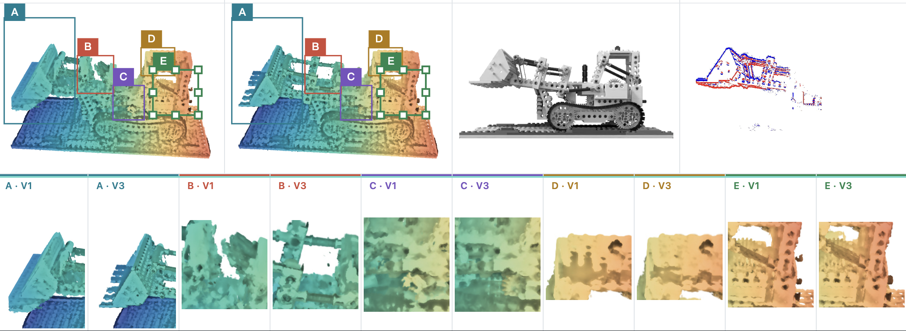
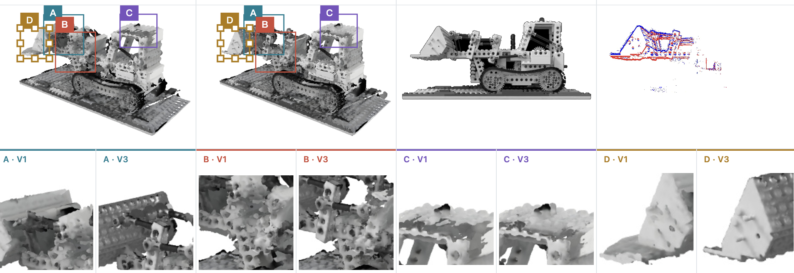

# MERCY: Monocular Event-boosted Locally RigidMotion Coherent 4DGS Reconstruction Dynamics

面向 Lego 机械结构的动态三维高斯重建：从早期运动不稳定、局部断臂的问题出发，结合视频帧、事件流与结构约束，改善运动连续性、部件完整性和多视角细节。

本项目按照三阶段对比展开：

**原始 SC-GS：运动不稳定 → 改进版 1：稀疏视频帧监督，仍有断臂 → 改进版 2：视频帧 + 事件流，并结合结构约束，追求细节清晰、全方位结构完整、关节运动连续。**

“乱动”“断臂”描述本项目早期运行中的定性观察，不是对原始 SC-GS 在所有场景下的结论。“增加视频帧监督”指本项目的改进配置，并非声称原始 SC-GS 不使用图像。三组统一配置的定量消融尚待补齐；下面明确区分已有结果、方法目标和额外先验。


<p align="center">
  
</p>

<p align="center">
  
</p>

<p align="center">
  
</p>


## 三阶段方法对比

| 阶段 | 本项目的输入与约束变化 | 重点观察 | 当前结论与边界 |
| --- | --- | --- | --- |
| A · 原始 SC-GS | 原始方法配置；未加入本项目的事件校正与机械关节完整性流程 | 是否出现非预期运动、局部漂移和时序不稳定，即“乱动” | 本项目早期使用反馈；需保留具体配置与同时间点结果后再做定量比较 |
| B · 改进版 1：视频帧监督 | 在项目基线上增加视频帧监督，不使用事件流作为监督 | 外观与帧内位置之外，机械臂是否仍有断裂、部件连接是否连续 | 已反馈局部断臂；帧拟合好不能直接证明三维结构完整 |
| C · 改进版 2：视频帧 + 事件流 | 视频提供外观参照，事件约束时间变化；结合刚体分组、硬关节连接和表面修复 | 帧间运动、机械臂连续性、细节以及正面 / 侧面 / 背面效果 | 已有融合实验支持局部断裂与覆盖改善；现有实现还使用 Blender 几何和运动初始化先验，不能把全部提升归因于事件流 |

下文目录名中的 `v1`、`v3` 等是各子实验内部编号，不等同于上表的“改进版 1 / 2”。现有融合演示也不是“只改一个事件开关”的三组消融。

### A · 原始 SC-GS：从“能动”到“动得合理”的问题

本项目早期结果出现非预期运动。对 Lego 这样的机械结构，观察重点不仅是高斯是否随时间变化，还包括同一部件是否保持形状、相连部件是否脱开，以及运动方向和时序是否与观测一致。

因此，原始结果作为对照的重点是**运动稳定性与结构一致性**，而不是仅展示一个能够播放的动画。

### B · 改进版 1：增加视频帧监督，但仍出现局部断臂

视频帧为外观和可见位置提供监督，使重建有明确的图像参照；但单帧投影接近，并不自动保证机械臂在三维空间中连续连接。此前观察到的断臂、局部缺口与部件错位，需要单独检查。

这一阶段要回答的是：**仅靠视频帧，能否同时约束外观、帧间运动和部件连接？** 本项目的局部断臂反馈说明，仅展示帧内外观还不够。

### C · 改进版 2：视频帧 + 事件流，联合改善运动、结构与细节

融合流程针对不同问题使用不同约束：

- **运动连续性**：视频帧提供外观参照，原始事件流约束帧间对数亮度变化；通过真实高斯渲染检查运动，而不是直接播放输入视频。
- **机械臂完整性**：同组刚体高斯共享旋转和平移，硬关节前向运动学保持连接点一致；连贯的表面重建与覆盖保护用于减少局部碎裂和缺口。事件监督本身不等于自动补齐几何。
- **细节清晰度**：在冻结已建立的几何和运动后，进行局部外观优化，检查机械臂、齿轮、驾驶室等区域的纹理、边缘与亮度误差。
- **全方位结构检查**：从正面、侧面、背面及留出视角检查覆盖。现有背面补全来自显式 Blender 网格先验，不是单目视频和事件直接观测到的真实背面。

目标是得到**运动有依据、部件不断开、局部细节清晰、自由视角下结构更完整**的动态高斯。已有抽检中，主梁与连杆的早期大面积碎裂明显减少；小缺口、软化和未通过的事件区间仍保留记录，不宣称所有时间、所有视角都已经“零断臂”。

### “符合物理原理”具体指什么？

当前已实现和检查的是**刚体与关节的运动学一致性**：

1. 同一刚体组内的高斯随同一个刚体变换运动，避免把刚性部件任意拉长。
2. 关节两侧使用同一个连接点；树状关节由前向运动学约束，闭环连接按源数据精度检查，并限制相关校正自由度。
3. 使用平滑时序参数和事件误差检查运动连续性，但平滑本身不构成运动正确的证据。

历史 `lego-multiview-v2` 的结构检查覆盖 400 帧、每帧 14 个关节：最大关节间隙为 `1.42e-6` 场景单位，低于 `1e-5` 的检查门槛；每帧抽检的刚体点对距离最大误差为 `8.94e-8` 场景单位。这支持“所检刚体与关节保持几何一致”，不等于所有渲染像素都没有缺口。

当前没有完成力、力矩、质量、惯性、碰撞或能量守恒的动力学验证；弹性带也没有新增真实弹性求解。因此本文不将运动学约束表述为完整物理仿真。

## 已有证据与三组对照的展示方式

以下是融合流程内部的分阶段证据，**不是 A / B / C 三组统一条件的定量消融**：

| 检查项 | 已有记录 | 可以支持的结论 |
| --- | --- | --- |
| 机械臂可见部件覆盖 | 表面修复前后，40 个采样帧中满足条件的部件帧有 1,489 个；其中缺失超过 10% 的部件帧由 130 个降到 0 个，仍有 56 个缺失像素 | 所检亮前景内部的大面积缺失减少；不覆盖所有边界、暗部或隐藏表面 |
| 背面覆盖 | 运动刚体背面的留出视角检查（alpha 阈值 0.5），像素加权缺失率由 12.9274% 降到 0.3481% | 给定几何先验下覆盖改善，不代表全部静态部件或未知背面真实细节被恢复 |
| 关节连接 | 400 帧结构检查，最大关节间隙 `1.42e-6` 场景单位 | 已检查关节的运动学连接保持在容差内 |
| 事件一致性 | `lego-global-detail-v1` 为 382 / 399 个区间通过，仍有 17 个失败区间 | 候选尚未通过全序列严格事件验收，不能宣称完整无误 |

来源为本地审计记录 `outputs/lego-comparison/fracture-surface-inclusive/evidence-summary.json`、`outputs/lego-multiview-v2-independent/heldout-coverage.json`、`outputs/lego-multiview-v2-reports/structure-check.json` 及 `outputs/lego-global-detail-v1/reports/`；大型产物和完整报告不随 Git 仓库发布。不同记录对应不同实验阶段，不能拼接成同一个模型已经通过全部检查。

正式三组对照应使用同一场景、时间戳、相机、分辨率和可比训练预算，并明确初始高斯及额外先验是否相同，排列为 **A 原始 SC-GS / B 视频帧 / C 视频帧 + 事件流**，分别展示：

- **整体运动**：完整运动周期，观察方向、相位、漂移和抖动。
- **机械臂局部**：同一时刻放大关节和细杆，观察断臂、错位、缺口及拉伸。
- **多视角**：固定同一时间，比较正面、侧面和背面；背面必须注明是否使用几何先验。
- **定量检查**：视频误差、事件一致性、部件缺失、关节间隙和时间平滑性分别报告，不用单个指标替代全部检查。

若 C 额外使用了 B 没有的网格、绑定或运动初始化，应单独列出，并补做“相同结构约束与先验、仅移除事件监督”的对照，才能识别事件本身的贡献。现有图片保留真实候选标签，不将内部实验截图重新命名为尚未完成的三组对照。

> 另有一条**严格输入支线**：仅使用修正 G0、原始事件流和相机内外参，不使用视频、Blender 或旧运动。它与上面的融合版不是同一流程；2026-10-18 的 `v5-plane` 仍为 0 / 266 个事件窗口通过，未替换网页。入口和完整失败记录保留在文末的“独立探索”中。

## 视频帧 + 事件流：现有融合实现

> 历史网页记录（2026-10-16，非本轮重建）：网页保留 `lego-global-detail-v1`，399 个事件区间中通过 382 个，仍有 17 个区间未通过，尚未通过全序列严格验收。`lego-roof-back-detail-v4` 因新增局部内部缺口被拒绝，未替换网页模型。播放已撤销“完整缓存后播放”，恢复短缓冲；流畅性问题尚未完全解决。

### 主要功能

- 读取单目 RGB 视频及原始 `x, y, t, p` 事件流，自动校准事件时间偏移与正负对比度阈值。
- 使用稀疏控制、刚体分组与硬关节前向运动学描述动态高斯运动。
- 仅用训练事件区间优化平滑时序校正，并对全部 399 个区间重新渲染审计。
- 在冻结几何和运动的前提下，对重建刚性表面的颜色、尺度和不透明度进行局部细化。
- 使用 Blender 三角网格作为明确标注的几何先验，补全观测相机不可见的背面与侧面。
- 在服务器 GPU 上实时渲染动态高斯，通过本地浏览器完成播放、逐帧检查和自由视角观察。
- 保存输入、模型、校正参数及审计结果的 SHA-256，避免不同实验产物被误配。

### 处理流程

1. **事件监督构建**：从 RGB 视频与原始事件流生成统一时间轴、事件计数和固定训练/留出划分。
2. **动态初始化**：从已有高斯、Lego 部件及相机参数生成 400 帧基础运动缓存。
3. **运动与关节校正**：利用原始事件变化、前景覆盖和接触约束优化平滑刚体运动。
4. **表面与外观细化**：修复可见刚性表面，并只调整新增表面的外观属性。
5. **多视角先验补全**：加入仅在轨道视角可见、在观测相机中不可见的网格先验采样点。
6. **独立审计与浏览**：执行事件一致性、部件完整性、多视角覆盖和序列化一致性检查。

## 已有融合实验结果（2026-10-14）

以下数字来自本地保存的 `lego-detail-v3` 与 `lego-multiview-v2` 审计记录，属于融合流程内部版本比较，不是原始 SC-GS、仅视频帧、视频帧加事件的三组消融，也不代表当前网页候选。所有事件指标均由实际高斯重新渲染得到，不使用视频帧替代渲染结果。

### 事件一致性

| 指标 | 细节增强前 v1 | 历史 v3 |
| --- | ---: | ---: |
| 全序列通过区间 | 377 / 399 | **380 / 399** |
| 平均事件余弦相似度 | 0.938474 | **0.943375** |
| 平均极性一致率 | — | **0.936914** |
| 平均相对 L1 | — | **0.380272** |
| 无事件支持变化比例 | — | **1.3307%** |
| 留出区间通过数 | 76 / 79 | **76 / 79** |
| 留出区间事件余弦 | — | **0.935391** |

该 v3 候选仍有 19 个区间未通过：余弦、极性、相对 L1 和无事件支持变化等失败原因可能重叠。因此其 `approved_for_export` 为 `false`，只允许显式导出带警告的候选预览。

### 图像细节与部件完整性

外观 v3 仅优化 88,878 个重建刚性表面高斯的灰度颜色、三轴尺度和不透明度；全部 XYZ、四元数、绑定、关节角及 400 帧运动保持不变。

| 参考相机指标 | v1 | v3 |
| --- | ---: | ---: |
| 铲臂区域 RGB L1 | 0.025700 | **0.024803** |
| 铲臂区域 Sobel 幅值误差 | 0.012448 | **0.011962** |
| 铲臂区域边缘 F1 | 0.877785 | **0.883694** |
| 可见部件内部缺失像素 | 81 | **56** |
| 缺失超过 10% 的部件帧 | 0 | **0** |
| 最大缺失连通块 | 2 px | **2 px** |

下图从左到右依次为 RGB 参考、内部 v1 候选和内部 v3 候选；两张图均不是 A / B / C 三阶段对照，不将其中的 v1 标为“仅视频帧”。

<p align="center">
  
</p>

<p align="center">
  
</p>

### 多视角几何先验补全

`lego-multiview-v2` 在紧凑父模型上加入 316,916 个轨道视角可见的先验高斯，最终包含 1,847,203 个高斯。这里的背面和侧面来自给定 Blender 网格与材质先验，不是由单目观测恢复出的未知真实几何。

下表使用 alpha 阈值 0.5，统计运动刚体背面视角的前景缺失率：

| 覆盖指标 | 补全前 | 补全后 |
| --- | ---: | ---: |
| 主采样视角：像素加权缺失率 | 18.0649% | **0.3445%** |
| 主采样视角：部件等权缺失率 | 7.7211% | **0.2608%** |
| 主采样视角：最大缺失连通块 | 3,098 px | **77 px** |
| 留出视角：像素加权缺失率 | 12.9274% | **0.3481%** |
| 留出视角：部件等权缺失率 | 6.5821% | **0.2888%** |
| 留出视角：最大缺失连通块 | 3,044 px | **43 px** |

第 100 帧多视角检查：

<p align="center">
  
</p>

独立留出时间与视角检查：

<p align="center">
  
</p>

### 实时浏览器预览

浏览器显示的是服务器端 CUDA 渲染的动态三维高斯，不是输入 MP4 或以视频替代三维重建。双视窗共享时间轴、相机和背景，对比清单指定的未校正初始动画与候选。该初始动画不等同于一次受控的原始 SC-GS 基线重跑。

当前默认启用“六视角预渲染后播放”：正视、斜视、侧视、背面、俯视、仰视的完整动画及 RGB／事件参考帧全部准备完成后，才统一显示画面。等待时显示“渲染中”和总进度，失败时可重试并复用已完成视角。六个视角的压缩帧分批写入浏览器 IndexedDB，独立于有界内存缓存。存储配额不足时先释放其他模式缓存，再使用最多 512 MiB 的压缩帧内存后备，保持当前六视角及清晰度；容量仍不足则明确报错，不提前展示残缺序列。切换当前模式的视角不会挤掉已完成序列，播放时仅保留少量解码帧。切换显示模式、背景、画质或清晰度时先准备对应的六视角；自由拖动相机使用独立缓存。已经准备好的六视角可在断网后切换和播放，不再逐帧请求服务器。此缓存仅在当前页面生命周期内复用，关闭页面时清理。自动档默认最多 30 FPS，保留原运动速度，可手动选择 60 FPS。取消该选项可使用原短缓冲在线流。首次准备时间取决于渲染与网络，本地流畅度仍受设备解码和绘制性能影响。

等待界面使用浅色进度卡，显示总百分比和六个视角各自的准备状态。细节放大镜按视角保留独立选区（位置、尺寸、颜色、编号及当前选择）；同一视角的五种显示模式共享该选区集合。自由旋转使用单独的选区集合，切回预设视角会恢复原来的框。选区在当前页面内保留。

所有常驻文字和按钮位于画布外，播放状态在时间轴上方显示。UI 已移除局部指标、事件检查及运动说明面板；原始审计数据和评估报告继续保留在服务数据与实验输出中。旧版播放实验及其验收记录留作历史资料，当前采用上述本地整段缓存策略。

<p align="center">
  
</p>

## 环境安装

推荐环境：Python 3.10、PyTorch 2.1.2、CUDA 12.1，以及支持 CUDA 的 NVIDIA GPU。

```bash
git clone --recursive https://github.com/SuleynanAuir/MonoEvent-RT3D-DMR.git
cd MonoEvent-RT3D-DMR
```

AutoDL 环境可直接运行：

```bash
bash scripts/setup/setup_autodl.sh
source scripts/setup/autodl_env.sh
```

手动安装时，先安装与本机 CUDA 匹配的 PyTorch，再安装项目依赖和两个 CUDA 子模块：

```bash
pip install -r requirements.txt
pip install -r requirements-event.txt
pip install -r requirements-viewer.txt
pip install --no-build-isolation ./submodules/diff-gaussian-rasterization
pip install --no-build-isolation ./submodules/simple-knn
```

## 数据目录

大文件数据不会提交到 Git。以下目录对应视频帧 / 事件融合流程，包含其实际使用的额外几何与初始化先验；不是严格输入支线的必需数据清单：

```text
Lego_data/
├── Lego.mkv
├── Lego_event
├── Lego.blend
├── camera_intrinsics.json
├── fixed_camera.json
└── fan_contrastive_g0/
    └── contrastive_g0.ply
```

仓库默认忽略 `Lego_data/`、`outputs/`、PLY、模型权重和 NumPy 大数组。请将实验产物写入 `outputs/` 或独立数据盘。

## 复现现有融合流程

以下命令运行现有的含结构先验融合实现，不是原始 SC-GS 或纯视频帧消融入口。严格输入流程请使用文末独立入口，不要运行这里读取视频、部件或 Blender 派生数据的命令。

### 1. 构建事件监督

```bash
python scripts/events/prepare_lego_events.py \
  --data /path/to/Lego_data \
  --output outputs/lego-event-supervision
```

脚本会固定划分训练与留出区间；每五个事件区间留出一个，不参与梯度或检查点选择。

### 2. 运行硬关节事件校正

以下命令中的基础缓存、部件、绑定和关节报告由对应的 `cache_lego_initial_motion.py`、部件导出/绑定脚本及关节诊断脚本生成。输出目录必须不存在。

```bash
python scripts/events/refine_lego_temporal.py \
  --baseline outputs/lego-baseline \
  --supervision outputs/lego-event-supervision/supervision.npz \
  --parts outputs/lego-init/blender-surface-parts.npz \
  --binding outputs/lego-binding/initial-binding.npz \
  --joint-report outputs/lego-joints/joint-report.json \
  --foreground-weight 12 \
  --lr 0.01 \
  --iterations 800 \
  --output outputs/lego-event-hard-joint
```

审计未通过时脚本保留全部诊断结果，但不会自动把候选标记成可正式导出。

### 3. 导出研究候选并启动浏览器

```bash
python scripts/events/export_lego_event_preview.py \
  --baseline outputs/lego-baseline \
  --candidate outputs/lego-event-hard-joint \
  --output outputs/lego-event-preview \
  --allow-unapproved-preview

python viewer.py \
  --sequence_path outputs/lego-event-preview/lego_event_candidate.npz \
  --host 127.0.0.1 \
  --port 8892 \
  --cache auto
```

浏览器打开 `http://127.0.0.1:8892/?autoplay=1&loop=1`。远程 GPU 建议通过 SSH 隧道访问，不要把查看器直接暴露到公网。

#### 可选 Mesh 展示（从高斯重建）

查看器的「渲染设置 → 显示模式」支持 `Gaussian` 和 `Mesh`，默认保留高斯对比。
Mesh 模式保持双视窗：左侧为 V1 Mesh（原始 GS），右侧为 V3 Mesh（最新优化 GS），两边同帧、同相机、同尺寸。此处 V1/V3 指查看器原有左右两份结果，并非历史实验目录的版本号。点击「放大对比」可将两个视窗一起全屏显示。
两份 Mesh 分别来自各自高斯的多视角 RGB/深度 TSDF 融合，不读取原始三角网格。V1 仅复用原有部件绑定标签，并从自身逐帧高斯恢复刚体变换、检查全部帧的刚性误差；V3 沿用自身事件校正运动。两份运动独立存入网格，避免将 V3 的运动套用给 V1。
细节版默认使用 1280 像素、90 个视角、0.0015 体素、0.65 透明度阈值和 4 体素截断距离；用受原始表面邻域限制的 Screened Poisson 重建改善细碎裂缝，并根据多视角高斯的空域证据剔除不受支持的表面，减少误填真实孔洞。颜色从可见的高分辨率高斯视角单独烘焙，显示时不再叠加光照。可使用 `--surface-method tsdf` 对照原始提取方法。
当整体表面正则化降低细节相似度时，可用 `scripts/mesh/refine_viewer_mesh_gaps.py --base <同版本细节网格> --surface <同版本经空域筛查的连续网格> --output <新目录>` 仅添加边界附近的补片，完整保留细节网格原有顶点、三角面和颜色。两种网格必须来自同一份高斯，不能跨 V1/V3 混用。
表面仍有细碎凸起时，可对左右两份网格分别运行 `python scripts/mesh/denoise_viewer_mesh.py --input <mesh.npz> --output <新目录>`，再将 manifest 指向处理后的文件。默认沿已有三角面连接进行 16 轮受限 Taubin 平滑，边界顶点最多移动 1 个体素，内部最多 2 个体素；不增删三角面、不跨部件或跨孔洞连接，并完整保留各自的运动。按实际保存的 float32 精度检查三角面朝向，对可能翻折的顶点局部回退。另做 3 轮保留颜色边界的顶点颜色去噪，输出报告记录每个部件的位移及局部起伏变化。查看器以宽高各 2 倍采样后缩回输出尺寸，改善微小三角面和轮廓的抗锯齿，画面大小和相机保持不变。
需要进一步减少毛躁时使用 `--preset smooth`：本次处理采用 64 轮几何平滑和 10 轮颜色去噪，保持相同的位移限制及防翻折检查。左右两版使用相同参数，输出保留前次去噪报告与输入文件哈希；建议对当前结果运行一次后检查轮廓与孔洞，不要无检查地反复叠加。此预设偏重平顺度，细小纹理的对比度可能略降。

需要增加三角面精细度时，可分别执行 `python scripts/mesh/subdivide_viewer_mesh.py --input <已去噪的 mesh.npz> --output <新目录>`。默认对超过 4/3 个体素的长边做一次自适应细分，每个部件的三角面最多增加至原来的 2 倍；相邻面共用边中点，过渡面同步拆分以避免裂缝。原有顶点和颜色保持不变，新增顶点按去噪后表面的切平面估计曲率，偏离线性中点最多 0.15 个体素且不超过边长的 8%；边界与锐边附近只做线性细分。原网格中的极薄面与重复面保持原样，按实际 float32 输出检查子面朝向，不安全区域回退或保持原面。左右独立处理并保留各自全部运动帧，新增顶点颜色沿边插值。细分改善曲面的离散精度，不会凭空恢复高斯源中缺失的真实结构或纹理；新增面数也会增加显存与渲染开销，切换 manifest 前应检查多视角效果和播放速度。
低置信度表面、小碎片及弹性带会被略去，网格是高斯表面的近似，不代表重建精度或事件验收有所提升。

细节颜色可在去噪后再拟合一次。`scripts/viewer/capture_viewer_mesh_views.cjs` 从正在运行的查看器采集 24 组训练视角和 6 组验证视角，每张图包含左右各自的高斯结果；拟合时严格按侧别裁切。`scripts/mesh/refine_viewer_mesh_colors.py` 仅优化顶点颜色，保持几何、三角面、部件归属及全部运动参数不变，限制 RGB 改变量，并通过随机表面邻域约束及递减学习率减少颗粒和单视角过拟合。已有颜色均匀区域的改动上限降至全局上限的 5%，避免白色平面新增斑点；沿已有颜色边缘逐步放宽限制。验证视角不参与梯度计算，候选应通过新视角对照后再部署；可以用采集脚本的 `check` 模式额外采集 4 组检查视角。颜色拟合不能补回缺失的几何或证明真实重建精度提高。

```bash
node scripts/viewer/capture_viewer_mesh_views.cjs http://127.0.0.1:8892 /path/to/color-views
python scripts/mesh/refine_viewer_mesh_colors.py \
  --comparison /path/to/comparison-manifest.json \
  --input /path/to/v1-denoised/mesh.npz --views /path/to/color-views \
  --output /path/to/v1-color-refined
# 对 V3 输入单独执行同一命令；不能将 V1 的颜色套给 V3。
node scripts/viewer/capture_viewer_mesh_views.cjs http://127.0.0.1:8892 /path/to/color-check check
```

在现有 CUDA 环境安装可选依赖并生成一次网格：

```bash
pip install --no-deps --no-build-isolation -r requirements-mesh.txt
pip install open3d-cpu==0.19.0 'numpy<2'
python scripts/mesh/reconstruct_viewer_mesh.py \
  --comparison /path/to/comparison-manifest.json \
  --side left --left-binding /path/to/original/initial-binding.npz \
  --output /path/to/v1-gaussian-mesh
python scripts/mesh/reconstruct_viewer_mesh.py \
  --comparison /path/to/comparison-manifest.json \
  --side right --output /path/to/v3-gaussian-mesh
```

在对比 manifest 中增加 `"mesh_paths": {"left": "/path/to/v1-gaussian-mesh/mesh.npz", "right": "/path/to/v3-gaussian-mesh/mesh.npz"}`，重启查看器即可选择 Mesh。两份文件必须与各自高斯、运动和侧别匹配；缺失或混用时禁用 Mesh 模式，避免误标。旧的单份 `mesh_path` 配置需要重新生成双份网格后迁移。
也可通过 `http://127.0.0.1:8892/?mode=mesh&autoplay=1&loop=1` 直接打开。
切换模式保留时间与相机；Mesh 加载失败时高斯仍可使用。重新生成高斯或校正参数后，需要重新生成匹配的网格。

#### 白模与表面线框（Clay）

显示模式中选择“V1 / V3 白模 · 清晰柔光”，或打开 `http://127.0.0.1:8892/?scene=lego&mode=clay`（风扇为 `scene=fan`）。默认使用纯白模；“显示表面线框”可开启低对比度线条，链接中可设置 `clay_style=wire`。已移除旧“灰模 · 网格”入口及对应资产加载，`clay_mesh` 不再是有效显示模式。

白模直接使用各侧原生 GS，保留覆盖率、轮廓、运动及 V3 局部 MLP 辅助变形。照明仅保留低频的柔和形体明暗，移除容易放大深度噪声的微小高光及局部遮蔽。亮度先按四个方向的连续性识别孤立亮暗颗粒，仅在不透明且深度连续的内部区域抑制噪点，再进行中值引导、深度约束的保边去噪。连续细线、薄轮廓与原始覆盖率保持；9 / 31 像素的分尺度明暗增强部件层次，并限制细碎纹理的增益，避免整体锐化放大毛躁。默认每侧 1024 px，保留 V1 / V3 双视图、同步相机、播放和截图；线框与纯白模分别缓存并预热。Lego 白模缓存预算为 384 MiB，以保留两套完整动画，避免第二套预热挤出第一套。

线框是用于展示的物体坐标网格，并非恢复出的四边形 Mesh 拓扑。每个高斯携带固定的规范帧材质坐标，在当前运动与遮挡下另渲染坐标场，再按表面方向混合三组平面网格。仅过滤线框坐标与光照引导，保留原 GS 的覆盖率和细节；细于像素的网格和不连续边界会淡出。线条随物体运动，不固定在屏幕上，也不使用跨帧混合。大角度视图中原 GS 的缺失表面仍可能显露。

`scripts/viewer/probe_gs_clay.py --scene lego --input <viewer.json> --output <新目录>` 保存不同帧／视角的原 GS 与白模线框对比及渲染字段。`tests/mesh/test_gs_clay.py` 检查覆盖率、遮挡、线条随材质坐标移动及远距离抗锯齿；`tests/geometry/test_gaussian_material.py` 用真实 CUDA 光栅器验证坐标覆盖颜色且不改变原始 SH 外观。线框开关不会改变运动帧、视角或 GS 模型参数。

以下离线网格修复工具保留用于几何实验；不参与当前白模显示，也不再通过 `clay_paths` 自动加载：

`scripts/mesh/regularize_clay_mesh.py --input <mesh.npz> --output <新目录>` 按运动组作局部定向采样、平面去噪和有距离限制的 Poisson 表面重建；`scripts/mesh/patch_clay_surface.py --input <去噪mesh.npz> --source <原mesh.npz> --camera <相机JSON> --output <新目录>` 从多个视角检测小封闭孔洞，仅在边界属于同一运动组、局部深度连续且靠近源表面时生成三维补片。补片随后随部件运动，而非每帧图像涂抹。依赖 Open3D 与 SciPy。修复是有尺度限制的几何推断，不是新的观测证据；细于修复尺度的孔洞可能被闭合，大面积未知表面仍不保证完整。

使用 `scripts/viewer/evaluate_clay_surface.py --before <原mesh.npz> --after <修复mesh.npz> --camera <相机JSON> --output <结果目录>` 生成相同相机、光照下的对比图、轮廓 IoU、内部高频粗糙度和小封闭背景区域统计。这些是显示效果代理，不能当作真实几何精度或事件监督指标。

完成补洞后，可运行 `scripts/mesh/refine_clay_features.py --input <补洞mesh.npz> --output <新目录> --radius .010 --max-move .004`（Lego；风扇使用 `.007` / `.0025`）。使用稳健局部平面拟合、静态／动态引导法线过滤和受限点到平面重建，保留原三角面及运动分组；反向薄片分开拟合，位移有上限，发生三角形翻转时回退。方法借鉴 [Static/Dynamic Filtering for Mesh Geometry](https://arxiv.org/abs/1712.03574) 的引导思想，采用局部点采样实现，并非该论文全局优化的复现。它不进行二维模糊、锐化或跨帧混合，不能从已有网格中恢复已经缺失的真实细节。保边资产默认以每侧 1024 px 显示；光照法线是去噪后的展示法线，不应视为原始几何微分法线或新的观测证据。

先补洞、后保边重建；补洞脚本拒绝已含规范法线的输入，防止新增顶点使用过期法线。`tests/mesh/test_clay_features.py` 验证平面降噪、直角保留、双面薄片厚度和位移限制，`tests/mesh/test_clay_shading.py` 验证法线随主运动与辅助关节旋转。

1024 px 灰模的自动播放以 30 FPS 开始，预缓冲约 0.6 秒，避免双侧高分辨率解码在启动时丢帧；图像质量与运动速度不变，也可手动选择 60 FPS。实际播放仍受客户端解码和网络速度影响。

#### 网页动态混合展示（Mesh＋Gaussian）

当目标是动态展示，单层网格加顶点颜色会损失原高斯的半透明边缘和细节，继续增面无法恢复这些外观信息。可额外启用明确标注的 `hybrid` 模式：每侧高斯绑定到该侧重建网格的三角面，保留重心坐标与规范帧中的偏移；网格自带的部件变换驱动高斯的位置与朝向，高斯继续绘制外观。这是混合表示，不是传统纯 Mesh，也不是 SuGaR 的训练实现。没有网格绑定的弹性部件沿用原高斯动画。静态偏移不被压缩，避免把体积外观拍扁或改变模型轮廓。

```bash
python scripts/mesh/bind_gaussians_to_viewer_mesh.py \
  --comparison /path/to/comparison-manifest.json \
  --left-binding /path/to/original/initial-binding.npz \
  --output /path/to/new-hybrid-bindings
```

生成器逐侧核对源身份与网格哈希，并检查全部运动帧。通过检查后，在 manifest 添加 `"hybrid_paths": {"left": "/path/to/new-hybrid-bindings/left.npz", "right": "/path/to/new-hybrid-bindings/right.npz"}`，重启查看器。访问 `?mode=hybrid&quality=surface&autoplay=1&loop=1`。左右仍为 V1/V3，同帧同相机；默认输出分辨率与单独 GS 一致，页面中的双视图尺寸不变。

混合画质默认“表面柔化”（`surface`）：沿用本侧 GS 的原生采样与外观，再根据透明度、归一化深度和颜色差异进行 3×3 联合双边去噪。透明度低于 0.98、明显颜色边缘及相对深度断裂超过 2% 的区域不进行平滑；邻近边界的强度连续衰减，每通道变化最多 0.035。它只处理显示图像，不改高斯属性、Mesh 绑定或运动，不使用跨帧图像混合，不能修复源几何的凹凸与缺失。

“GS 原生外观”（`native`）关闭去噪，便于与单独 GS 对照；“旧版均衡”（`balanced`）和“旧版高采样”（`detail`）保留 2 倍与 3 倍采样。高采样会缩小原光栅器在最终像素中的滤波覆盖，可能让源噪点更明显，不能仅凭接近高采样参考就判断视觉质量提升。所有模式、画质的缓存隔离。默认视角的 `surface` 和 `native` 各预缓存全部 400 帧；新视角仍需实时渲染，不能保证任意分辨率实时 60 FPS。显示去噪不改变原事件验收结论。

验收命令：`scripts/mesh/evaluate_hybrid_surface.py --comparison <manifest> --bindings <绑定目录> --output <新目录>`。三个视角各 48 个时刻直接比较同分辨率的单独 GS、旧版三倍混合和表面柔化；输出对比动画、原生绑定一致性、受保护区域变化、强边缘保留和局部高频变化。高频变化只是图像粗糙度代理，不能当作真实几何误差或感知质量真值。加 `--probe` 可先检查第 100 帧。旧版采样实验仍可用 `scripts/viewer/evaluate_viewer_hybrid.py --detail` 复现，其 4 倍采样参考只衡量采样接近程度。

### 4. 测试

```bash
python -m unittest discover -s tests -v
node --test tests/viewer/test_viewer_playback.cjs
```

浏览器端到端测试位于 `scripts/viewer/test_gaussian_viewer_ui.cjs`，需要额外安装 `playwright-core` 并配置 Chrome 路径。

### 5. 车顶与固定背侧的受保护表面细化

此流程为实验代码：本轮 `lego-roof-back-detail-v4` 未通过缺口验收，未部署；保留代码不代表该候选已达标。

此阶段叠加在已审计的颜色残差候选上，不改变动态部件绑定或运动：

- `prepare_lego_back_detail.py` 在已知三角网格上采样薄层各向异性高斯；颜色使用同部件先验，不生成未知背面纹理。
- `preview_lego_roof_detail.py` 对完整 400 帧检查新增和替换点的观测相机贡献，并迭代剔除超限点。出现新的目标部件内部缺口时，恢复原始高斯及邻域支撑，不使用二维补洞。
- `package_lego_surface_detail.py` 仅打包已收敛结果，保留父模型、颜色与运动数据，输出独立的 `model/surface-detail.npz` 与带哈希的报告；不会自动部署。
- `render_audit_lego_completion.py` 和 `render_lego_multiview.py` 从打包结果重新渲染。最终运行 `check_lego_surface_detail_release.py`，检查整段 RGB / 事件无回退、序列化一致性和多视角新增内部缺口。

36 个构造视角及用于缺口修复的额外 24 个视角均属于选择数据，不能称为独立验证。启用这 24 个修复视角后，发布检查还要求 `export_lego_multiview_masks.py --detail-check` 生成的另一组 12 个未参与选点的视角；相机记录不能重叠。

运行各脚本的 `--help` 查看所需路径。发布检查示例（各目录须已完成实际渲染）：

```bash
python scripts/appearance/check_lego_surface_detail_release.py \
  --parent /path/to/audited-parent \
  --candidate /path/to/packaged-detail \
  --supervision /path/to/supervision.npz \
  --masks /path/to/rigid-masks-36.npz \
  --heldout-masks /path/to/rigid-masks-heldout-24.npz \
  --detail-masks /path/to/roof-back-check-12.npz \
  --output /path/to/packaged-detail/qa/release-check.json
```

浏览时使用 `viewer.py --comparison_path /path/to/manifest.json`，其中 `right_baseline` 和 `candidate` 分别指向新包内的 `baseline/` 与 `candidate/`。**仅打开父模型 PLY 不包含这一细化层**；旧单序列导出入口会拒绝此类候选，避免静默丢失新增高斯。

有限角度零新增内部缺口不等于任意视角无缺陷，结构边缘与网格的一致性也不等于真实背面纹理准确。事件尚未整段通过时，UI 必须继续显示未通过警告。

## 代码结构

```text
gaussian_renderer/   CUDA 高斯渲染入口
scene/               相机、数据读取、Gaussian 模型与形变模型
utils/               事件监督、运动、关节、网格和序列工具
scripts/             按功能分类的实验与运行脚本
viewer/              浏览器前端
viewer.py            GPU 渲染服务
tests/               按功能分类的 Python 与 JavaScript 回归测试
```

脚本和测试文件已移入功能子目录，顶层仅保留包入口。Python 包导入、源码快照路径、Shell 根目录、JavaScript 相对路径及下文命令均使用新位置。

| 功能 | 脚本 | 测试 |
| --- | --- | --- |
| 局部 MLP 与变形 | `scripts/deformation/` | `tests/deformation/` |
| 事件监督与事件重建 | `scripts/events/` | `tests/events/`、`tests/event_only/` |
| 运动、绑定与关节 | `scripts/motion/` | `tests/motion/` |
| 几何重建与补全 | `scripts/geometry/` | `tests/geometry/` |
| 颜色、表面与细节 | `scripts/appearance/` | `tests/appearance/` |
| 网格与高斯绑定 | `scripts/mesh/` | `tests/mesh/` |
| 浏览器、播放与性能 | `scripts/viewer/` | `tests/viewer/` |
| 风扇 | `scripts/fan/` | `tests/fan/` |
| 数据诊断／环境配置 | `scripts/diagnostics/`、`scripts/setup/` | `tests/io/`（数据读写） |

从项目根目录运行：

```bash
python -m unittest discover -s tests -t .
node --test tests/viewer/*.cjs
python scripts/deformation/train_v3_deformation.py --help
```

历史实验输出中的源码快照与审计哈希保留原样，当前可执行入口按上表定位。

## 独立探索：仅 G0 + 事件 + 相机

这条支线的输入限制与“视频帧 + 事件流”融合版不同：只接受修正 G0、原始事件流、相机内参和外参。历史融合版的结果不作为这条支线的输入或成绩；最近完整候选仍未通过验收。

<details>
<summary>展开严格输入流程的运行命令、实验记录和未解决问题</summary>

### 输入与独立重建入口

2026-10-18 新增事件-only 流程，**与上文依赖 RGB/Blender 的融合流程分开**。它只读取显式给出的修正 G0、原始事件流、相机内参与外参，不读取视频、网格、动画、旧绑定、旧运动或旧监督。原始事件可以是没有扩展名的 NPY 数组（例如 `Lego_event`），不能用事件可视化视频替代。

运动默认从恒等状态开始学习：仅依据 G0 位置建立变形图，固定首帧、颜色、尺度、透明度和高斯行序，优化连续时间的节点平移与旋转。原生分辨率渲染后在对数亮度域比较事件；局部刚性和时间平滑是正则约束，不是输入的真实部件或动画。事件积分产生的训练目标由 G0 和事件派生，不是额外 RGB 观测。

可在 `--fit-split all` 下增加 `--event-flow-initialization`：仅由 G0 渲染和累计事件构造代理图，使用无预训练的经典光流生成初值。初始深度用于反投影，是先验而非真实动态深度；隐藏节点、低纹理及不一致流会被过滤。每段以实际高斯事件损失比较多个初值幅度，包含不采用光流的候选。联合优化先逐一监督最短事件窗，再采样多窗跨度。

若 G0 的黑底渲染与事件传感器亮度模型不匹配，可显式使用 `--estimate-event-background --log-floor .0001`。程序仅依据初始亮前景和累计负事件推估一个全局、固定背景参数 B，并统一使用 `log(gray + (1-alpha)*B)` 生成目标、训练与审计；不会用逐像素偏置掩盖运动误差。该估计与未知事件阈值耦合，不等于真实背景标定，证据不足会停止并保留诊断。输出预览仍可使用黑底。

可选 `--propagate-event-flow` 将可信节点初值沿有界 G0 三维邻接传播到被遮挡或低纹理节点，使用局部刚体拟合与 ARAP，静态锚点仍由事件活动的保守假设确定。这不是原有部件绑定，也不证明背面运动正确；近邻跨部件和历史观测滞后仍需通过真实高斯渲染检查。

另一条实验分支是 `--rigid-feature-initialization --feature-reference-reacquisition`：在原 G0 的不透明、深度一致表面提取特征，用事件积分代理跟踪，再跨时间推断刚体组。每个已绑定高斯只受一个刚体变换控制，位置与四元数同时旋转，不再用多个部件的加权形变拉伸单个部件。未知绑定保留为单独的恒等初始化先验，不算已重建；刚体分组检查也不代替原生事件审计。该分支不能与 `--event-flow-initialization` 同用。

可选 `--geodesic-binding` 把分组种子沿 G0 占用体素的有界互近邻路径传播；`--binding-cell-fraction`、`--binding-radius-fraction`、`--binding-path-fraction` 分别限制体素、欧式距离及路径长度（相对于 G0 包围盒对角线）。冲突、无路径及超预算仍未知，不自动扩半径或降级为最近邻。它只是空间先验，不能证明隐藏表面属于同一运动部件。

`--feature-method sift` 是可选的原 G0 双向描述子匹配分支，不读取预训练模型，也不把断链补成连续观测。它在当前 Lego 实测中未比角点跟踪提供更多有效运动支持，默认仍为 `corners`。

`--motion-model camera_plane` 在刚体分支中显式假设每个 G0 高斯的相机深度固定，只允许绕相机光轴旋转与成像平面内平移；初始化及训练全程保持此约束。它可减少单目姿态歧义，但会排除真实的面外运动，因此不是物理规律保证。默认仍是未限制的 `se3`，所有原生事件门槛不变。

```bash
python scripts/events/reconstruct_lego_event_only.py \
  --g0 /path/to/corrected_g0.ply \
  --events /path/to/Lego_event \
  --intrinsics /path/to/camera_intrinsics.json \
  --extrinsics /path/to/fixed_camera.json \
  --g0-time 0 --time-scale 1 \
  --fit-split all --nodes 256 --warmup-steps 32 --polish-steps 600 \
  --output /path/to/new-event-only-run

python scripts/events/render_event_only_sequence.py \
  --g0 /path/to/new-event-only-run/gaussians.ply \
  --checkpoint /path/to/new-event-only-run/deform.pth \
  --fps 30 --width 640 --output /path/to/new-preview
```

注意：示例的 G0 对应 `t=0`、事件时间单位为秒，以及默认正/负阈值 `0.2` 都需要实际确认；程序不会从旧视频标定中继承这些数值。当前相机入口明确支持 boundary 像素中心约定与转置保存的 3DGS `R`/`T`，不猜测其他约定，不跟随相机 JSON 内的历史文件引用。

输出包含原样复制的 `gaussians.ply`、自定义变形图 `deform.pth`、输入 SHA-256、训练记录和整段 `event-audit.json`。`deform.pth` **不是原版 SC-GS 网络权重**，须配合 `utils/event_only_checkpoint.py` 和 `utils/event_only_motion.py` 加载。导出器生成 `G0.ply`、`deform.pth`、预览视频与关键帧；可用 `--write-ply-times 0,6.65` 额外导出少量真正变形后的 PLY，不批量复制全序列百万点文件。

### V3：集成 Blender 主运动与局部 MLP 辅助变形

当前部署统一为 **V1／V3**，不再设置独立 V4 场景。原 V4 当前部署的整套方法已成为 V3 的辅助变形模块：姿态条件 MLP、多尺度时间残差、叠加后轨迹的平滑约束、关节层级与刚性约束、事件监督、局部增益校准，以及幅度／相位／关节闭合检查。Blender 仍负责主运动，MLP 只补偿局部小偏差。

- `utils/v3_deformation.py` 加载已训练的网络，核验模型、事件审计、冻结基线和局部指标的来源。Gaussian 在原始 V3 位姿后叠加一次辅助变形；纯 Mesh 顶点应用同一关节残差；Mesh＋GS 在网格绑定后应用一次，覆盖已绑定和未绑定的受影响高斯。V1 保持原样。
- 比较 manifest 增加 `"deformation": "/path/to/deformation.json"`。该文件格式为 `v3_deformation_v1`，包含 `checkpoint`、`audit`、各自 SHA256，以及可选 `local_metrics` 和 SHA256。不修改旧基线、网格文件或已训练权重。
- 场景目录仅保留 `fan` 与 `lego`；`lego` 使用普通 `comparison` 类型和上述 manifest。三种展示共用 V3 局部辅助运动。
- 局部指标在报告中保留为 **V3 内部辅助关闭／开启的消融对照**，UI 不再展示指标、事件检查和运动说明面板。这些指标不是画面左侧 V1 与右侧 V3 的指标。关闭时相当于合并前 V3，开启时相当于原已部署的局部 MLP 结果。此次集成未重新训练，既有指标不能解释为新增收益。
- 新训练入口为 `python scripts/deformation/train_v3_deformation.py ...`，参数与原局部 MLP 训练器一致。旧模块名、权重格式及实验文件保留，供已有检查点和审计结果复现；它们不是独立产品版本。早期互斥的尺度场／非 MLP 实验保留为历史实现，不将它们的权重重复叠加到当前网络。

部署目录：`/root/autodl-tmp/scgs-results/lego-v3-integrated-20261022/`；界面：`http://127.0.0.1:8892/?scene=lego`。

以下为集成所沿用的训练与评估记录。记录中的 V3／V4 分别表示“辅助关闭／开启”，历史数值与文件名保持原样以便复核。

### 局部关节 MLP 训练与评估记录（原 V4）

**评估报告的主指标采用实际启用的局部范围；UI 不显示此表。** `scripts/deformation/evaluate_v4_focused_local.py` 在已冻结的同一 V4 权重上重新评估 6/8 两个关节与 4,665 个高斯点，保留全部 400 帧、399 个事件区间及原 320/79 划分。范围由已经部署的 MLP 支持集合决定，不按误差挑选关节或好看的时间片。该报告属于训练后的局部诊断，不是新训练收益，也不是预注册的独立基准。

- 改善比例：`100 × (V3_local − V4_local) / V3_local`，两版使用相同局部样本。
- 关节角指标：各关节三阶差分除以该关节的冻结 V3 角度范围，再仅对选定关节和全部时间求 RMS；不会用 V4 缩小后的幅度重新归一化。
- 三维位置指标：使用两个局部零件的全部高斯，分别除以各自 V3 规范坐标包围盒对角线，按零件等权合并；不使用全局场景尺寸归一化。
- 事件指标：每个区间的分子是局部 ROI 内预测／观测差的绝对值和，分母是**同一 ROI** 内观测事件的绝对幅值和。主表保留原来的区间相对误差均值，同时另报总误差／总事件幅值的聚合结果。零事件区间不强行除 epsilon，其伪变化仍纳入总量指标并单列。

ROI 由 V3 原始渲染对 6/8 组的敏感性确定，沿用固定 0.5% 相对／0.001 绝对阈值与一个比较单元的扩张；两版共用连续帧区域的并集。平均覆盖约 1.281% 画面、9.007% 的比较尺度事件绝对幅值；原生渲染 640 px、事件比较 80 px。区域可能包含相邻或遮挡零件，不能解释为逐事件精确零件归属。

| 当前局部口径 | V3 | 同一 V4 | 相对 V3 局部 |
| --- | ---: | ---: | ---: |
| 局部角 jerk ↓ | 2.634576 | 2.567584 | 下降 2.5428% |
| 6 组角 jerk ↓ | 2.559734 | 2.449878 | 下降 4.2917% |
| 8 组角 jerk ↓ | 2.707349 | 2.680125 | 下降 1.0056% |
| 全段局部事件 L1，区间均值 ↓ | 0.606600885 | 0.606998945 | 上升 0.0656% |
| 留出局部事件 L1，区间均值 ↓ | 0.495159320 | 0.495046465 | 下降 0.0228% |
| 局部三维 jerk，局部尺寸归一化 ↓ | 2.975470 | 2.976073 | 上升 0.0203% |

运动幅度仍不变。补充总量聚合的局部事件 L1：全段 0.410338851 → 0.410377213（上升 0.00935%），留出 0.398812359 → 0.398907211（上升 0.02378%）。区间权重不同会出现不同趋势，不能只引用有利的聚合方式。全画面 382/399 通过数仍仅是全画面验收，不能作为局部通过数。

```bash
python scripts/deformation/evaluate_v4_focused_local.py \
  --run /path/to/lego-v4-local-mlp-refined-20261022 \
  --output outputs/lego-v4-local-metrics-20261022
```

新报告、掩码、每区间分子／分母、范围示意图及独立 viewer manifest 保存在 `outputs/lego-v4-local-metrics-20261022/`。该入口只写评估文件，**不重写 MLP 权重**；加载时仍校验指标文件 SHA、模型 SHA、关节范围和帧数；结果保存在服务数据中。原全局结果继续作为参考保留。

`utils/v4_local_mlp.py` 增加真正训练的 1,540 参数 MLP。输入为冻结的局部关节姿态、速度、关节位置和分支标识，预测四种时间尺度的小角度补偿权重；它是受约束的局部残差网络，不重新估计整物体运动，也不是原版 DeformableGS 的完整复现。首尾和转折点的残差严格为零，关节层级传递保持部件刚性与连接。根、闭环、主传动齿轮、支架、弹性带和高斯颜色／不透明度／尺度保持 V3。

当前 Lego 仅开放 6/7/8 三个局部分支，最多影响 9,313 个高斯点。网络在冻结 V3 的多尺度时间先验上学习补偿，原生渲染有限差分提供事件训练代理，叠加后的局部角轨迹 jerk 进入训练损失。随后按分支校准辅助增益；这些增益只缩放小残差，不缩放 Blender 运动。候选使用完整 320 个训练事件区间重新渲染，必须同时改善上一版 V4 的角 jerk、全段训练事件 L1 和固定局部区域训练事件 L1，并限制相对 V3 的全段训练 L1 增加不超过 0.02%。逐关节 jerk、运动幅度、亚帧相位、关节闭合与空间偏移另行检查。

训练仅读事件计数及冻结 V3 几何先验，不读 RGB 目标。79 个留出事件区间不参与梯度或候选选择；继承的 V3 和标定可能有历史数据暴露，因此不是从零训练整个方法的独立留出实验。局部评估区域由源渲染敏感性固定生成，不根据事件误差挑选。原生事件复核是必须步骤，代理损失下降不能代替真实渲染验收。

```bash
python scripts/deformation/train_v4_local_mlp.py \
  --base-field /path/to/lego-v4-joint-stability/auxiliary-mlp.pth \
  --steps 300 --output outputs/lego-v4-local-mlp
python scripts/deformation/report_v4_local_mlp.py --run outputs/lego-v4-local-mlp \
  --previous /path/to/lego-v4-joint-stability
python scripts/deformation/report_v4_joint_stability.py --run outputs/lego-v4-local-mlp
python scripts/deformation/render_scgs_v4_comparison.py \
  --checkpoint outputs/lego-v4-local-mlp/auxiliary-mlp.pth \
  --output outputs/lego-v4-local-mlp/comparison.mp4
```

权重格式为 `v4_local_joint_mlp_v1`，保存实际网络参数、冻结绑定与几何先验。加载时由 MLP 重新生成残差，再缓存固定序列的关节变换；把网络权重清零会精确退回 V3。该权重已集成至当前 V3；界面为左 V1／右 V3，局部消融仅保存在报告中，Mesh 与 Mesh＋GS 也使用相同辅助运动。

2026-10-22 的本轮结果保存在 `outputs/lego-v4-local-mlp-refined-20261022/`。第一轮严格要求几乎不增加 V3 局部误差，全部候选被拒绝；第二轮明确以改善上一版 V4 的平滑／事件取舍为目标，用全部训练事件校准分支增益。最终只启用 6/8 两个局部关节，影响 4,665 个高斯点（完整模型约 0.253%），7 组补偿关闭；主传动、支架及其他保护行的位姿最大误差为 0。未用留出事件改选权重。

| 同口径真实数据指标 | V3 | 上一版 V4（非 MLP） | 本轮局部 MLP |
| --- | ---: | ---: | ---: |
| 全部活动关节归一化角 jerk ↓ | 2.671927 | 2.661168 | 2.653229 |
| 预先固定局部 6/7/8 组角 jerk ↓ | 2.781656 | 2.760604 | 2.739575 |
| 全段事件相对 L1 ↓ | 0.375605970 | 0.375773662 | 0.375636513 |
| 固定局部区域全段事件 L1 ↓ | 0.610010224 | 0.612979894 | 0.610465100 |
| 固定局部区域留出事件 L1 ↓ | 0.512410736 | 0.512889052 | 0.512306817 |
| 全画面留出事件 L1 ↓ | 0.341323772 | 0.341319961 | 0.341337712 |
| 全段通过区间 | 382 / 399 | 382 / 399 | 382 / 399 |

相对 V3，整体角 jerk 降低约 **0.700%**，固定局部角 jerk 降低约 **1.513%**；全段 L1 的增幅从上一版约 **0.0446%** 缩小到约 **0.00813%**。局部留出 L1 改善，但全画面留出 L1 增加约 **0.00408%**，不能宣称所有指标均改善。运动角度范围变化为 0，最大局部补偿约 0.001816°，全时间／所有受影响点最大位移约 3.21e-6；采样角度交点最大偏移约 0.00190 ms，最大关节闭合误差 1.42e-6，抽样部件内部距离误差 4.24e-8。静态几何与外观参数没有优化。

本轮相关 **58 项测试通过**。报告包含实际网络重载后的指标、逐关节结果、全段及局部事件对照、原比例视频和同范围局部放大视频；局部放大不放大运动差值。改进仍属小幅数值收益，完整事件验收仍未通过，也没有证据表明真实画面已明显消除抖动。

三维位置轨迹与关节角指标分开核算：全部部件采样三维 jerk 基本不变（36.263107393 → 36.263107742）；固定局部区域三维 jerk 从 0.541359559 增至 0.541455953，约增加 0.0178%，在 0.1% 的退化检查预算内，但不算改善。不能把关节角更平滑等同于所有三维轨迹指标都下降。

### 上一版 V4：受约束关节轨迹优化（没有新 MLP）

上一版使用 `utils/v4_joint_trajectory.py` 的**受约束关节轨迹优化**，没有训练新的 MLP；更早的 SC-GS MLP 实验保留在下节。V3 的模型、Blender 主轨迹、事件关节校正、颜色、透明度和尺度均作为冻结基线，每个刚性部件只接受统一的微小刚体修正，避免逐点变形把机械零件变软。

优化以 V3 关节角为参照，用受限最小二乘惩罚叠加后关节轨迹的三阶差分（加速度变化），固定首尾与转折点，限制角度和三维位置偏移。闭环及其祖先关节不开放残差，其他关节通过完整层级传递修正以保持连接。当前 Lego 的 9/10/11/12 组在源曲线满足传动关系检查后共享成比例残差。候选还需通过最终三维轨迹 jerk、动作幅度、整数帧相位和关节闭合检查。

使用全部 320 个训练事件区间筛选六组候选；79 个留出区间不参与筛选。事件计算仍为原生 640 px、先 log 再池化，沿用 V3 标定，不引入 RGB 训练。默认完整训练事件组合目标允许最多 0.1% 的增加，用作明确的平滑／保真预算；实际变化单独报告。新增候选按最终角轨迹与三维轨迹的平滑度综合选择，预算不代表留出误差或视觉质量保证。候选权重文件沿用导出接口的 `auxiliary-mlp.pth` 文件名，内部格式为 `v4_joint_trajectory_residual_v1`，不应据文件名称其为 MLP 权重。

```bash
python scripts/deformation/train_v4_joint_trajectory.py \
  --base-field /path/to/lego-scgs-v4-pose/auxiliary-mlp.pth \
  --max-angle-degrees 0.1 --max-position-fraction 0.0005 \
  --event-budget-fraction 0.001 --output outputs/lego-v4-joint-stability

python scripts/deformation/render_scgs_v4_comparison.py \
  --checkpoint outputs/lego-v4-joint-stability/auxiliary-mlp.pth \
  --output outputs/lego-v4-joint-stability/comparison.mp4
python scripts/deformation/report_v4_joint_stability.py --run outputs/lego-v4-joint-stability
```

`--base-field` 仅提供已经校验的 V3 点绑定和来源，不继承旧 MLP 的尺度或位移残差。新权重可复用 V4 网页入口；页面增加平滑度、相位和幅度实测条目，原 Lego/Fan 的 Mesh 与混合模式继续保留。

2026-10-22 的真实 Lego 结果：六组候选仅第二组通过事件预算，训练组合目标从 0.394774994 增至 0.394990569（增加约 0.055%）。规划角曲线的归一化 jerk 从 2.671927 降至 2.661132（下降约 0.404%）；重载后实际组合姿态为 2.661168（下降约 0.403%），最终三维位置轨迹 jerk 基本不变（36.263107 → 36.263106）。动作角度范围偏差为 0，整数帧相位偏移为 0；分段 1/4、1/2、3/4 角度交点的最大时间偏差约 0.000233 ms，这只是采样交点检查，不是连续时间全局上界。最大关节角修正约 0.001079°，所有运动高斯／帧的最大位移约 1.83e-7；最大关节闭合误差 1.42e-6，抽样部件内部距离误差约 3.07e-8。

| 原生事件指标 | V3 | V4 关节防抖候选 |
| --- | ---: | ---: |
| 全段相对 L1 ↓ | 0.375605970 | 0.375773662 |
| 留出区间相对 L1 ↓ | 0.341323772 | 0.341319961 |
| 全段通过区间 | 382 / 399 | 382 / 399 |

全段事件 L1 略升，留出误差几乎不变，整段严格验收仍未通过。真实 V3 的刚性部件和弹性带检查都没有明显的高频轨迹噪声证据，本次结果只能称为小幅数值平滑，不能宣称视觉抖动已经明显改善。

另用 `scripts/deformation/stress_test_v4_joint_stability.py --run /path/to/run` 做**明确标注的人工微抖压力测试**：向源关节轨迹注入最高 0.02°、15 Hz 噪声，在保持动作幅度的情况下，角度误差降低约 91.9%。这是几何消噪能力验证，未对人工噪声序列重新做事件验收，不能当作真实 V3 的提升或替换网页候选。真实报告、400 帧对比视频、约束曲线、人工测试及源码归档于 `outputs/lego-v4-joint-stability-20261022/`。

测试：`test_v4_joint_trajectory.py` 验证零残差精确还原、层级连接、刚性距离、保护行、幅度限制、齿轮联动和权重重载；本轮相关 52 项测试通过。

### 前一版 V4：V3 主运动 + SC-GS 稀疏残差运动场

`utils/scgs_v4_field.py` 参考本仓库 `utils/time_utils.py` 中的 `ControlNodeWarp` 和 `DeformNetwork`，使用部件内 K=3 的高斯距离权重、控制点局部坐标旋转与平移，以及独立的高斯朝向和尺度预测头。它是适配当前 V3 的残差实现，不是原版 SC-GS 的完整训练复现。固定 V3 的 Blender 主运动、事件关节校正、几何、颜色和不透明度；在 V3 姿态上叠加辅助场。

网络输入为控制点规范坐标和**冻结 V3 在当前时刻的关节姿态**，不单独输入时钟：相同 V3 姿态产生相同辅助场，避免部件停下时仍产生与主运动无关的变形。输出减去首帧网络输出，使首帧严格保持 V3。控制点不跨部件，静态和既有弹性行保持原值，关节附近残差平滑衰减。默认最终位移范数不超过运动部件包围盒对角线的 0.05%，旋转向量不超过 0.005 rad，激活后的高斯尺度相对增加不超过 2%。空间约束包含局部 ARAP 项，并约束残差幅度及时间加速度。

```bash
python scripts/deformation/train_scgs_v4.py \
  --baseline /path/to/lego-global-detail-v1/baseline \
  --candidate /path/to/lego-global-detail-v1/candidate \
  --supervision /path/to/lego-event-supervision/supervision.npz \
  --optimizer guarded-sgd --steps 6 --shape-warmup-steps 3 \
  --learning-rate 0.5 --output outputs/lego-scgs-v4-pose

python scripts/deformation/render_scgs_v4_comparison.py \
  --checkpoint outputs/lego-scgs-v4-pose/auxiliary-mlp.pth \
  --output outputs/lego-scgs-v4-pose/comparison.mp4
```

`guarded-sgd` 使用全部 320 个训练事件区间计算梯度与回溯步长，仅保留训练事件目标下降的更新；79 个留出区间在训练结束后评估，不参与选模。前三步仅开放尺度头，之后位置和旋转头使用较小步长。新增网络不使用 RGB 训练，沿用 V3 的相机、标定和原生 640 px 渲染后先取 log 再池化的审计口径；既有 V3 与标定仍含历史先验。训练目标下降并不自动证明留出指标或视觉质量改善，需查看 `summary.json` 和完整审计。

权重格式为 `v4_scgs_pose_residual_field_v2`，包含冻结的姿态条件和控制点绑定，并绑定原 V3 输入哈希。网页目录可在现有 `comparison` 类型的 Lego 场景之后增加 `scgs_v4` 场景，并用 `base_scene` 指向它；该场景左右分别为 V3 / V4，共用相机、时间及 V3 GPU 资产。新增场景仅展示高斯运动场，原 Lego 和 Fan 的纯 Mesh / Mesh＋GS 模式继续保留。测试：`python -m unittest tests.deformation.test_scgs_v4_field tests.viewer.test_scgs_v4_viewer tests.deformation.test_v3_auxiliary_mlp tests.viewer.test_viewer_server`。

2026-10-22 在当前网页 Lego V3 上完成两组姿态驱动实验，使用 353 个控制点、151,766 个运动高斯和 73,484 个网络参数。仅按完整训练事件目标选择候选：尺度预热组为 0.394611888，直接开放全部分支组未找到超过接受精度的改进，保留零场 0.394774994。前者在第三步无法改善后停止，最终保留第二步；因此本次实际接受的更新只有尺度分支，位置和旋转残差仍为零，**还没有证明辅助微位移能提升效果**。

| 指标 | 原 V3 | V4 实验候选 |
| --- | ---: | ---: |
| 全段事件相对 L1 ↓ | 0.375605970 | 0.375440952 |
| 留出 79 区间相对 L1 ↓ | 0.341323772 | 0.341154768 |
| 全段事件余弦 ↑ | 0.944258655 | 0.944295020 |
| 留出区间极性一致性 ↑ | 0.928070142 | 0.928042000 |
| 全段通过区间 | 382 / 399 | 382 / 399 |

全段 L1 下降约 0.044%，留出 L1 下降约 0.050%，但留出极性一致性略降，通过数未增加；两者均未通过整段严格验收。抽样最大尺度变化为 0.8701%，位置残差及受保护行误差为零。这只是很小的指标收益，不能宣称画面明显更清晰或细微运动明显改善。网页以实验项提供对比，保留原 V3；候选选择依据、两个实验的报告、执行源码和对比视频归档于 `outputs/lego-scgs-v4-selected-20261022/`。

轨迹抖动可用 `scripts/deformation/diagnose_scgs_v4_motion.py --checkpoint /path/to/auxiliary-mlp.pth --output /path/to/trajectory-stability.json` 单独诊断。脚本校验绑定的 V3 关节与时间元数据，按运动组采样实际高斯位置，比较速度、加速度、jerk、局部三次多项式残差和高频速度能量；在 CPU 上执行，不改动网页模型。2026-10-22 的 936 点、400 帧检查显示当前 V3/V4 位置逐值相同；10 Hz 以上速度能量占比约 4.39e-9，最大 jerk 集中在约第 50、150、250、350 帧。后者可能包含真实速度变化，不能单凭 jerk 判为噪声；诊断也不覆盖弹性带、表面闪烁或浏览器播放时序。

当前 V4 的时间正则作用于网络原始残差，不能保证叠加后的 V3 轨迹更平滑。若确认需要改善轨迹微抖，应对最终组合轨迹增加时间约束，同时限制偏离 V3 的程度、保持关节连接并用事件监督保护运动相位。单纯平滑残差或提高约束权重，不等于解决基线轨迹抖动；本次仅完成定位，没有宣称已训练出防抖模型。诊断指标测试：`python -m unittest discover -s tests -p test_trajectory_stability.py`。

### V3 上的辅助 MLP（早期独立时间残差实验）

`scripts/deformation/train_v3_auxiliary_mlp.py` 直接加载当前网页 V3 的 `baseline` 与 `candidate`，保留 Blender 主运动、已有事件关节校正、补全几何和颜色增强。新增网络仅预测小幅局部位移和旋转，在 V3 的运动坐标系中叠加；不重新估计主轨迹、不训练外观。每个运动组最多 32 个控制点，控制点绑定不跨组，静态组和原有弹性行保持 V3 原值。首帧残差严格为零；关节附近平滑衰减至零，并加入幅度、空间和时间平滑约束。默认位移范数上限为运动部件包围盒对角线的 0.5%，局部旋转上限为 0.025 rad。

```bash
python scripts/deformation/train_v3_auxiliary_mlp.py \
  --baseline /path/to/lego-global-detail-v1/baseline \
  --candidate /path/to/lego-global-detail-v1/candidate \
  --supervision /path/to/lego-event-supervision/supervision.npz \
  --steps 400 --batch-size 8 --learning-rate 0.0001 \
  --output outputs/lego-v3-auxiliary-mlp

python scripts/deformation/render_v3_auxiliary_comparison.py \
  --checkpoint outputs/lego-v3-auxiliary-mlp/auxiliary-mlp.pth \
  --output outputs/lego-v3-auxiliary-mlp/comparison.mp4
```

新增 MLP 的训练和选模仅使用 320 个训练事件区间；79 个留出事件区间仅在训练完成后评估。沿用 V3 的相机、对比度标定与原生 640 px 渲染后 log-domain 8×8 平均的指标口径。既有 V3 和标定包含历史先验，因此这里检验的是新增 MLP 的收益，不能称为整套方法从未见过的独立测试。RGB 仅用于既有审计中的参考检查，不进入新增 MLP 的训练目标。

训练前校验完整 V3 文件哈希，并抽样要求零初始化网络与原 V3 的渲染逐值相同；训练后重载权重再计算全部 399 个区间的指标。保存源代码快照、权重、基线及新模型审计、训练记录和约束检查；不会自动替换网页 V3。模型格式 `v3_blender_auxiliary_mlp_v1` 与下面的纯事件基线实验分开。测试：`python -m unittest discover -s tests -p 'test_v3_auxiliary_mlp.py'`。

### 纯事件基线上的 MLP（独立实验）

`scripts/deformation/train_event_mlp.py` 在仅由 G0、原始事件和相机建立的硬分组运动上，训练一个位置／时间编码 MLP。每个运动组默认增加 32 个局部控制点，预测小幅平移与旋转，再与基线变换组合。分组之间不混合控制点；基线轨迹恒为单位变换的静止／未知组保持原值。首帧通过网络输出差分固定为 G0，外观、尺度、不透明度和基线运动均冻结。默认位移上限为场景尺度的 1%，局部旋转上限为 0.08 rad，并加入幅度、局部 ARAP 和时间加速度约束。这是稀疏控制点残差 MLP，不是 DeformableGS 的完整复现。

训练要求 `reconstruct_lego_event_only.py --rigid-feature-initialization` 生成的事件基线，拒绝直接加载网页融合版运动。原始事件哈希必须与基线一致。示例：

```bash
python scripts/deformation/train_event_mlp.py \
  --base /path/to/event-only-baseline/deform.pth \
  --g0 data/Lego_data/fan_contrastive_g0/contrastive_g0.ply \
  --events data/Lego_data/Lego_event \
  --steps 800 --output outputs/lego-event-mlp

python scripts/deformation/render_event_mlp_comparison.py \
  --checkpoint outputs/lego-event-mlp/deform-mlp.pth \
  --g0 data/Lego_data/fan_contrastive_g0/contrastive_g0.ply \
  --output outputs/lego-event-mlp/comparison.mp4
```

输出包含网络权重、冻结的基线、控制点绑定、训练记录、基线／MLP 原生 640 px 事件审计和并排关键帧。单模型导出可使用 `render_event_only_sequence.py --motion-format event-mlp`。每五个事件区间留出一个，不参与 MLP 梯度；若基线已使用完整事件，这些区间**不是整套方法的独立留出集**。报告明确保留这一限制，事件误差下降也不等于三维运动或视觉质量已通过验收。训练和导出不自动替换正式网页模型。

G0 中 `opacity=+∞/-∞` 是 sigmoid 后恰为 1/0 的合法饱和 logit，加载器保留其源数据和精确不透明度；NaN 或非有限几何仍拒绝。大规模二进制 PLY 使用映射读取后复制，避免旧版 plyfile 逐标量解码。

测试：`python -m unittest discover -s tests -p 'test_event_mlp.py'`，以及 `test_event_only_renderer.py`、`test_event_only_checkpoint.py`。

2026-10-22 的 Lego 检测使用 1,841,816 个 G0 高斯、5,817,429 条原始事件和 266 个时间区间。短程基线为每节点时刻 4 步优化及 300 步联合优化；在冻结基线上训练 800 步 MLP（10,310 个参数、128 个运动控制点）。全段平均相对 L1 从 2.762804 降至 2.718331（下降 1.61%），余弦从 0.116905 升至 0.130743。53 个未参与 MLP 梯度的区间相对 L1 下降 1.74%，但极性一致性从 0.373928 略降至 0.373450；这些区间已参与基线初始化，不能视为独立测试。两者均为 0/266 区间通过严格事件检查，且对比度阈值未独立标定。静止组抽样位置／朝向误差为 0，视觉变化较小。因此这是残差网络跑通后的初步候选，不证明优于充分优化的基线，也未替换正式网页展示。权重、201 帧并排视频、原始审计和实际执行源码保存于本地 `outputs/lego-event-mlp-v2-20261022/`。

`--fit-split all` 使用全部事件恢复整段运动，审计只能称为训练数据上的一致性检查，不能称为独立验证。若使用留出窗口，应选择 `--fit-split train --warmup-steps 0`；训练目标不跨越留出窗口，也不构建含留出事件的累计目标。未知触发阈值、未确认的 G0/时间对应关系和失败区间都会保留为验收阻碍。仅仅成功训练、保存或播放，不代表整段事件通过或单目不可见部分真实正确。

`scripts/events/diagnose_event_only_run.py --run-dir /path/to/run` 可汇总实际优化覆盖、原生分辨率指标和未通过原因；缺少最终报告不会视为通过。`scripts/events/audit_event_only_checkpoint.py --checkpoint /path/to/run/deform.pth --g0 /path/to/run/gaussians.ply --events /path/to/Lego_event --output /path/to/new-consistency.json` 会重载模型并整段重渲染，补充时间累计诊断。后者保留原生严格门槛，额外报告理想事件模型的必要残差界 `C+ + C-`；不超界并不足以证明运动正确，正负抵消也不等于没有运动。

新流程测试：`python -m unittest discover -s tests -p 'test_event_only*.py'`。本流程不使用上文融合实验中的模型、轨迹或标定结果。

#### 前一阶段实测状态（2026-10-18，尚未成功）

三次完成的实验都优化了完整 6.65 秒、266 个原生事件窗口，保留全部 1,841,816 个 G0 高斯。下表是全部事件参与训练后的拟合一致性，不是独立验证；原生严格门槛没有调整。

| 候选 | 平均事件余弦 | 平均相对 L1 | 通过窗口 |
| --- | ---: | ---: | ---: |
| v1：恒等初值 | 0.0896 | 4.7414 | 0 / 266 |
| v3：事件代理初值和背景估计 | 0.4240 | 3.4259 | 0 / 266 |
| v4：增加有界邻接传播 | 0.4811 | 3.0838 | 0 / 266 |

v4 序列化重载后重新渲染的指标与训练审计一致，但铲斗仍有明显非刚性拉伸，因此模型与预览均是**失败的实验候选**，没有替换网页。三维刚体发现诊断也未找到具有足够跨时证据的动态组；静态组的 identity 不能算动态运动重建。

实测后还发现旧光流初值允许在中断后从过期坐标继续采样相邻帧光流，不能保证 G0 点身份连续。现已改为断链后冻结未验证先验、不自动恢复观测身份，196 项云端测试通过。修复后的真实数据诊断从 72 个初始可见节点中保留 11 条全程连续轨迹，拦截 829 次缺少 G0 连续身份的局部候选，仍未建立足够的动态刚体组。代码测试通过不等于重建通过。

旧候选保留原始执行源码和失败记录，不因后续代码修复而改标为已修复或通过；v3/v4 源码清单已逐项校验归档，v1 缺完整执行源码哈希清单。上述实验运行时，G0 文件身份及 t=0 对齐尚未得到用户确认，历史记录不追溯改写。

#### 用户确认后的续优化

用户现已确认 `fan_contrastive_g0/contrastive_g0.ply` 是修正后的 G0，且对应事件 `t=0`。新运行显式记录 `--identity-time-confirmed` 和四个输入哈希；事件正负阈值 `0.2` 仍未独立标定。继续仅使用该 G0、原始事件流和相机内外参，不使用旧视频、Blender、部件标签、绑定或运动权重。

`scripts/events/diagnose_event_feature_groups.py` 可先执行新特征/分组/绑定初始化诊断，接受同样的四个显式原始文件；加 `--make-binding` 输出 `initialization-only.pth`。它没有训练，不能当成最终 `deform.pth` 或通过验收的模型。派生代理图、跟踪数组和源码快照均仅用于同输入审计，不是新增观测模态。

诊断入口的 `--score-binding-photometry` 对 G0 可见表面的小块进行跨时光度评分。候选使用共同的有效时刻、原 G0 的绝对对数亮度和同一事件积分模型；目标可见性未被测量，低信息、相互冲突及高残差保留未知。该诊断仅输出建议标签和证据，不修改绑定，更不把背面当作已观测。

若所有运动组共同有效的时刻过少，可用 `--score-binding-photometry-pairs` 分别比较恒等先验与每个动态候选。不同二元比较的有效时刻可能不同，因此分数不能跨比较排序，也不能直接合并成互斥部件标签；还需要动态组之间的竞争、几何传播及整段高斯渲染检查。当前训练不自动采用这些诊断标签。

本轮 `v5-plane` 已完成全部 6.65 秒的 67 个非零时间节点逐段拟合（每节点 32 步）及 600 步联合优化，266 个原生窗口均单独参与优化。输入 G0 的 1,841,816 行及外观属性全部保留；角点分支使用 904 个初始可见特征，推断 4 个动态候选组，但这些组不是已知部件标签。绑定未知处仍是冻结先验，不能当成已恢复运动。

| 全序列候选 | 平均事件余弦（越高越好） | 平均相对 L1（越低越好） | 原生通过窗口 |
| --- | ---: | ---: | ---: |
| 前阶段 v4 | 0.4811 | 3.0838 | 0 / 266 |
| 本轮 v5-plane | 0.2261 | 2.5147 | 0 / 266 |

**v5-plane 被拒绝，没有替换网页。** 相对 L1 降低不代表整体更好：事件余弦明显下降，平均极性一致率由 0.7249 降至 0.4918，无事件支持变化比例由 0.5970 升至 0.6300。两次实验使用相同四个原始输入哈希；该表是候选之间的同输入拟合检查，不是控制变量消融或独立验证。

最终 `deform.pth` 已重载并重新渲染全部 267 个事件端点；266 个窗口的四项原生指标与训练审计逐项完全一致。201 帧、30 FPS、640×640 的预览已导出，但属于失败候选预览，不是已验收的动态模型。

只读诊断发现，在大幅运动的约 1.5–2.0 秒，上臂故障位置附近的轨迹支持不足。例如原像素 `(265,155)` 半径 20 像素内的 22 个特征，在 1.7 秒全部失去有效跟踪；半径 50 像素内也只剩 7 条，未达到组拟合所需 8 条。这里的区域仅用于故障定位，不作为输入分割；没有有效轨迹不等于没有事件。缺失组姿态的插值跨过了运动峰值，后续优化未解决残影。

另记录了一项待实验验证的监督风险：刚体初值的 23 个超出重投影门槛的点次仍进入特征先验，另有 572 个点次缺少当时的组级姿态支持；后者不能直接认定为错误轨迹。尚未证明它是残影主因，本轮模型也没有追溯改标为已修复。当前云端 356 项回归测试通过，实际执行的 16 个源码文件与本地及归档哈希一致；代码测试通过不等于重建验收通过。

</details>

## 实验边界

- 当前结果是单场景研究候选，不能直接代表其他场景的泛化性能。
- 融合流程的留出事件不参与梯度和检查点选择，但相邻 RGB 帧仍可能参与外观或覆盖约束，因此它不是全新场景测试集。严格输入支线的全事件拟合则只报告训练内一致性。
- 多视角补全评估的是给定网格先验下的投影覆盖，不证明不可见面的真实形状、材质或物理正确性。
- 刚体、关节几何检查不等于无视觉缺口或动力学验证；事件一致性、部件覆盖和运动学约束应分别验收。
- 弹性带没有使用刚性网格补面；透明材质也未由不透明三角掩码完整建模。
- 所有失败实验和大体积审计结果保留在本地 `outputs/`，不上传到 GitHub。

## 致谢

本项目基于以下工作和代码继续开发：

- [SC-GS: Sparse-Controlled Gaussian Splatting for Editable Dynamic Scenes](https://github.com/yihua7/SC-GS)
- [Deformable 3D Gaussians](https://github.com/ingra14m/Deformable-3D-Gaussians)
- [3D Gaussian Splatting](https://repo-sam.inria.fr/fungraph/3d-gaussian-splatting/)

使用或扩展本仓库时，请同时遵守原项目许可并引用相关工作：

```bibtex
@article{huang2023sc,
  title={SC-GS: Sparse-Controlled Gaussian Splatting for Editable Dynamic Scenes},
  author={Huang, Yi-Hua and Sun, Yang-Tian and Yang, Ziyi and Lyu, Xiaoyang and Cao, Yan-Pei and Qi, Xiaojuan},
  journal={arXiv preprint arXiv:2312.14937},
  year={2023}
}
```

## 许可证

项目采用 [MIT License](LICENSE)。

### Fan_data 与 UI 物件选择

`data/Fan_data` 的新风扇场景使用 `fan_contrastive_g0.ply` 和给定相机；从 `Fan.mkv` 拟合右侧叶片的逐帧转角，左侧风扇及后方支架保持静止。网页呈现实际三维高斯，支持播放、逐帧查看和自由视角。它是具有世界 Z 轴、近似平面叶片和显式前层分组假设的**视频拟合刚体预览**，不是事件重建通过版。输入哈希、分组范围、旋转中心、转角和拟合误差保存在 `motion-report.json`。

2026-10-22 收到的 `Fan_event.npy` 文件头声明 `(10327310, 4)` 个 float64，含文件头预期 330,474,048 字节，实际仅 46,923,776 字节，无法加载完整事件。本次预览未使用截断的事件作为训练或验证证据。Fan 尚未生成独立的 Mesh / Mesh＋GS，界面会禁用这两项；Lego 原有 V1 / V3 对比及显示模式继续保留。

在已配置依赖的环境运行：

```bash
python scripts/fan/prepare_fan_viewer.py --data data/Fan_data --output outputs/fan-video-viewer
python viewer.py --scenes_path viewer/scenes.example.json --host 127.0.0.1 --port 8892
```

目录清单中路径相对于清单文件解析；运行前将示例中的两个路径改为各自产物的实际路径。`default` 决定未指定物件时的默认场景。模型常驻 GPU、Fan 运动缓存使用 CPU；部署前需为全部物件预留显存。服务按清单顺序加载，初次启动需等待模型加载和 Lego 预热完成。

通过 SSH 转发后，打开 `http://127.0.0.1:8892/?scene=fan`，在右侧“物件选择”切换 **Fan · 风扇** 与 **Lego · V1 / V3 对比**。物件标识也用于状态接口和 WebSocket；页面之间独立选择，切换后重置相机与时间轴，防止复用上一物件的图像缓存。浏览器只能选择清单中的 ID，不能提交服务器文件路径。

Fan 预览现默认使用 **超清 · 1280 px**，播放与静帧 JPEG 均为质量 95。宽屏示例从 640×400 提高为 1280×800，避免低分辨率画面被画布放大。宽屏输出按画布比例生成；竖屏保留标定的正方形视野，避免裁掉外侧叶片。接近正方形时自动缩放到服务器像素上限，防止窗口变化导致渲染请求失败。Lego 双视图仍使用其原有默认分辨率，超清 1280 档仅对单场景视图开放。该变化只提高实际渲染采样密度，不改变高斯属性或已拟合运动。

风扇支架误绑定修复：最初仅按前层深度与半径划分旋转组，会把一部分支架前缘带着叶片旋转，形成叶片旁的灰色突出物。生成脚本现使用视频的多时刻前景支持度，对“静止位置持续吻合、旋转位置明显不吻合”的高斯恢复静止归属。只调整运动归属，保留全部高斯、颜色、尺度与不透明度；其余叶片的转角和轨迹保持原值。偶数帧用于选择，奇数帧检查分组支持度；由于转角拟合已使用完整视频，此检查不代表整套重建的独立测试，也不替代事件验证。

已有的 Fan 序列可单独修复，无需重新拟合转角：

```bash
python scripts/fan/repair_fan_motion_binding.py \
  --sequence outputs/fan-video-viewer/fan-motion.npz \
  --motion-report outputs/fan-video-viewer/motion-report.json \
  --data data/Fan_data --output outputs/fan-binding-fixed
```

修复后将物件清单中的 Fan 路径指向新的 `fan-motion.npz` 并重启服务。`reassigned-static-indices.npy` 记录恢复静止的原始高斯行号，运动报告保留选择和检查帧及统计量。

风扇的纯 Mesh 和 Mesh＋GS 对比：左侧 V1 为支架绑定修复前，右侧 V3 为修复后。两版初始高斯完全相同，网格规范几何可共享，但分别保存并校验各自 100 帧运动。旋转叶片、静止部分、改变归属的支架分别重建，三角面不跨运动组。Mesh＋GS 将全部高斯绑定到所属组的三角面，保留规范位置偏移、颜色、尺度和不透明度。

```bash
python scripts/fan/prepare_fan_mesh.py \
  --before outputs/fan-video-viewer/fan-motion.npz \
  --after outputs/fan-binding-fixed/fan-motion.npz \
  --output outputs/fan-mesh-pair

python scripts/fan/refine_fan_mesh.py \
  --manifest outputs/fan-mesh-pair/manifest.json \
  --output outputs/fan-mesh-refined
```

局部修补仅填充半径不超过 0.003、且有源高斯深度支持的小孔，并优先使用标定正视颜色；原顶点、三角面前缀和全部高斯绑定保持不变。将物件清单中 Fan 的 `type` 改为 `fan_mesh`，`path` 指向修补输出的 `manifest.json`。GS 模式继续显示修复后的单视图（1280 px）；Mesh 和 Mesh＋GS 为同步双视图（默认每侧 1024 px），支持拖动视角、逐帧检查、循环播放和全屏。Mesh＋GS 的“GS 原生外观”保留源高斯采样；默认“表面柔化”只做深度引导的轻度显示去噪。纯网格是高斯表面的近似重建，薄片、透明及遮挡处仍可能存在缺失；两版运动仍是视频拟合，未替代事件验证。

### 伪彩色展示

显示模式新增 `V1 / V3 伪彩色 · 柔光`（链接参数 `mode=pseudocolor`）。两侧初始高斯位置使用共同范围的靛蓝、湖青、柔金、珊瑚橙渐变；颜色一次计算后绑定至各自高斯，跟随 Blender 主运动与 V3 局部辅助变形，不随视角重新归一化。颜色用于展示，不代表真实材质、深度或误差指标。

采用白模相同的去颗粒与分尺度柔光，保持原始覆盖率和孔洞。独立渲染缓存与完整默认视角动画预热；支持 1024 px 双侧展示、同步相机、时间轴与彩色截图，原白模和原始 GS 仍可切换。

伪彩色使用 [OKLab](https://bottosson.github.io/posts/oklab/) 中的连续三次插值，减少各色标附近的平坦色带。显示材质采用有界的漫反射明暗与少量中性亮部混合，避免逐通道硬截断造成亮色细节丢失；不增加微法线高光。配色固定在初始高斯上，V1 / V3 共用色域，动画不会逐帧重新归一化。


### 1×4 同步查看

场景目录中的物件可增加 `reference_path`，指向 `rgb_event_reference_v1` 格式的 `reference.json`。界面按一行四列排列，从左到右为 V1、V3、RGB 视频、事件视频；普通高斯、Mesh、Mesh＋GS、白模和伪彩色模式均使用相同布局。V1 / V3 联动视角，RGB / 事件保留原始相机视角；物件切换、时间轴、变速、循环、全屏和 1×4 截图均共用一套控制。

```bash
python scripts/viewer/prepare_reference_videos.py \
  --rgb data/Lego_data/Lego.mkv \
  --events data/Lego_data/Lego_event_video.mp4 \
  --output outputs/viewer-reference/lego
```

该脚本需要 FFmpeg / ffprobe、NumPy、SciPy 和 Pillow。它保留原视频分辨率，生成同一时刻的 RGB／事件 JPEG 对及来源 SHA256。当前 Lego 为 400 帧／60 FPS，Fan 为 100 帧／30 FPS。参考序列与渲染序列的长度、帧率及时间戳必须一致，否则场景加载失败，避免静默播放错配数据。

这两份事件预览按向前区间编号：RGB 第 i 帧对应事件预览第 i−1 帧，即事件累计区间结束于当前 RGB 帧。首帧 t=0 无前序区间，明确显示空事件画面；不重复末帧补齐。脚本用 RGB 对数亮度差核对事件活动，测试相邻时间偏移，并用留出帧检查局部像素平移；本次两物件的最佳空间偏移均为零，保持原始 RGB 像素坐标，不拉伸、裁剪或额外扭曲事件画面。这是提供的视频之间的图像空间一致性核查，不等同于独立物理双相机标定。事件预览的颜色仅用于展示，不作为训练的事件极性标签。

首次播放会预载 RGB／事件参考帧，并显示准备进度；可取消准备，已下载内容仍保留。之后切换渲染模式和循环播放复用同一缓存，避免视频帧下载与高斯流争用带宽。浏览器按渲染帧号获取参考图像，等上、下两组画面全部解码后再一起呈现；沿用有上限的播放缓冲，避免四个独立视频时钟漂移。参考 JPEG 内存缓存上限 160 MiB，只有所有帧仍在缓存中才标记准备完成；完整渲染序列缓存总预算 384 MiB，按整套视角淘汰旧缓存。本地解码窗口最多 20 帧；可选在线短缓冲模式仍沿用 64 MiB 渲染 JPEG 缓存。参考资产通过限定场景与帧号的只读接口提供，不能用 URL 读取任意服务器路径。


四列白底展示：V1 / V3 默认使用真正的白色渲染背景（`light = [1,1,1]`），参考视频可用 `prepare_reference_videos.py --white-background ...` 生成独立的白底预览。RGB 仅把与画面边缘连通的近黑背景换成白色，保留封闭区域内的暗部细节；这是没有 alpha 通道时的保守展示蒙版，原始视频与训练数据不变。事件图只归一化明亮的中性背景，不移动事件坐标。四格不裁切、不拉伸，各列图像居中显示，保留 1 px 分隔，桌面标题栏为 28 px，导出截图也使用白底和一行四列布局。窄屏保留单行，可横向滚动查看。


V1 / V3 多选区细节对比：点击“细节放大镜”开启，再用“添加选区”创建 A、B、C… 彩色框。框内拖动可移动，拖动四边或四角可独立调整宽高；两侧选区同步，始终约束在图像范围内。可用当前选区菜单切换、删除单个或清空全部选区。字母编号在删除后不重排。

放大画面位于 1×4 总览正下方的一行，按 A·V1、A·V3、B·V1、B·V3… 排列；下排各窗口等宽，按选区宽高比、列宽及总览尺寸自适应高度，并保留少量内边距；不再强制与总览等高。极窄的竖向选区按比例缩小，避免撑高整排。全屏保留内容高度，必要时滚动，窄屏下排可横向滑动。画面保持选区原始比例，画内没有倍率或“固定区域”等文字。播放、逐帧及时间轴更新时，所有细节直接读取同一时刻的 V1 / V3 原始显示帧；编辑选区不暂停播放，也不发送新的相机请求。关闭细节对比后恢复拖动旋转，重新开启保留已有选区。保存对比图包含上排选框和下排细节。选区固定在画面坐标中，不自动跟踪部件，也不生成源图中不存在的细节。


自适应留白：白底总览对四路当前画面进行低分辨率内容检测，使用统一的上下裁切范围并保留约 6% 源图高度的安全边距。该范围在同一视角下只扩展、不逐帧收缩；改变视角或渲染方式后重新估计。选区超出内容范围时会扩展展示范围，使方框仍可操作。四路图像和选区共享坐标变换，源图、原始相机参数及事件坐标不变；非白底保留全幅。截图按同样的裁切范围、细节高度规则及标题比例排版。


### 完整视频批量导出

RGB 白底参考支持源几何蒙版：`scripts/viewer/render_reference_mattes.py` 使用已导出的 Blender 完整网格、原始部件动画和原视频相机，包含弹性部件，生成逐帧 4× 超采样覆盖率。将其输出作为 `prepare_reference_videos.py --white-background --matte-directory ...` 的输入，可去除驾驶舱、机械臂和零件孔洞里的黑色背景，同时保留真正的黑色零件。合成在 RGB 原始帧上进行，仅补上缺失的白色背景贡献，不改变完全覆盖区域的颜色；源视频及 GS 模型不变。加上 `--event-reference 原reference.json` 可直接复用已对齐的事件画面，输出无损 PNG 帧对，确保事件像素完全不变；参考接口兼容旧 JPEG 与新 PNG 序列。蒙版必须匹配 RGB 文件指纹、尺寸、帧数、帧率，并通过逐帧前景对齐检查。没有有效蒙版时仍使用保守的边界连通背景处理，避免把所有暗色像素误删。该蒙版仅用于参考视频显示，不用于训练或指标计算。

右侧“保存全部模式完整视频”一次导出 Gaussian、纯 Mesh、白模清晰柔光、伪彩色柔光、Mesh＋GS 五种模式。保留当前视角、背景及已启用的 A/B/C 选框和下排细节，完整覆盖源序列，使用源帧率和时间戳；与当前播放速度、网络等待时间无关。五种模式逐帧扫描完整运动范围，统一裁切、画面尺寸和选区。编码为 2560 px 宽的 WebM（优先 VP9，支持时回退 VP8），包含 RGB 与对齐事件画面；五个文件及帧数、时间戳、相机、选区说明 `manifest.json` 一并打包成 ZIP。没有音轨。

视频逐帧编码，不使用实时屏幕录制；编码队列有界，不因下载等待重复或丢弃源帧。五种模式完成预取后写入 IndexedDB 临时缓存，编码阶段直接读取磁盘缓存，避免多个高清序列挤出内存后重复下载；正常完成或取消后删除临时数据库，异常关闭遗留数据在后续导出时按 24 小时过期规则清理。导出可取消，部分缓存可复用；失败时不提供冒充完整结果的下载包。需要支持 WebCodecs VideoEncoder 的浏览器（可用新版 Chrome / Edge），页面会检查能力。下载完成后保留重新下载入口。源帧渲染、缓存和视频编码在浏览器与现有只读渲染连接之间完成，无需重启 GPU 服务。

媒体实现参考 [WebCodecs](https://www.w3.org/TR/webcodecs/) 和 [WebM 容器规范](https://www.webmproject.org/docs/container/)；自动化测试覆盖缓存完整性、视角隔离、离线播放、ZIP 校验及视频容器，实际导出还通过 ffprobe 检查完整帧数、源帧率和时长。
