<h1 align="center">
  SC-GS: Sparse-Controlled Gaussian Splatting for Editable Dynamic Scenes

  <a href="https://www.hku.hk/"> </a>
  <a href="https://github.com/VAST-AI-Research/">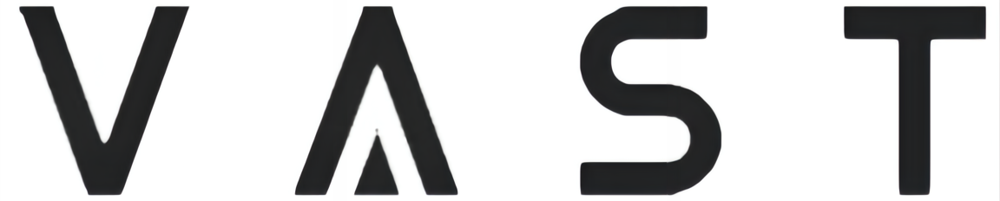 </a>
  <a href="https://www.zju.edu.cn/english/"> </a> 
</h1>

This is the code for SC-GS: Sparse-Controlled Gaussian Splatting for Editable Dynamic Scenes.

<div align="center">
  
[](https://yihua7.github.io/SC-GS-web/)
[](https://arxiv.org/abs/2312.14937)

</div>

<div align="center">
  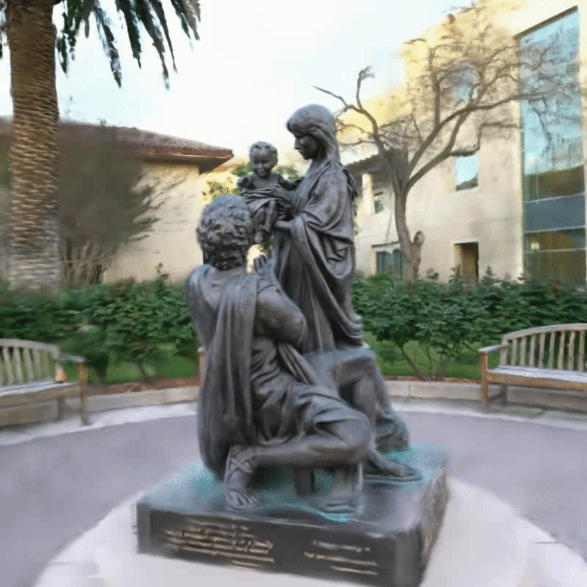
  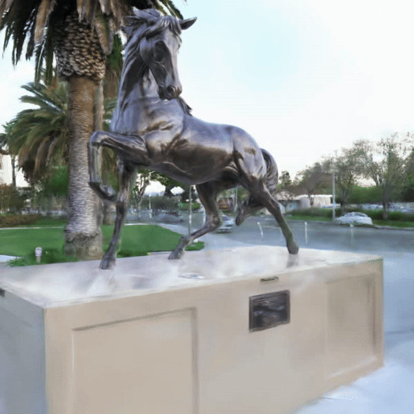
  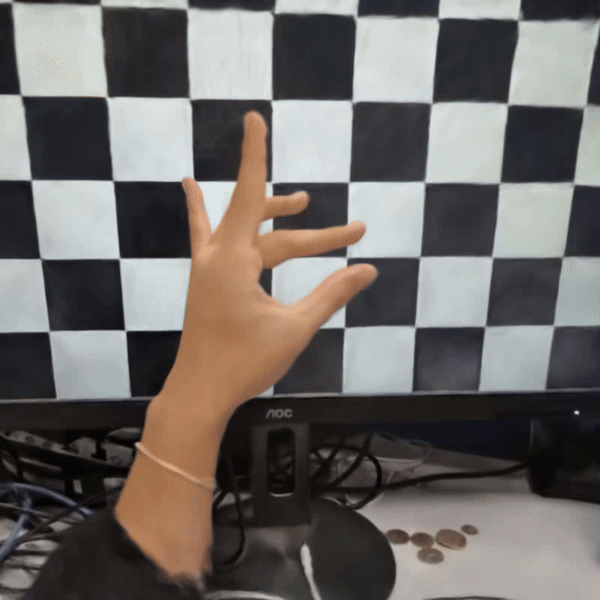
  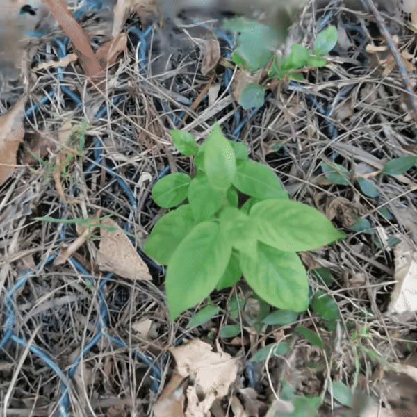
</div>

<div align="center">
  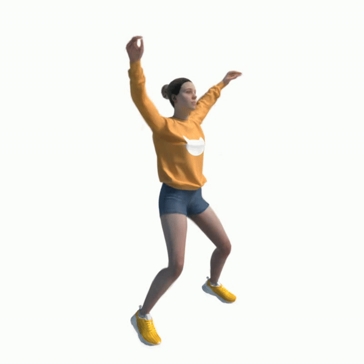
  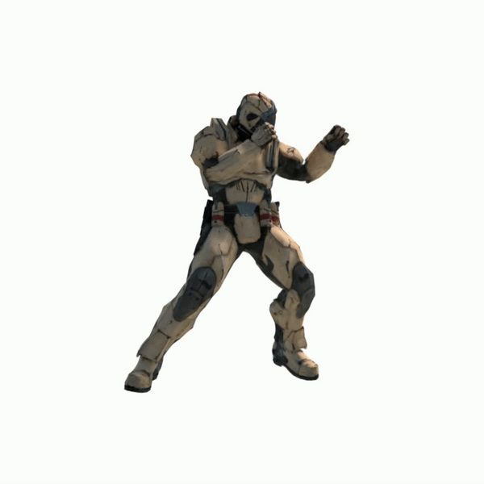
  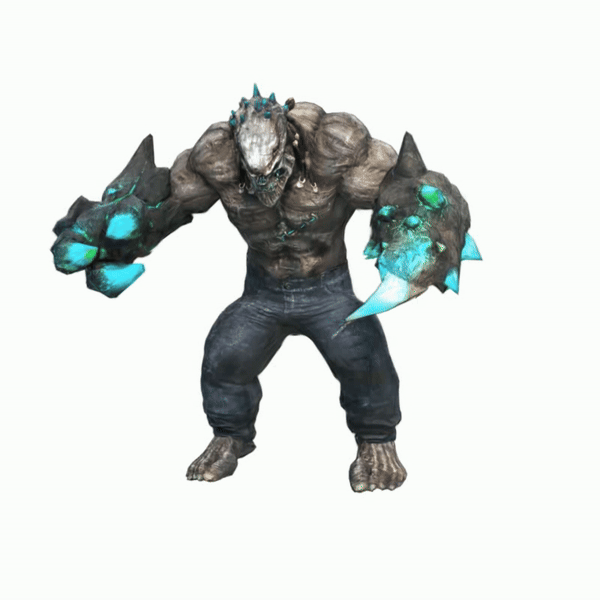
  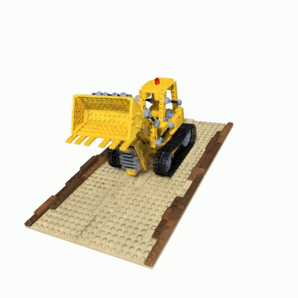
</div>

*With interactive editing empowered by SC-GS, users can effortlessly edit and customize their digital assets with interactive editing features.*

<div align="center">
  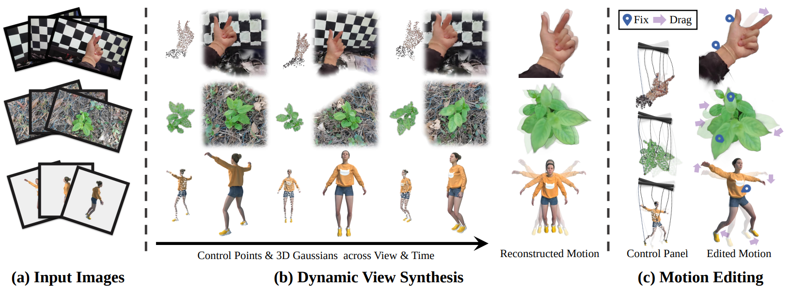
</div>

*Given (a) an image sequence from a monocular dynamic video, we propose to represent the motion with a set of sparse control points, which can be used to drive 3D Gaussians for high-fidelity rendering.Our approach enables both (b) dynamic view synthesis and (c) motion editing due to the motion representation based on sparse control points*


## Updates

### 2025.06.19

<div align="center">
  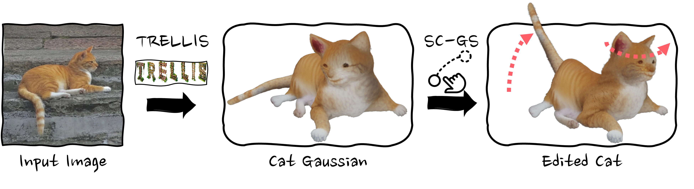
</div>

Now, editing static Gaussians from `.ply` files is supported via [edit_gui.py](./edit_gui.py). The example command below demonstrates editing a Gaussian cat generated by [TRELLIS](https://microsoft.github.io/TRELLIS/):

```bash
python edit_gui.py --gs_path ${PATH_TO_PLY} # --model_path ${PATH_TO_SAVE} # You can save your edited Gaussian to ${PATH_TO_SAVE} by clicking the button `save`
```

### 2025.05.21

#### Editing Real-World Static Objects

Solving a reported issues that invertable laplacian matrix causing slow editing. Editing real world static object is now flexible and show interesting results.

#### 1. Masking the Object to Edit  
When editing, remember to mask the object you want to modify. If you are using MiVOS and encounter an issue with non-digital image names (e.g., `frame_000.jpg` causing errors), you can resolve it by replacing the line in [this file](https://github.com/hkchengrex/MiVOS/blob/f2600a6eea8709c7b9f1a7575adc725def680b81/interact/interactive_utils.py#L26) with the following:  

```python
fnames = sorted(glob.glob(os.path.join(path, '*.jpg')), key=lambda x: int(''.join(char for char in os.path.basename(x).split('.')[0] if char.isdigit())))
```

#### 2. Training and Editing Static Scenes  

Run the following command to train and edit a static scene:  

```bash
CUDA_VISIBLE_DEVICES=0 python train_gui.py \
    --source_path "XXX/person-small" \
    --model_path "outputs/person/" \
    --is_scene_static \
    --gui \
    --deform_type "node" \
    --node_num "512" \
    --gt_alpha_mask_as_dynamic_mask \
    --gs_with_motion_mask \
    --W "800" \
    --H "800" \
    --white_background \
    --init_isotropic_gs_with_all_colmap_pcl
```

#### 3. Editing Results on I-N2N Scenes
By following the editing guidance, you can easily achieve satisfactory geometry editing results on static scenes, as demonstrated in [Instruct-NeRF2NeRF](https://instruct-nerf2nerf.github.io/):  

<div align="center">
  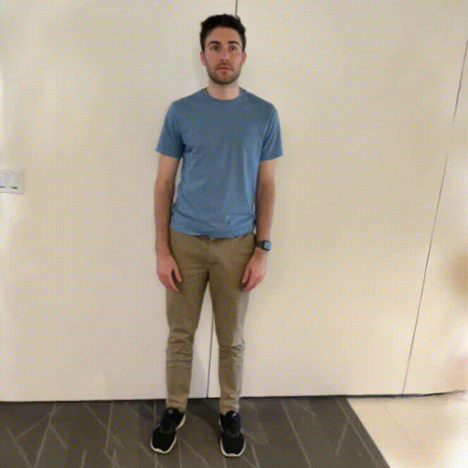
  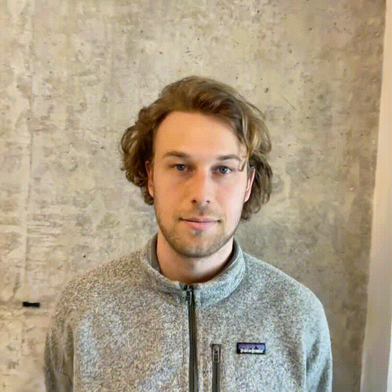
  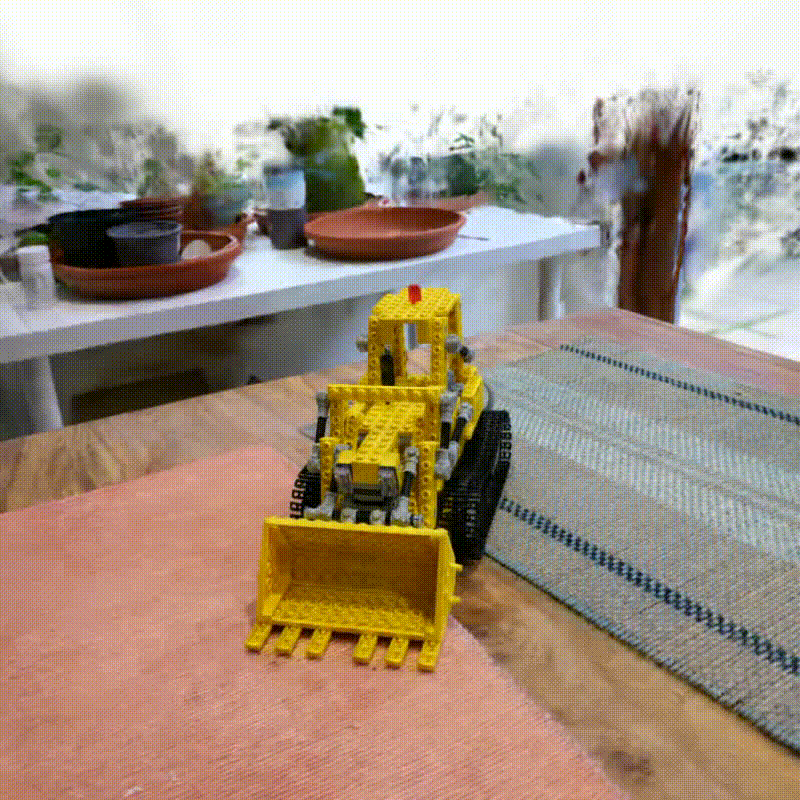
  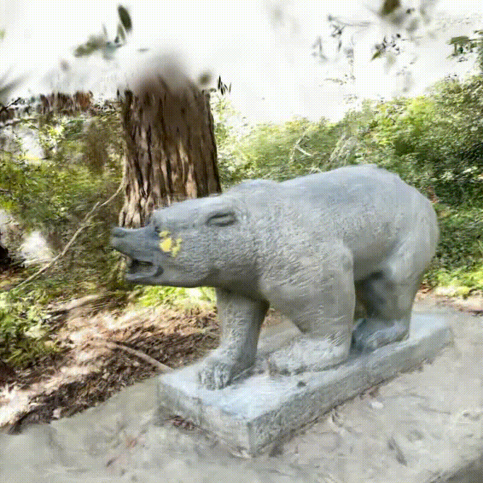
</div>

<div align="center">
  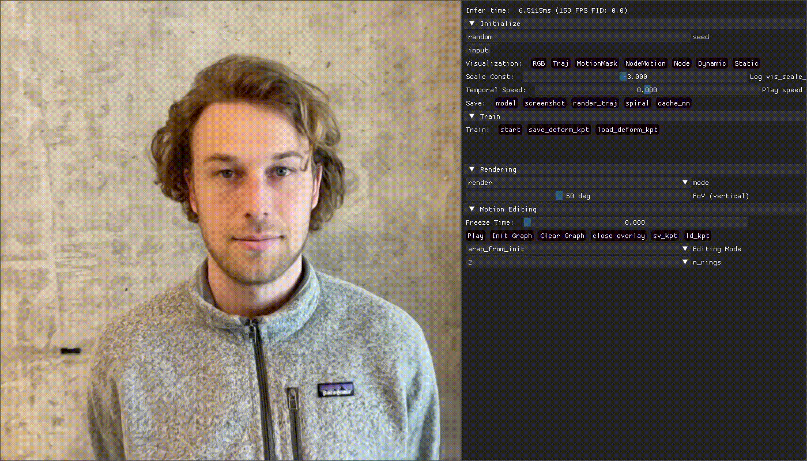
  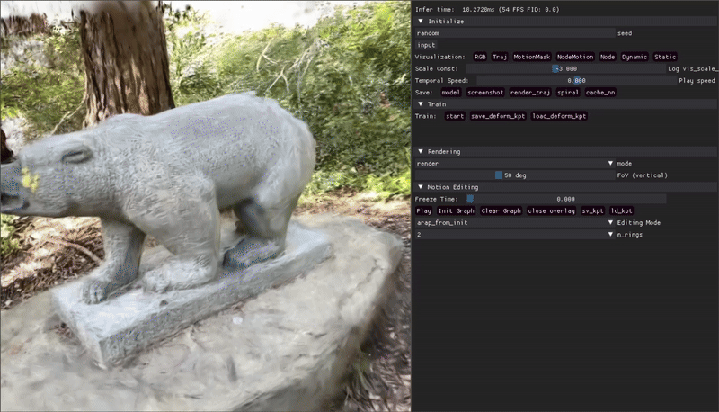
</div>

### 2024-03-17: 

1. Editing **static scenes** is now supported! Simply include the `--is_scene_static` argument and you are good to go!

2. Video rendering is now supported with interpolation of editing results. Press the button `sv_kpt` to save each edited result and press `render_traj` to render the interpolated motions as a video. Click the `spiral` to switch the camera-motion pattern of the rendered video between a spiral trace and a fixed pose.

3. On self-captured real-world scenes where Gaussian number will be too large, the dimension of hyper coordinates that seperate close but disconnected parts can be set to 2 to speed up the rendering: ` --hyper_dim 2`. Also remember to remove `--is_blender` in such cases!

### 2024-03-07

We offer two ARAP deformation strategies for motion editing: 1. iterative deformation and 2. deformation from Laplacian initialization.

### 2024-03-06

To prevent initialization failure of control points, you use the argument `--init_isotropic_gs_with_all_colmap_pcl` on self-captured datasets.


## Install

```bash
git clone https://github.com/yihua7/SC-GS --recursive
cd SC-GS

pip install -r requirements.txt

# a modified gaussian splatting (+ depth, alpha rendering)
pip install ./submodules/diff-gaussian-rasterization

# simple-knn
pip install ./submodules/simple-knn
```

## Run

### AutoDL: render a ready-made model without training

For the AutoDL Python 3.10 / PyTorch 2.1.2+cu121 / CUDA 12.1 image and a T4 or 2080 Ti,
the added setup uses `/root/autodl-tmp/scgs-env` and keeps caches on the data disk.
Run from `/root/autodl-tmp/SC-GS`:

```bash
bash scripts/setup_autodl.sh
source scripts/autodl_env.sh
bash scripts/download_test_model.sh
python render_ply.py \
    --gs_path /root/autodl-tmp/scgs-downloads/splatt3r-example.ply \
    --output /root/autodl-tmp/scgs-results/preview \
    --camera-origin --frames 1 --width 512 --height 384
```

Use a new or empty output directory. This saves PNG images and `summary.json`;
omit `--camera-origin` and set `--frames 24` for an orbit video. The renderer
uses SC-GS's original CUDA rasterizer and does not run any optimizer.

The example is a static Gaussian asset from the
[Splatt3r authors](https://huggingface.co/brandonsmart/splatt3r_v1.0/blob/main/demo_examples/in_the_wild_1.ply),
with a verified SHA256 checksum. It tests model loading and rendering, not SC-GS
dynamic reconstruction or paper metrics. See the source project's license for
reuse conditions. Both `edit_gui.py --gs_path ...` and `render_ply.py` detect
SH degrees 0-3 from the PLY and preserve its stored color coefficients.
Interactive editing requires a graphical display; SSH alone does
not provide one. The headless renderer does not require a display or dataset.

To use your own Gaussian PLY, replace `--gs_path` with its path. Ordinary
point-cloud/mesh PLYs are not supported. A single standard Gaussian PLY contains
one state, not a learned motion sequence, even if its filename includes `dynamic`.
Run format/export regression tests with `python -m unittest discover -s tests`;
export tests need the SC-GS CUDA environment and skip when CUDA is unavailable.
The editor's save path preserves quaternion rotations and SH colors, supports
saving before any deformation, and selects an unused `edit_N.ply` filename.

If pip downloads are throttled on AutoDL, prefetch the pinned dependencies using
curl with HTTP/2 (each download is checked against the official PyPI SHA256):

```bash
# After the setup script has created the virtualenv:
source scripts/autodl_env.sh
python scripts/prefetch_autodl.py --destination /root/autodl-tmp/scgs-downloads/wheelhouse
PIP_NO_INDEX=1 PIP_FIND_LINKS=/root/autodl-tmp/scgs-downloads/wheelhouse bash scripts/setup_autodl.sh
```

### Rigid fan rotation, without training

For the supplied rotor-only `fan_dynamic_gaussians.ply`, this command renders a
fixed-camera, clockwise rotation that smoothly accelerates from rest to 60 RPM
over 2 seconds, then holds that speed:

```bash
source scripts/autodl_env.sh
python render_rotation.py --gs_path fan_dynamic_gaussians.ply \
    --output /root/autodl-tmp/scgs-results/fan-rigid-spin \
    --center 0.2278893872 0.3084347519 0.1445585489 \
    --axis -0.00429996 0.00905835 0.99994973 \
    --rpm 60 --ramp-seconds 2 --duration 6 --fps 60 --direction cw \
    --samples 4 --shutter-fraction 0.5 --show-axis
```

The axis point was estimated from the visible hub in the original render
(pixel 388.5, 411.5 at 768x768), using alpha-normalized depth. The axis direction
was estimated from the rotor's principal plane. These are configurable estimates,
not measured mechanical parameters. `cw` is viewed from the positive axis.
Use a new/empty output directory; the original PLY is never rewritten.

The entire PLY is treated as one rigid rotor: point positions and Gaussian
orientations rotate together while sizes, opacity and colors stay unchanged.
Do not use an unsegmented assembly containing a stationary motor, guard or stand.
The current renderer requires zero directional SH coefficients, as in this fan.
Speed uses a quintic smoothstep; angle is its exact integral. This is prescribed
rigid-body kinematics, **not** an inferred motor-torque or aerodynamic simulation.
Temporal supersampling supplies simple exposure blur. High RPM may require higher
FPS to avoid temporal aliasing, especially for symmetric multi-blade rotors.

Outputs include `preview.mp4`, checkpoint PNGs, per-frame angle/speed/acceleration
in `motion.json`, and geometric invariant checks in `summary.json`.
`--view-angle 25` gives an optional fixed oblique view.

### Export Gaussians + analytic `deform.pth` (no training)

This is a **custom, versioned parameter checkpoint**, NOT the original SC-GS
network `state_dict`. Do not pass it to native `DeformModel.load_weights`,
`render.py` or the native training resume path. Use the companion loader below.
The filename is lowercase `deform.pth` (Linux paths are case-sensitive).

Export the motion from the preceding render, preserving the original Gaussian
PLY byte-for-byte, including every SH coefficient, scale, opacity and quaternion:

```bash
source scripts/autodl_env.sh
python export_rigid_model.py --gs_path fan_dynamic_gaussians.ply \
    --motion-summary /root/autodl-tmp/scgs-results/fan-rigid-spin/summary.json \
    --output /root/autodl-tmp/scgs-results/fan-rigid-model

# Load BOTH saved files and render; the paired PLY is resolved automatically.
python render_rotation.py \
    --deform_path /root/autodl-tmp/scgs-results/fan-rigid-model/deform.pth \
    --output /root/autodl-tmp/scgs-results/fan-rigid-reloaded --show-axis
```

The bundle contains `point_cloud.ply` (canonical state at t=0), `deform.pth`
(axis, center, target RPM, ramp duration, direction and conventions), and a
human-readable `manifest.json`. Both model files can be moved together; they
contain no absolute file dependencies. The loader checks their SHA256 pairing
and uses `torch.load(..., weights_only=True)` without unsafe pickle fallback.
Exporting refuses any existing destination directory. Merely opening the PLY
shows a static model; animation requires applying the checkpoint with the loader.

For another speed/axis, export a **new bundle**, replacing `--motion-summary`
with `--center X Y Z --axis X Y Z --rpm 90 --ramp-seconds 3 --duration 8
--direction cw`. This changes analytic parameters; it performs no training.
Camera settings, exposure and FPS are render options, not motion weights.
`--duration` on the renderer can change preview length without changing motion.

Minimal Python integration (inside the SC-GS CUDA environment):

```python
from utils.rigid_checkpoint import load_rigid_bundle
from scene.gaussian_model import GaussianModel
from gaussian_renderer import render

bundle = load_rigid_bundle("/path/to/fan-rigid-model/deform.pth")
gaussians = GaussianModel(bundle.metadata["gaussians"]["sh_degree"], with_motion_mask=False)
gaussians.load_ply(str(bundle.gs_path))

# camera, pipe and CUDA background are set up as in render_rotation.py.
# Always use the canonical positions; NEVER accumulate last frame's deformation.
motion = bundle.motion.step(gaussians.get_xyz, time_seconds=1.25)
image = render(camera, gaussians, pipe, background, **motion)["render"]
```

Positions follow `x(t) = R(t) @ (x(0) - center) + center`; Gaussian orientation
is left-multiplied by the same rotor quaternion (`w,x,y,z`). Scales and opacity
are unchanged. Time is **seconds**, not normalized 0-1. The 6-second duration is
only a default preview length, not a loop period: the rotor keeps turning at
target speed after the ramp. Evaluation is analytic with floating-point rounding,
not neural approximation or incremental integration. It models the **entire PLY
as one rotor**, with the same appearance and physical limitations described above.
Export/load/evaluate work on CPU with PyTorch, NumPy and plyfile; rendering needs
CUDA. Tests: `python -m unittest discover -s tests -v`.

### Baked moving Gaussians: complete PLY sequence, no checkpoint at playback

To deliver the **already-moving Gaussian data**, bake each timestamp into a
complete Gaussian PLY. This is not a video and not just a motion configuration:
each file contains its final positions and composed Gaussian quaternions.
Every Gaussian retains its row identity, SH coefficients, scales and opacity.

```bash
source scripts/autodl_env.sh
python export_gaussian_sequence.py \
    --deform_path /root/autodl-tmp/scgs-results/fan-rigid-model/deform.pth \
    --camera-summary /root/autodl-tmp/scgs-results/fan-rigid-reloaded/summary.json \
    --output /root/autodl-tmp/scgs-results/fan-moving-gaussians \
    --fps 60 --duration 6

# Playback/render reads only the already-transformed PLY frames.
# It never loads deform.pth or evaluates the rotation law.
python render_gaussian_sequence.py \
    --sequence_path /root/autodl-tmp/scgs-results/fan-moving-gaussians/fan_motion.plyseq.zip \
    --output /root/autodl-tmp/scgs-results/fan-moving-gaussians-preview
```

The ZIP contains `frames/frame_0000.ply` through `frames/frame_0359.ply`,
`sequence.json` (timestamps, FPS and SHA256 for every frame), `README.txt` and
a standalone `load_sequence.py`. The 360 PLYs total about **23.3 GB uncompressed**
for this 260,790-Gaussian asset. The archive is compressed losslessly and streamed
to the data disk; no full-size uncompressed temporary sequence is created.
Keep it on `/root/autodl-tmp`, not the small system disk. Output directories must
be new. Original models and previous outputs are preserved.

Python access to the **stored data**, with no PyTorch/CUDA required:

```python
from utils.gaussian_sequence import GaussianSequence

with GaussianSequence("/path/to/fan_motion.plyseq.zip") as sequence:
    ply = sequence.frame(75)  # t = 75 / 60 = 1.25 seconds
    positions = ply["vertex"]  # x/y/z and all Gaussian attributes are already updated
    ply.write("fan_at_1.25s.ply")
```

After extraction, `from load_sequence import GaussianSequence` also works with
just NumPy and plyfile. The loader accepts the ZIP or its extracted directory.
Any compatible Gaussian PLY viewer can open an individual snapshot. A single
ordinary PLY has no playback clock; to animate, a viewer must advance through
the sequence. The supplied CUDA renderer does this offline and validates every
frame's checksum, static attributes and sampled rigid pair distances. Frames
are instantaneous states (no baked exposure blur), not a native SC-GS learned
4D model or a universally standardized animation file. The startup segment is
not a seamless loop; steady-speed frames can be used separately for looping.

For a smaller **single-file moving Gaussian asset**, pack the same baked frames:

```bash
python pack_gaussian_sequence.py \
    --sequence_path /root/autodl-tmp/scgs-results/fan-moving-gaussians/fan_motion.plyseq.zip \
    --output /root/autodl-tmp/scgs-results/fan-moving-gaussians/fan_motion.npz

python render_gaussian_sequence.py \
    --sequence_path /root/autodl-tmp/scgs-results/fan-moving-gaussians/fan_motion.npz \
    --output /root/autodl-tmp/scgs-results/fan-moving-gaussians-npz-preview
```

`fan_motion.npz` is a lossless baked-data container, **not a neural checkpoint**.
It stores `poses[N,T,7]` with each Gaussian's actual XYZ and wxyz quaternion at
every frame, `base_vertices` with the complete static attributes, `times_seconds`
and `metadata_json`. Nonzero normals add three pose channels. For this fan the
pose array has shape **(260790, 360, 7)**. No motion fitting, interpolation,
decimation or quantization is performed. Colors, scales and opacity are shared
once, not repeated 360 times. The reader can reconstruct each PLY byte-for-byte,
checking it against the original sequence's SHA256. `GaussianSequence` accepts
NPZ as well as the full PLY ZIP and extracted directory. NPZ loading uses about
3 GB of RAM; it is not a universally supported viewer format. The ZIP offers
standard per-frame Gaussian PLY interoperability.

To inspect the already-stored 3D state directly:

```python
import numpy as np

with np.load("fan_motion.npz", allow_pickle=False) as data:
    poses = data["poses"]
    xyz_at_1_25_seconds = poses[:, 75, :3]
    quaternions_at_1_25_seconds = poses[:, 75, 3:7]
    static_gaussian_properties = data["base_vertices"]
```

Use `GaussianSequence("fan_motion.npz").frame(75)` when you need the complete
PLY object with positions and rotations already applied. The NPZ and ZIP both
contain real 3D Gaussians, not rendered pixels. No `deform.pth` is needed to use
either baked representation.

### 实时动态高斯浏览器（AutoDL GPU + 本地浏览器）

`viewer.py` 读取上面导出的 **`fan_motion.npz` 逐帧高斯数据**，首次加载后缓存位置、四元数和静态属性。每次改变时间或视角，都由 CUDA 重新渲染该帧的 3D 高斯；不是 MP4 播放器，也不调用 `deform.pth`。普通静态 PLY 或原版 SC-GS 的网络检查点不能直接作为此查看器的输入。

在 AutoDL 终端启动（已配置的服务器不需要重复安装依赖）：

```bash
cd /root/autodl-tmp/SC-GS
source scripts/autodl_env.sh
# 仅在缺少 aiohttp 时运行：pip install -r requirements-viewer.txt
python viewer.py \
  --sequence_path /root/autodl-tmp/scgs-results/fan-moving-gaussians/fan_motion.npz \
  --port 8890
```

在本机另一个终端建立 SSH 隧道，并保持终端打开：

```bash
ssh -p 38063 -N -L 127.0.0.1:8890:127.0.0.1:8890 root@region-41.seetacloud.com
```

浏览器打开 **http://127.0.0.1:8890**。密码只在 SSH 提示时输入，不保存在代码中。服务仅绑定回环地址，拒绝跨站 WebSocket 连接；不需要 AutoDL 公网暴露端口，也不依赖 CDN。

界面支持播放/暂停、时间轴、前后逐帧、0.25–2× 播放速度、循环、正视/斜视/侧视、深浅背景、512/768/1024 分辨率及 PNG 截图。拖动旋转视角，Shift + 拖动或右键拖动平移，滚轮缩放，双击或 `R` 重置；`Space` 播放/暂停，方向键逐帧查看。切换浏览器标签页自动暂停以节省 GPU。

风扇序列有 260,790 个高斯、360 帧、60 FPS 采样、6 秒时长，前 2 秒从静止平滑加速至 60 RPM。循环播放会从静止重新开始。查看器使用已烘焙的数据，不改变转速曲线或训练模型。界面显示的 RPM 来自序列元数据，仅供参考。

运动张量约占 2.45 GiB 显存，另需渲染缓冲和静态属性；首次加载也需要数 GiB 系统内存。默认 `--cache auto` 在显存不足时改用 CPU 缓存；可手动指定 `--cache cpu`。它仍需要服务器上的 CUDA 光栅化器，本机浏览器不需要 CUDA。输入须为 `pack_gaussian_sequence.py` 输出的 NPZ，并带 `preview_camera` 元数据；大型不可信文件不应在服务上加载。

连续播放使用 **服务器主动推送 + 浏览器帧缓冲 + 显示器刷新节奏调度**，不再逐帧等待网络往返，也不在网络数据到达的瞬间直接显示。单视窗默认目标 60 FPS；启动预缓冲最多 20 帧（30 FPS 时 12 帧）；服务端、网络及浏览器合计最多提前 24 帧，通过已显示帧的确认消息限制发送量。可选 30 FPS 节省带宽。目标帧率不是保证值，实际性能仍取决于网络和浏览器。

显示 FPS 统计实际画面呈现频率，`ms 渲染` 是 GPU 渲染加图像回读耗时。播放按固定帧间隔和所选倍速推进，风扇的高斯状态、旋转轨迹与转速曲线不变，不使用图像插帧或视频替代三维渲染。网络不足时显示缓冲状态，补足后继续，不用快速追帧来掩盖断流。暂停后可逐帧检查全部状态，暂停且视角不变时不持续请求渲染。

拖动/缩放视角时暂缓运动，优先返回低延迟视角预览；松开后清空旧视角帧并恢复连续播放。暂停、时间轴跳转、改变倍速或背景同样会使旧缓存失效，避免旧画面突然返回。建议先保持默认 `768 px / 60 FPS`；网络较慢时选 `512 px` 或 `30 FPS`。

验证命令：

```bash
python -m unittest discover -s tests -v
python scripts/benchmark_gaussian_viewer.py --url http://127.0.0.1:8890
node --test tests/test_viewer_playback.cjs
```

可选浏览器端到端测试位于 `scripts/test_gaussian_viewer_ui.cjs`，需要单独安装 `playwright-core` 并设置 `SCGS_PLAYWRIGHT_PATH`、`SCGS_CHROME_PATH`（见脚本顶部）。`scripts/measure_viewer_smoothness.cjs` 使用同样环境变量测量真实画面呈现间隔，报告 FPS、P95/P99、超过 50 ms 的停顿及跳帧；可用 `SCGS_MEASUREMENT_OUTPUT=路径.json` 保存报告。它不是用网络收包速率冒充显示 FPS。测试默认针对当前风扇实例，截图和报告存入 `outputs/fan-viewer-ui/`。服务重启命令同上；若关闭 AutoDL 实例，需重新启动服务和 SSH 隧道。

### Lego 单视角原始事件监督（实验版，尚未通过验收）

允许 `Lego.blend` 提供运动初始化，但初始化动画不等于事件监督结果。
`Lego_event` 中的原始 `x,y,t,p` 用来校准时间和有效对比度阈值，并约束实际
高斯渲染的对数亮度变化；`Lego_event_video.mp4` 仅是可视化，不替代原始事件。
当前校正器只优化共享运动坐标，冻结颜色、不透明度、尺度与相机，保留原刚体
运动关系。这是有限参数的运动校正，不是原版 SC-GS 变形网络训练。

AutoDL 工作副本在 `/root/autodl-tmp/SC-GS`；输入仍使用
`/root/SC-GS/Lego_data`，不会覆盖原始数据。已配置的环境使用：

```bash
cd /root/autodl-tmp/SC-GS
source scripts/autodl_env.sh
python -m unittest tests.test_event_supervision tests.test_event_refinement -v
```

下面命令要求输出目录尚不存在。初始化缓存由
`scripts/cache_lego_initial_motion.py` 生成，含逐帧高斯位姿而非视频替代品。

```bash
python scripts/prepare_lego_events.py \
    --data /root/SC-GS/Lego_data \
    --output /root/autodl-tmp/scgs-results/lego-event-supervision-new

python scripts/refine_lego_events.py \
    --baseline /root/autodl-tmp/scgs-results/lego-event-baseline \
    --supervision /root/autodl-tmp/scgs-results/lego-event-supervision-new/supervision.npz \
    --output /root/autodl-tmp/scgs-results/lego-event-refinement-new \
    --train-resolution 640 --iterations 400
```

默认在 640×640 渲染后计算对数亮度差，再汇总为 80×80 进行运动检查。
每五个事件区间留出一个不参与事件拟合；相邻 RGB 帧仍可能参与优化，因此不是
独立场景测试。检查包含事件变化相关性、亮度极性、变化幅度和无事件支持的变化。
无事件或参考视频自身也不可靠的区间不能直接判定正确。此检查只覆盖相邻
60 FPS 帧之间的累计变化，不保证帧间微秒级轨迹、精细光流方向或不可见面的三维运动。

输出 `correction.json`、`rendered_gray.npy`、预览和 `event-audit.json`。
审计记录逐区间原因、留出集结果以及模型/监督/渲染的 SHA256。
验收不通过时退出码为 **2**，不导出最终动态高斯。
即使通过，本脚本也仅产生候选校正和审计；浏览器预览需要下面的烘焙步骤。
不得将 `correction.json` 改名成 SC-GS 的 `Deform.pth`。

2026-10-14 实测：初始动画平均事件余弦 0.782，640 分辨率校正后为 0.831；
严格检查仅通过 92/399 个区间，留出事件区间通过 18/79。
因此当前结果仍为 **未通过**，不能宣称已经满足事件运动要求。
铲臂预览存在残留和错位，后续需要改进高斯与零件的绑定及局部运动模型；
不能靠放宽阈值、冻结运动或隐藏失败区间宣布完成。
原 `export_lego_sequence.py` 是未加事件监督的 Blender 动画转移流程，
其输出不能替代这里的事件验收。

#### 查看事件校正后的候选高斯

用户要求查看当前结果时，可以显式导出尚未验收的候选预览。此操作不会改变
`approved_for_export: false`，也不会覆盖原始高斯。预览器会显示全序列验收状态
以及当前时间段是否通过粗尺度事件检查；自由视角未经事件验证。

```bash
python scripts/export_lego_event_preview.py \
    --baseline /root/autodl-tmp/scgs-results/lego-event-baseline \
    --candidate /root/autodl-tmp/scgs-results/lego-event-checked \
    --output /root/autodl-tmp/scgs-results/lego-event-ui \
    --allow-unapproved-preview

python viewer.py \
    --sequence_path /root/autodl-tmp/scgs-results/lego-event-ui/lego_event_candidate.npz \
    --host 127.0.0.1 --port 8892 --cache auto
```

新预览包包含 1,841,816 个高斯，其中 430,402 个更新位置与朝向，共 400 帧。
它保存真实三维高斯轨迹，不是视频，也不需要播放时重新运行 Blender 或优化器。
先通过 SSH 将远端 `127.0.0.1:8892` 转发到本机，再打开
`http://127.0.0.1:8892/?autoplay=1&loop=1` 即可自动循环预览。
默认 640 px / 30 FPS；可暂停、拖动时间轴、旋转、缩放和保存当前画面。
关闭网页会停止渲染请求，但服务器模型仍留在 GPU 中，直到停止服务或关闭实例。

#### 同步双视窗与连杆完整性改进

```bash
python viewer.py \
    --comparison_path /root/autodl-tmp/scgs-results/lego-comparison/manifest.json \
    --host 127.0.0.1 --port 8892 --cache auto
```

打开 `http://127.0.0.1:8892/?autoplay=1&loop=1&compare=final`。
左侧始终使用 `lego-event-baseline` 的未校正动画；右侧使用
`lego-raft-visible-baseline` 的运动绑定及 `lego-event-articulated/correction.json`。
旧版 93/399 配置保存在 `outputs/lego-comparison/manifest-visible-v1.json`，原结果未覆盖。
左右共享时间轴、相机和背景，每个网络图像包同时包含同一帧的两张实时高斯渲染。
原始方形相机画面留边适配双面板，避免 UI 裁切被误认为模型缺损。
两边运动掩码不同，渲染前会还原全部高斯，防止左右状态串扰。
GPU 位姿缓存根据空闲显存设定上限，最多 448 个单侧帧，并预留 1.5 GiB。
双视窗启动时先渲染默认视角的全部 400 个源帧，之后同视角循环直接复用
完全相同的 JPEG，省去重复 CUDA 渲染、显存回读和编码。图像缓存最多 96 MiB / 1200 项；
缓存键包括帧、相机全部参数、尺寸、背景和质量，改变任何一项都会重新渲染。
每次发送重新生成请求 ID 和流序号，不会复用旧的时间轴信息。UI 会标示“同视角缓存”。
这不会减少高斯数量、插值修改运动，也不是用输入视频替换高斯；新视角仍可交互渲染。
播放按显示器刷新时间调度，允许最多 2 ms 的刷新抖动，避免 30 FPS 下出现
50 / 16 ms 交替持帧。右侧状态显示缓冲帧数及断流次数。
浏览器还为当前播放流保留最多 64 MiB 压缩 JPEG（不是数百张解码位图）。
只有客户端明确确认已保留的帧，服务器才会在下一次播放时发送小型索引包；
更换相机、分辨率或播放流时双方缓存协议重置，旧客户端仍可接收完整图片。
双视窗默认“自动 · 流畅优先”：预热默认视角目标 60 FPS，新视角目标 30 FPS；
60 FPS 连续发生两次断流时自动降至 30 FPS，运动仍按原始时间戳和倍速前进。
也可手动固定 30/60 FPS。点击重新选择自动档可重试 60 FPS。

通过本机 SSH 隧道检查传输及播放调度（不包含浏览器 JPEG 解码/Canvas 绘制）可运行：

```bash
node scripts/benchmark_viewer_stream.cjs http://127.0.0.1:8892 15 30 640 12
```

真实浏览器的呈现 FPS 以界面读数为准；`window.gaussianViewerStats` 还记录
断流、丢帧、解码/绘制耗时及缓存命中数，用于区分网络与浏览器瓶颈。

改进流程：`scripts/rebind_lego_motion.py` 利用前后向一致的视频轨迹重新判断
刚体运动组；`scripts/filter_lego_binding_visibility.py` 依据初始渲染深度与透明度，
保护被遮挡高斯的原始绑定；随后 `scripts/refine_lego_events.py --foreground-weight 8`
执行原始事件约束加可见前景覆盖约束的优化。没有改颜色、透明度、尺度、相机或原始 PLY，
也没有通过视频播放、后处理补洞或冻结运动冒充重建。

2026-10-14 第一版对比：未校正 → `lego-event-visible` 候选，平均事件余弦 0.7825 → 0.8318；
事件活动区域的可见前景缺失率 2.662% → 2.148%（相对下降约 19.3%），
额外前景比例 9.325% → 8.889%。相比上一轮单视窗事件校正版，缺失率
2.454% → 2.148%（下降约 12.5%）。缺失率是在参考视角、强度阈值 0.08、
全序列事件像素并集向外扩张 3 像素的区域中统计，不代表三维缺损或断臂数量。

该旧版原始事件严格验收通过 93/399 个时间段，留出事件区间通过 18/79。
另一个候选 `lego-event-coverage` 的事件余弦更高（0.8626），但可见缺失率为
2.637%；默认方案优先保护完整性，不声称各项同时最优。最新默认结果见下节。
单视角不能确定不可见面的真实形状，残留碎片和局部缺口仍存在。

#### 平滑时序与部件级事件校正

`scripts/refine_lego_temporal.py` 扩展旧版整段共用 7 参数的校正：

- `v2` 使用 17 个三次插值控制点描述平滑的时变校正。每个刚体的内部距离不变。
- `v3` 再加入运动组级的刚体旋转/平移残差，能够调整原先相似变换共轭无法改变的
  关节旋转幅度。残差最多每轴 4 度、平移每轴 0.012 场景单位，按平滑的源运动
  幅度包络启用，初始帧保持不变。
- 部件接触约束由初始化中始终邻近的高斯对构建，另外保护近静止锚点。
  它是保守的连接正则，不等同于已知真实骨架或物理仿真。
- 损失同时检查 40/80/160 像素的事件变化、极性、RGB 和前景覆盖；保持高斯颜色、
  不透明度、尺度及输入 PLY 不变，不用图像变形、删除高斯或冻结动画获取分数。
- 每第五个事件区间仍不参与梯度和训练探针选择；相邻 RGB 帧可以参与。
  最终仍按原有 80 像素逐区间标准重渲染审计所有 399 段，弱证据区间不豁免。

可选的绑定初始化 `scripts/rebind_lego_motion.py --flow raft-small` 使用
[Torchvision 0.16 官方 RAFT-small](https://docs.pytorch.org/vision/0.16/models/generated/torchvision.models.optical_flow.raft_small.html)
权重构建四帧步长的双向一致轨迹；模型缓存保存在 AutoDL 数据盘，不上传视频或事件。
光流只提供绑定建议，不能代替原始事件校正与审计。

以下例子输出目录必须尚不存在：

```bash
python scripts/refine_lego_temporal.py \
  --baseline /root/autodl-tmp/scgs-results/lego-raft-visible-baseline \
  --supervision /root/autodl-tmp/scgs-results/lego-event-supervision/supervision.npz \
  --initial-correction /root/autodl-tmp/scgs-results/lego-event-raft-temporal/correction.json \
  --parts /root/autodl-tmp/scgs-results/lego-event-init/blender-surface-parts.npz \
  --binding /root/autodl-tmp/scgs-results/lego-raft-visible-binding/initial-binding.npz \
  --foreground-weight 12 --lr 0.01 --iterations 800 \
  --output /root/autodl-tmp/scgs-results/lego-event-articulated-new
```

省略 `--parts/--binding` 则使用 v2。模型、渲染、初始化和原始 PLY 的 SHA256
绑定到审计记录；查看器及导出器共同使用 `correction_from_record`，支持 v1/v2/v3。
审计未通过仍以退出码 2 结束且保留诊断，不会伪装成正式验收通过。
UI 会额外显示留出区间结果和当前失败原因（幅度、极性、分布或不受事件支持的变化）。

2026-10-14 本轮完成：默认右侧切换到 `lego-event-articulated`，左侧未校正动画不变。

| 同标准全序列检查 | 旧版 visible | 当前 articulated |
| --- | ---: | ---: |
| 通过区间 | 93/399 | 113/399 |
| 平均事件余弦 | 0.831850 | 0.850432 |
| 平均相对 L1 | 0.691661 | 0.650994 |
| 留出事件通过 | 18/79 | 22/79 |
| 留出事件相对 L1 | 0.638789 | 0.607487 |
| 可见前景缺失率 | 2.1481% | 2.0679% |
| 轮廓 IoU | 0.893467 | 0.898012 |

当前结果仍是未整段通过的候选，不能称为完整无误的动态重建。266 段有幅度误差，
146 段有极性误差（原因可以重叠）。10 段参考自检证据偏弱，仍计入 399 段，未豁免。
留出事件不参与梯度和训练探针选权重，但本轮多候选比较也查看其结果，因此不是
全新独立测试集；相邻 RGB 可以参与训练。

13 个运动组使用 202 对先验接触约束、39 个近静止锚点；400 帧数值有限，初始帧
不变。每帧抽样 208 对组内高斯检查新增变换，最大距离误差 8.94e-8 场景单位。
这只验证新增校正的刚性，不证明真实关节约束或物理动力学完全正确。
1841816 个原始高斯均保留，颜色、透明度、尺度与相机均冻结。

首帧部件射线初始化的附加实验也已保留：`scripts/export_lego_part_mask.py`
在禁用自动执行的 Blender 中只读取初始帧部件；`scripts/bind_lego_part_mask.py`
仅重新分配深度可见刚体高斯，保留隐藏几何与弹性带对应关系。它随后经过相同的
原始事件校正，`lego-event-semantic` 最终通过 103/399、余弦 0.831233，未选为默认。
所有实验、阈值和完整性检查保留在 `outputs/lego-event-*/`；云端还保留全帧渲染和位姿缓存。

### Train wit GUI

* To begin the training, select the 'start' button. The program will begin with pre-training control points in the form of Gaussians for 10,000 steps before progressing to train dynamic Gaussians.

* To view the control points, click on the 'Node' button found on the panel located after 'Visualization'.

```bash
# Train with GUI (for the resolution of 400*400 with best PSNR)
CUDA_VISIBLE_DEVICES=0 python train_gui.py --source_path YOUR/PATH/TO/DATASET/jumpingjacks --model_path outputs/jumpingjacks --deform_type node --node_num 512 --hyper_dim 8 --is_blender --eval --gt_alpha_mask_as_scene_mask --local_frame --resolution 2 --W 800 --H 800 --gui

# Train with GUI (for the resolution of 800*800)
CUDA_VISIBLE_DEVICES=0 python train_gui.py --source_path YOUR/PATH/TO/DATASET/jumpingjacks --model_path outputs/jumpingjacks --deform_type node --node_num 512 --hyper_dim 8 --is_blender --eval --gt_alpha_mask_as_scene_mask --local_frame --W 800 --H 800 --random_bg_color --white_background --gui
```

### Train with terminal

* Simply remove the option `--gui` as following:

```bash
# Train with terminal only (for the resolution of 400*400 with best PSNR)
CUDA_VISIBLE_DEVICES=0 python train_gui.py --source_path YOUR/PATH/TO/DATASET/jumpingjacks --model_path outputs/jumpingjacks --deform_type node --node_num 512 --hyper_dim 8 --is_blender --eval --gt_alpha_mask_as_scene_mask --local_frame --resolution 2 --W 800 --H 800
```

### Evalualuate

* Every 1000 steps during the training, the program will evaluate SC-GS on the test set and print the results **on the UI interface and terminal**. You can view them easily.

* You can also run the evaluation command by replacing `train_gui.py` with `render.py` in the command of training. Results will be saved in the specified log directory `outputs/XXX`. The following is an example:

```bash
# Evaluate with GUI (for the resolution of 400*400 with best PSNR)
CUDA_VISIBLE_DEVICES=0 python render.py --source_path YOUR/PATH/TO/DATASET/jumpingjacks --model_path outputs/jumpingjacks --deform_type node --node_num 512 --hyper_dim 8 --is_blender --eval --gt_alpha_mask_as_scene_mask --local_frame --resolution 2 --W 800 --H 800
```

## Editing

### 2 min editing guidance:

(The video was recorded prior to the addition of the editing mode selection menu in the UI. In the video, the deformation was performed using the `arap_from_init` method.)

https://github.com/yihua7/SC-GS/assets/35869256/7a71d29b-975e-4870-afb1-7cdc96bb9482

### Editing Mode

We offer two deformation strategies for editing: **(1)** iterative ARAP deformation and **(2)** ARAP starts with the initial frozen moment. Users can select their preferred strategy from the Editing Mode drop-down menu on the UI interface.

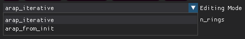

(1) **Iterative deformation (`arap_iterative`)**:

- **Pros**: It allows easy achievement of large-scale deformation without rotating artifacts.

- **Cons**: It may be difficult to revert to the previous state after unintentionally obtaining unwanted deformations due to the iterative state update.

(2) **Deformation from the initial frozen moment (`arap_from_init`)**:

- **Pros**: It ensures that the deformed state can be restored when control points return to their previous positions, making it easier to control without deviation.

- **Cons**: For large-scale rotational deformation, ARAP algorithm may fail to achieve the optimum since the initialization from the Laplace deformation is not robust to deal with rotation. This may result in certain areas not experiencing corresponding large-scale rotations.

**Users can personally operate and experience the differences between the two strategies. They can then choose the most suitable strategy to achieve their desired editing effect.**

### Tips on Editing with the deformation from the initial frozen moment (`arap_from_init`)

1. **When and why will artifacts appear when using `arap_from_init`?** Most artifacts of editing are caused by the inaccurate initialization of ARAP deformation, which is an iterative optimization process of position and rotation. To optimize both position and rotation to a global optimum, a good initialization of ARAP is highly required. The mode `arap_from_init` uses Laplacian deformation for initialization, which only minimizes the error of the Laplacian coordinate that changes related to rotation. Hence Laplacian deformation is not robust enough for rotation, resulting in inaccurate initialization in the face of large rotation. As a result, some areas fail to achieve correct rotations in subsequent ARAP deformation results.

2. **How to deal with artifacts?** To address this issue, the following steps are recommended, of which the core idea is to **include as many control points as possible** for large-scale deformation: (1) If you treat a big region as a rigid part and would like to apply a large deformation, use more control points to include the whole part and manipulate these control points to deform. This allows for a better Laplacian deformation result and better initialization of ARAP deformation. (2) Edit hierarchically. If you need to apply deformation of different levels, please first add control points at the finest part and deform it. After that, you can include more control points; treat them as a rigid body; and perform deformation of larger levels.

3. More tips: (1) To more efficiently add handle points, you can set the parameter `n_rings` to 3 or 4 on the GUI interface. (2) You can press `Node` button to visualize control points and check if there are any points in the region of interest missed. Press `RGB` to switch back the Gaussian rendering.

4. The above are some operational tricks for editing with `arap_from_init`, which require a sufficient understanding of ARAP deformation or more practice and attempts. This will allow for a clearer understanding of how to operate and achieve the desired deformation results.

## SOTA Performance

Quantitative comparison on D-NeRF datasets. We present the average PSNR/SSIM/LPIPS (VGG) values for novel view synthesis on dynamic scenes from D-NeRF, with each cell colored to indicate the best, second best, and third best.
<div align="center">
  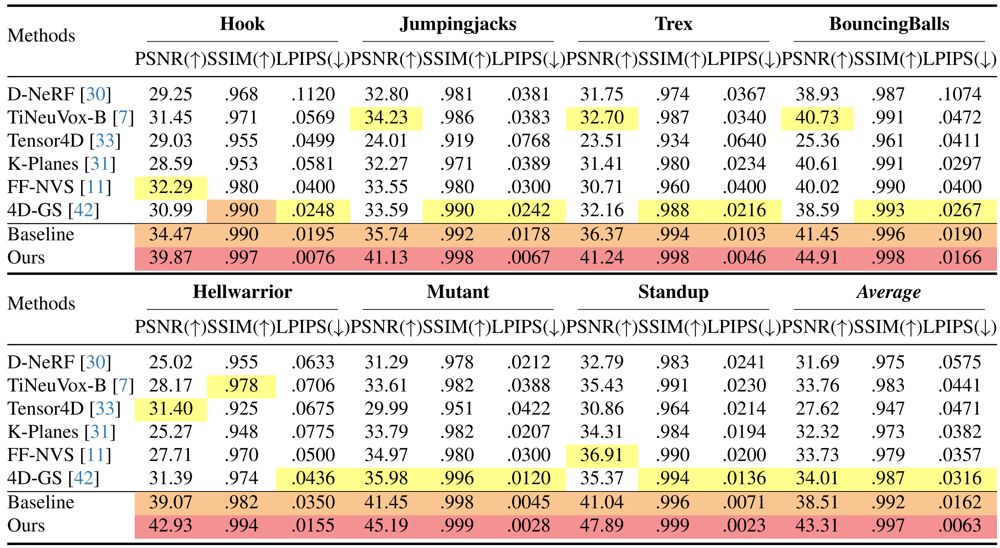
</div>

## Dataset

Our datareader script can recognize and read the following dataset format automatically:

* [D-NeRF](https://www.albertpumarola.com/research/D-NeRF/index.html): dynamic scenes of synthetic objects ([download](https://www.dropbox.com/s/0bf6fl0ye2vz3vr/data.zip?e=1&dl=0))

* [NeRF-DS](https://jokeryan.github.io/projects/nerf-ds/): dynamic scenes of specular objects ([download](https://github.com/JokerYan/NeRF-DS/releases/tag/v0.1-pre-release))

* Self-captured videos: 1. install [MiVOS](https://github.com/hkchengrex/MiVOS) and place [interactive_invoke.py](data_tools/interactive_invoke.py) under the installed path. 2. Set the video path in [phone_catch.py](data_tools/phone_catch.py) and run ```python ./data_tools/phone_catch.py``` to achieve frame extraction, video segmentation, and COLMAP pose estimation in sequence. Please refer to [NeRF-Texture](https://github.com/yihua7/NeRF-Texture) for detailed tutorials.

* Static self-captured scenes: For self-captured static scenes, editing is now also supported! Simply include the `--is_scene_static` argument and you are good to go!

**Important Note for Using Self-captured Videos**: 

* Please remember to remove `--is_blender` option in your command, which causes the control points to be initialized from random point clouds instead of COLMAP point clouds. 
* Additionally, you can remove `--gt_alpha_mask_as_scene_mask` and add `--gt_alpha_mask_as_dynamic_mask --gs_with_motion_mask` if you want to model both the dynamic foreground masked by MiVOS and the static background simultaneously.
* If removing `--is_blender` still meets the failure of control point initialization, please use the option: `--init_isotropic_gs_with_all_colmap_pcl`. This will initialize the isotropic Gaussians with all COLMAP point clouds, which can help avoid the risk of control points becoming extinct.
* The dimension of hyper coordinates that seperate close but disconnected parts can be set to 2 to avoid the slow rendering: `--hyper_dim 2`.


## Acknowledgement

* This framework has been adapted from the notable [Deformable 3D Gaussians](https://github.com/ingra14m/Deformable-3D-Gaussians), an excellent and pioneering work by [Ziyi Yang](https://github.com/ingra14m).
```
@article{yang2023deformable3dgs,
    title={Deformable 3D Gaussians for High-Fidelity Monocular Dynamic Scene Reconstruction},
    author={Yang, Ziyi and Gao, Xinyu and Zhou, Wen and Jiao, Shaohui and Zhang, Yuqing and Jin, Xiaogang},
    journal={arXiv preprint arXiv:2309.13101},
    year={2023}
}
```

* Credits to authors of [3D Gaussians](https://repo-sam.inria.fr/fungraph/3d-gaussian-splatting/) for their excellent code.
```
@Article{kerbl3Dgaussians,
      author       = {Kerbl, Bernhard and Kopanas, Georgios and Leimk{\"u}hler, Thomas and Drettakis, George},
      title        = {3D Gaussian Splatting for Real-Time Radiance Field Rendering},
      journal      = {ACM Transactions on Graphics},
      number       = {4},
      volume       = {42},
      month        = {July},
      year         = {2023},
      url          = {https://repo-sam.inria.fr/fungraph/3d-gaussian-splatting/}
}
```

## Citing
If you find our work useful, please consider citing:
```BibTeX
@article{huang2023sc,
  title={SC-GS: Sparse-Controlled Gaussian Splatting for Editable Dynamic Scenes},
  author={Huang, Yi-Hua and Sun, Yang-Tian and Yang, Ziyi and Lyu, Xiaoyang and Cao, Yan-Pei and Qi, Xiaojuan},
  journal={arXiv preprint arXiv:2312.14937},
  year={2023}
}
```
