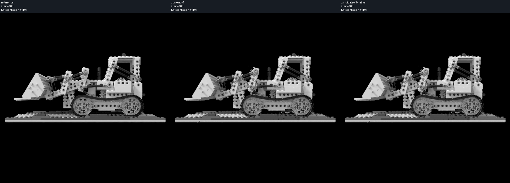
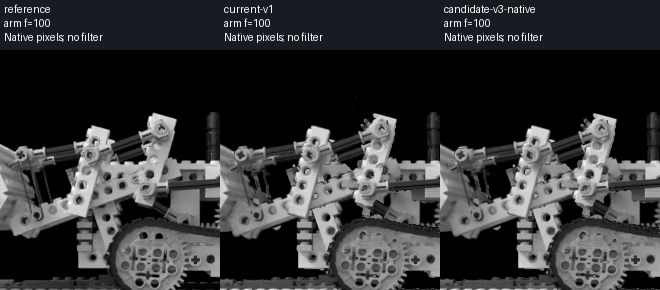
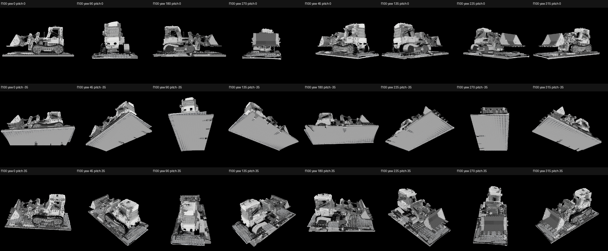
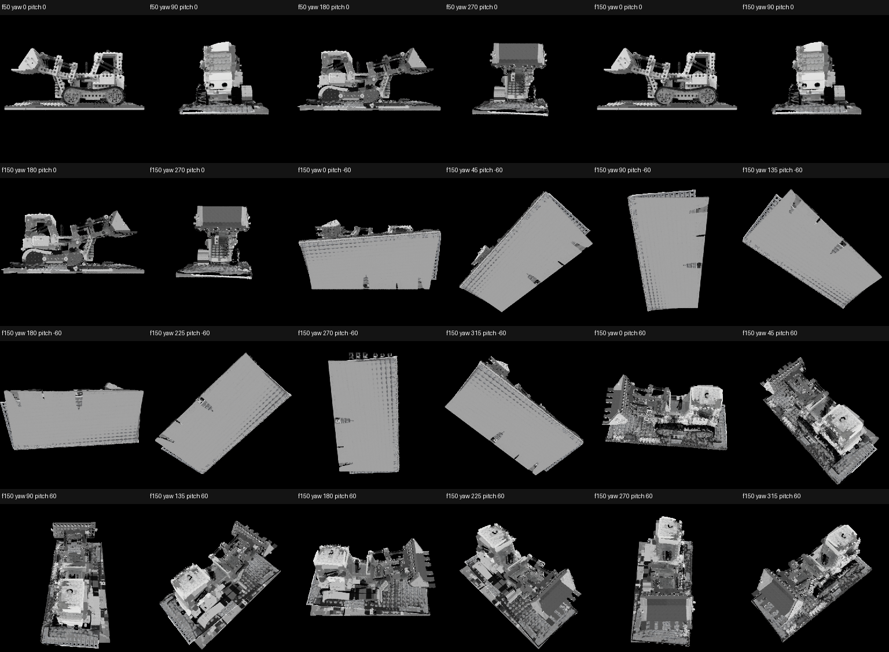
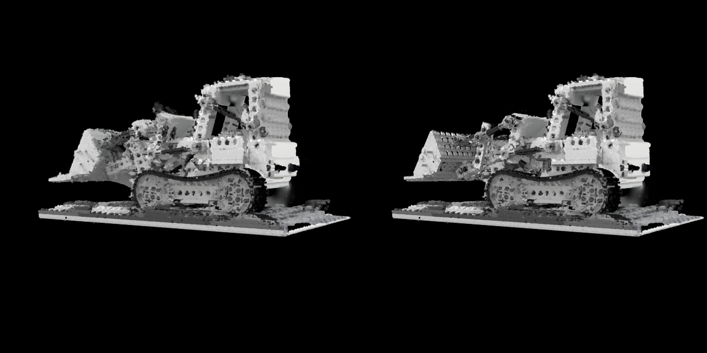

# MonoEvent-RT3D-DMR

基于单目 RGB、原始事件流与 3D Gaussian Splatting 的实时动态三维重建研究代码。

本项目在 SC-GS 的动态高斯表示基础上，加入事件时间标定、刚性部件绑定、时序关节校正、局部外观细化、多视角几何先验补全，以及面向浏览器的实时 CUDA 渲染。当前实验对象为带关节运动的 Lego 工程车。

> 当前状态（2026-10-14）：最新候选为 `lego-detail-v3`，399 个事件区间中通过 380 个。该结果仍未通过全序列严格验收，因此仓库将其标记为研究候选，而不是完整重建结论。

## 主要功能

- 读取单目 RGB 视频及原始 `x, y, t, p` 事件流，自动校准事件时间偏移与正负对比度阈值。
- 使用稀疏控制、刚体分组与硬关节前向运动学描述动态高斯运动。
- 仅用训练事件区间优化平滑时序校正，并对全部 399 个区间重新渲染审计。
- 在冻结几何和运动的前提下，对重建刚性表面的颜色、尺度和不透明度进行局部细化。
- 使用 Blender 三角网格作为明确标注的几何先验，补全观测相机不可见的背面与侧面。
- 在服务器 GPU 上实时渲染动态高斯，通过本地浏览器完成播放、逐帧检查和自由视角观察。
- 保存输入、模型、校正参数及审计结果的 SHA-256，避免不同实验产物被误配。

## 方法流程

1. **事件监督构建**：从 RGB 视频与原始事件流生成统一时间轴、事件计数和固定训练/留出划分。
2. **动态初始化**：从已有高斯、Lego 部件及相机参数生成 400 帧基础运动缓存。
3. **运动与关节校正**：利用原始事件变化、前景覆盖和接触约束优化平滑刚体运动。
4. **表面与外观细化**：修复可见刚性表面，并只调整新增表面的外观属性。
5. **多视角先验补全**：加入仅在轨道视角可见、在观测相机中不可见的网格先验采样点。
6. **独立审计与浏览**：执行事件一致性、部件完整性、多视角覆盖和序列化一致性检查。

## 最新实验结果

以下数字来自本地保存的 `lego-detail-v3` 与 `lego-multiview-v2` 审计记录。所有事件指标均由实际高斯重新渲染得到，不使用视频帧替代渲染结果。

### 事件一致性

| 指标 | 细节增强前 v1 | 当前 v3 |
| --- | ---: | ---: |
| 全序列通过区间 | 377 / 399 | **380 / 399** |
| 平均事件余弦相似度 | 0.938474 | **0.943375** |
| 平均极性一致率 | — | **0.936914** |
| 平均相对 L1 | — | **0.380272** |
| 无事件支持变化比例 | — | **1.3307%** |
| 留出区间通过数 | 76 / 79 | **76 / 79** |
| 留出区间事件余弦 | — | **0.935391** |

当前仍有 19 个区间未通过：余弦、极性、相对 L1 和无事件支持变化等失败原因可能重叠。因此 `approved_for_export` 仍为 `false`，只允许显式导出带警告的候选预览。

### 图像细节与部件完整性

外观 v3 仅优化 88,878 个重建刚性表面高斯的灰度颜色、三轴尺度和不透明度；全部 XYZ、四元数、绑定、关节角及 400 帧运动保持不变。

| 参考相机指标 | v1 | v3 |
| --- | ---: | ---: |
| 铲臂区域 RGB L1 | 0.025700 | **0.024803** |
| 铲臂区域 Sobel 幅值误差 | 0.012448 | **0.011962** |
| 铲臂区域边缘 F1 | 0.877785 | **0.883694** |
| 可见部件内部缺失像素 | 81 | **56** |
| 缺失超过 10% 的部件帧 | 0 | **0** |
| 最大缺失连通块 | 2 px | **2 px** |

下图从左到右依次为 RGB 参考、原 v1 候选和当前 v3 候选。

<p align="center">
  
</p>

<p align="center">
  
</p>

### 多视角几何先验补全

`lego-multiview-v2` 在紧凑父模型上加入 316,916 个轨道视角可见的先验高斯，最终包含 1,847,203 个高斯。这里的背面和侧面来自给定 Blender 网格与材质先验，不是由单目观测恢复出的未知真实几何。

下表使用 alpha 阈值 0.5，统计运动刚体背面视角的前景缺失率：

| 覆盖指标 | 补全前 | 补全后 |
| --- | ---: | ---: |
| 主采样视角：像素加权缺失率 | 18.0649% | **0.3445%** |
| 主采样视角：部件等权缺失率 | 7.7211% | **0.2608%** |
| 主采样视角：最大缺失连通块 | 3,098 px | **77 px** |
| 留出视角：像素加权缺失率 | 12.9274% | **0.3481%** |
| 留出视角：部件等权缺失率 | 6.5821% | **0.2888%** |
| 留出视角：最大缺失连通块 | 3,044 px | **43 px** |

第 100 帧多视角检查：

<p align="center">
  
</p>

独立留出时间与视角检查：

<p align="center">
  
</p>

### 实时浏览器预览

浏览器显示的是服务器端 CUDA 实时渲染的动态三维高斯，不是 MP4 或预先录制的视频。双视窗共享时间轴、相机和背景，可对比原始基线与当前候选。

<p align="center">
  
</p>

## 环境安装

推荐环境：Python 3.10、PyTorch 2.1.2、CUDA 12.1，以及支持 CUDA 的 NVIDIA GPU。

```bash
git clone --recursive https://github.com/SuleynanAuir/MonoEvent-RT3D-DMR.git
cd MonoEvent-RT3D-DMR
```

AutoDL 环境可直接运行：

```bash
bash scripts/setup_autodl.sh
source scripts/autodl_env.sh
```

手动安装时，先安装与本机 CUDA 匹配的 PyTorch，再安装项目依赖和两个 CUDA 子模块：

```bash
pip install -r requirements.txt
pip install -r requirements-event.txt
pip install -r requirements-viewer.txt
pip install --no-build-isolation ./submodules/diff-gaussian-rasterization
pip install --no-build-isolation ./submodules/simple-knn
```

## 数据目录

大文件数据不会提交到 Git。Lego 实验默认使用以下本地结构：

```text
Lego_data/
├── Lego.mkv
├── Lego_event
├── Lego.blend
├── camera_intrinsics.json
├── fixed_camera.json
└── fan_contrastive_g0/
    └── contrastive_g0.ply
```

仓库默认忽略 `Lego_data/`、`outputs/`、PLY、模型权重和 NumPy 大数组。请将实验产物写入 `outputs/` 或独立数据盘。

## 基本使用

### 1. 构建事件监督

```bash
python scripts/prepare_lego_events.py \
  --data /path/to/Lego_data \
  --output outputs/lego-event-supervision
```

脚本会固定划分训练与留出区间；每五个事件区间留出一个，不参与梯度或检查点选择。

### 2. 运行硬关节事件校正

以下命令中的基础缓存、部件、绑定和关节报告由对应的 `cache_lego_initial_motion.py`、部件导出/绑定脚本及关节诊断脚本生成。输出目录必须不存在。

```bash
python scripts/refine_lego_temporal.py \
  --baseline outputs/lego-baseline \
  --supervision outputs/lego-event-supervision/supervision.npz \
  --parts outputs/lego-init/blender-surface-parts.npz \
  --binding outputs/lego-binding/initial-binding.npz \
  --joint-report outputs/lego-joints/joint-report.json \
  --foreground-weight 12 \
  --lr 0.01 \
  --iterations 800 \
  --output outputs/lego-event-hard-joint
```

审计未通过时脚本保留全部诊断结果，但不会自动把候选标记成可正式导出。

### 3. 导出研究候选并启动浏览器

```bash
python scripts/export_lego_event_preview.py \
  --baseline outputs/lego-baseline \
  --candidate outputs/lego-event-hard-joint \
  --output outputs/lego-event-preview \
  --allow-unapproved-preview

python viewer.py \
  --sequence_path outputs/lego-event-preview/lego_event_candidate.npz \
  --host 127.0.0.1 \
  --port 8892 \
  --cache auto
```

浏览器打开 `http://127.0.0.1:8892/?autoplay=1&loop=1`。远程 GPU 建议通过 SSH 隧道访问，不要把查看器直接暴露到公网。

### 4. 测试

```bash
python -m unittest discover -s tests -v
node --test tests/test_viewer_playback.cjs
```

浏览器端到端测试位于 `scripts/test_gaussian_viewer_ui.cjs`，需要额外安装 `playwright-core` 并配置 Chrome 路径。

## 代码结构

```text
gaussian_renderer/   CUDA 高斯渲染入口
scene/               相机、数据读取、Gaussian 模型与形变模型
utils/               事件监督、运动、关节、网格和序列工具
scripts/             Lego 实验、诊断、审计、打包与多视角流程
viewer/              浏览器前端
viewer.py            GPU 渲染服务
tests/               Python 与 JavaScript 回归测试
```

## 实验边界

- 当前结果是单场景研究候选，不能直接代表其他场景的泛化性能。
- 留出事件不参与梯度和检查点选择，但相邻 RGB 帧仍可能参与外观或覆盖约束，因此它不是全新场景测试集。
- 多视角补全评估的是给定网格先验下的投影覆盖，不证明不可见面的真实形状、材质或物理正确性。
- 弹性带没有使用刚性网格补面；透明材质也未由不透明三角掩码完整建模。
- 所有失败实验和大体积审计结果保留在本地 `outputs/`，不上传到 GitHub。

## 致谢

本项目基于以下工作和代码继续开发：

- [SC-GS: Sparse-Controlled Gaussian Splatting for Editable Dynamic Scenes](https://github.com/yihua7/SC-GS)
- [Deformable 3D Gaussians](https://github.com/ingra14m/Deformable-3D-Gaussians)
- [3D Gaussian Splatting](https://repo-sam.inria.fr/fungraph/3d-gaussian-splatting/)

使用或扩展本仓库时，请同时遵守原项目许可并引用相关工作：

```bibtex
@article{huang2023sc,
  title={SC-GS: Sparse-Controlled Gaussian Splatting for Editable Dynamic Scenes},
  author={Huang, Yi-Hua and Sun, Yang-Tian and Yang, Ziyi and Lyu, Xiaoyang and Cao, Yan-Pei and Qi, Xiaojuan},
  journal={arXiv preprint arXiv:2312.14937},
  year={2023}
}
```

## 许可证

项目采用 [MIT License](LICENSE)。
