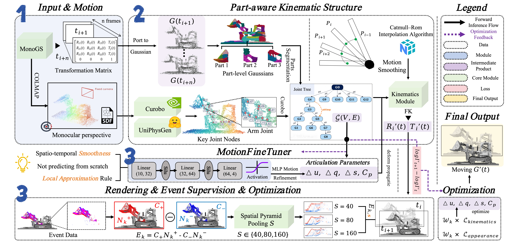
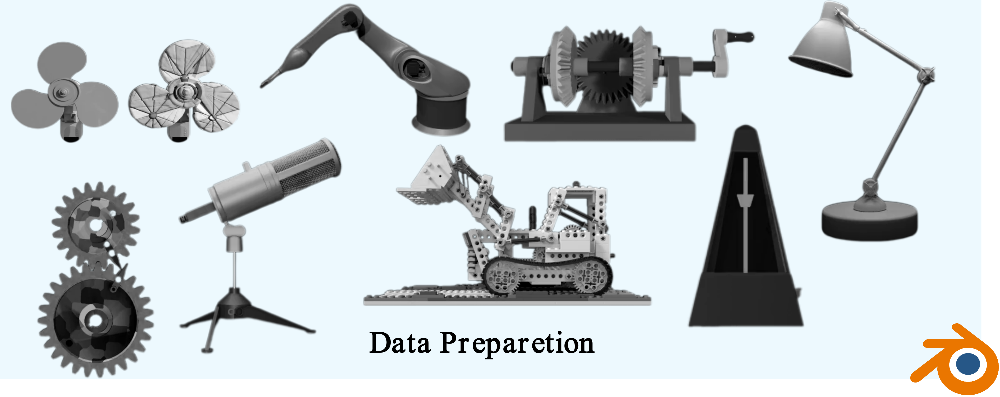
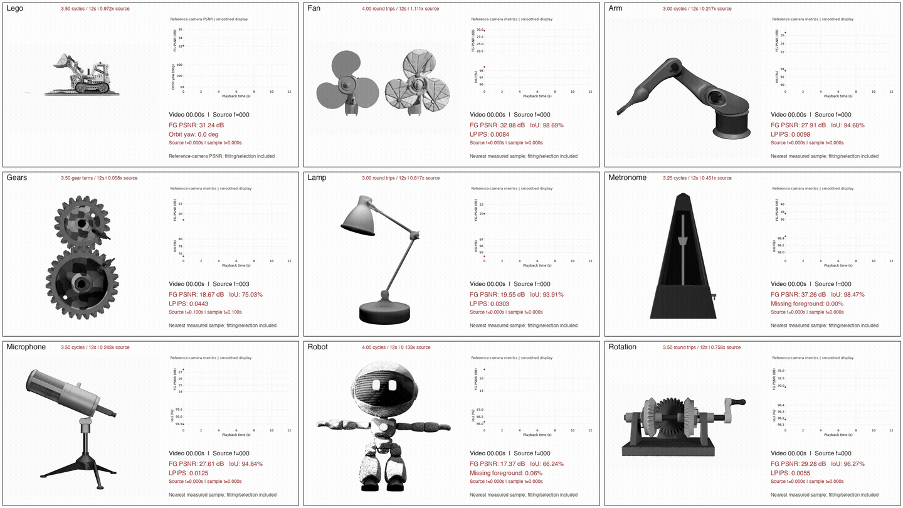
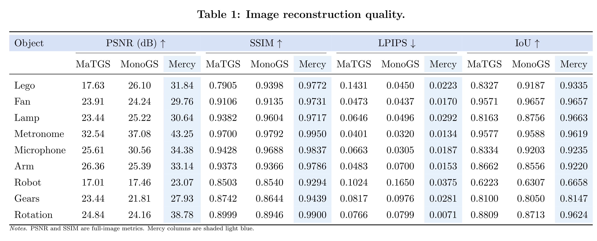
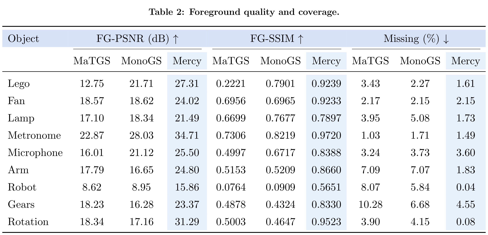
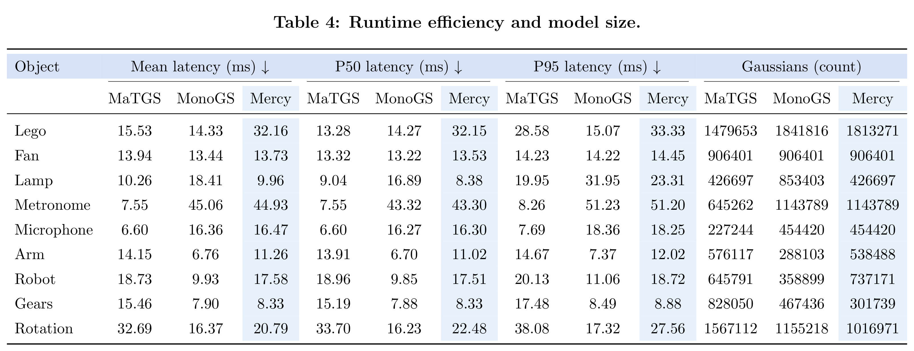
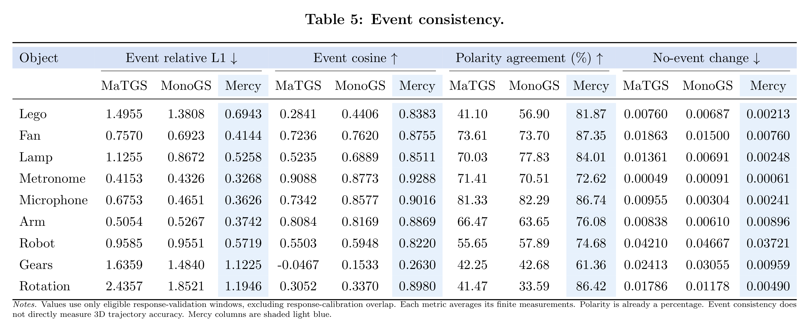

# MERCY

**Monocular Event-boosted Locally Rigid Motion and Coherent 4D Gaussian Reconstruction**

MERCY reconstructs coherent dynamic 3D Gaussians from a fixed monocular viewpoint, combining RGB video, event streams, and part-level motion constraints.

**Authors:** Liang Yirui, Chen Qianqi, Li Minghao.

[📄 Technical Report](project_page/ppt_all.pdf) · [🌐 Project Page](project_page/index.html) · [🎬 Reconstruction Demo](project_page/assets/web/reconstruction-4k.mp4)

## Workflow

The following stages follow PDF pp. 15, 34–58, and 70–80.

| Step | Action | Output |
| --- | --- | --- |
| 1. Prepare data | Render Blender animations, extract the first frame, simulate events with ESIM, and collect camera intrinsics. | RGB frames, events, and camera parameters |
| 2. Initialize Gaussians | Generate a static mesh from the first frame with Hunyuan3D 3.1, then convert it with Mesh2Splat. | Initial Gaussians G₀ |
| 3. Refine initialization | Apply CARE-GS camera alignment, Gaussian refinement, and continuity enhancement. | Corrected G₀ |
| 4. Identify parts | Assign part labels with PartField; use FEAST optical flow and events to separate moving and static parts. | Part labels and dynamic part IDs |
| 5. Estimate motion | Estimate transformations using COLMAP, ICP, Kabsch, and SVD, with MonoGS monocular video supervision. | Part motion sequences |
| 6. Constrain joints | Extract key joints with CuRobo and UniPhysGen, build a parent–child joint tree, smooth trajectories with Catmull–Rom interpolation, and apply forward kinematics. | Connected, smooth part motion |
| 7. Optimize and render | Freeze static parts; refine motion with the MotionFineTuner MLP, weighted positive/negative events, multi-scale pooling, and rendering-based event supervision. | Dynamic Gaussians and rendered video |

## Methods

Method names follow PDF pp. 61–78.

| Method | Description |
| --- | --- |
| MaTGS | Drives Gaussian motion with estimated rigid transformation matrices. |
| MonoGS | Adds monocular video supervision to improve appearance; disconnected parts can remain. |
| MERCY | Adds part-aware joint structure, motion smoothing, and event-supervised refinement for coherent motion and geometry. |

## Dataset

Nine Blender scenes: **Arm, Fan, Gears, Lamp, Lego, Metronome, Microphone, Robot, and Rotation**. Each provides a **640 × 640, 30 FPS RGB video**, its first frame, an ESIM-simulated event stream `(x, y, t, p)`, and camera intrinsics `K` (PDF pp. 8–14).

## Key Concepts

- **Dynamic Gaussians:** 3DGS represents a spatial scene; 4DGS also describes its evolution over time.
- **Event supervision:** Events encode pixel-level log-intensity changes as position, timestamp, and polarity, providing motion supervision.
- **Local rigidity:** Gaussians within a moving part share a rigid transformation, while static parts remain fixed.
- **Joint and temporal coherence:** A joint tree, forward kinematics, and trajectory interpolation preserve connections and smooth motion beyond independent rotations and translations.
- 
## Results

**Image reconstruction quality — PDF p. 83.** MERCY achieves the highest PSNR and SSIM, lowest LPIPS, and best or tied-best IoU across the nine objects. Higher PSNR, SSIM, and IoU are better; lower LPIPS is better.

**Foreground quality and coverage — PDF p. 84.** Foreground reconstruction improves while missing regions are reduced.

**Efficiency — PDF p. 85.** Latency decreases in scenes such as Lamp, Gears, and Rotation, while complex scenes such as Lego and Metronome incur additional overhead.

**Event consistency — PDF p. 86.** MERCY reduces Event L1, improves event cosine similarity and polarity agreement, and suppresses changes in no-event regions.

## Acknowledgments

We thank all professors and co-supervisors, and acknowledge the tools and platforms shown below.

   
  

This project builds on SC-GS, Deformable 3D Gaussians, and 3D Gaussian Splatting.

## Resources and License

Technical content and results follow the [technical report](project_page/ppt_all.pdf); figures come from `project_page/assets/`. See the [project page instructions](project_page/README.md) for local preview and [LICENSE](LICENSE) for repository terms. Upstream licenses also apply.
